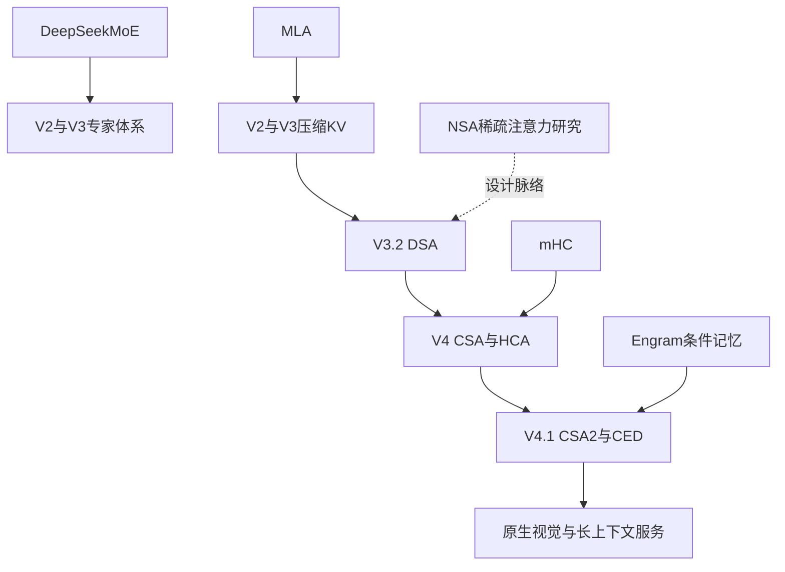

学习DeepSeek最容易出现的偏差，是把V3/R1当成整个开放技术体系。
它们是重要节点，但2026年的公开材料已经扩展到V4、V4.1、原生视觉、跨层KV共享、条件记忆与新的系统组件。

本页以2026-11-07为核对日。
版本事实来自官方模型卡、论文、GitHub组织仓库和API发布记录。
这里只把实际读到的版本称为已核对，不对未来发布作预测。

## 1. 三条并行演进线

第一条线是模型能力：通用语言、代码、数学、视觉、形式化证明与agent。
第二条线是模型结构：DeepSeekMoE、MLA、DSA、CSA/HCA、mHC、CED、CSA2与Engram。
第三条线是系统实现：算子、通信、并行调度、数据处理、存储和服务核心。

它们存在连接，但不是每篇研究都立即进入每个产品。
判断某个机制是否被采用，需要对应模型报告或代码证据。

## 2. 通用主干的大致时间线

| 节点 | 关键问题 | 对应材料 |
|---|---|---|
| 2023 DeepSeek-LLM | 开放通用语言模型与训练研究 | [官方仓库](https://github.com/deepseek-ai/DeepSeek-LLM) |
| 2024 DeepSeekMoE | 提高专家专业化与参数效率 | [论文与模型](https://github.com/deepseek-ai/DeepSeek-MoE) |
| 2024-05 V2 | MLA压缩KV，扩大MoE规模 | [官方仓库](https://github.com/deepseek-ai/DeepSeek-V2) |
| 2024 V2.5 | 通用与代码能力整合 | [V2官方材料](https://github.com/deepseek-ai/DeepSeek-V2) |
| 2024-12 V3 | 大规模MoE、FP8训练、MTP与系统协同 | [官方仓库](https://github.com/deepseek-ai/DeepSeek-V3) |
| 2025-01 R1 | 强化学习驱动推理能力及蒸馏 | [官方仓库](https://github.com/deepseek-ai/DeepSeek-R1) |
| 2025 V3-0324、R1-0528 | 后续模型与能力更新 | [官方模型目录](https://huggingface.co/deepseek-ai) |
| 2025-08 V3.1 | 思考/非思考与工具能力路线 | [官方V3.1模型卡](https://huggingface.co/deepseek-ai/DeepSeek-V3.1) |
| 2025-09 V3.1-Terminus | V3.1后续更新 | [官方模型卡](https://huggingface.co/deepseek-ai/DeepSeek-V3.1-Terminus) |
| 2025-09 V3.2-Exp | 通过继续训练引入DSA | [官方仓库](https://github.com/deepseek-ai/DeepSeek-V3.2-Exp) |
| 2025-12 V3.2 / Speciale | DSA与更大后训练投入 | [官方论文](https://arxiv.org/abs/2512.02556) |
| 2026-04 V4 Preview | 百万上下文、CSA/HCA、mHC、Muon | [官方发布](https://deepseek.com/en/news/v4-preview/) |
| 2026-09 V4.1-Flash | CED、CSA2、Engram、原生视觉 | [官方发布](https://api-docs.deepseek.com/news/news260910/) |
| 2026-10 V4.1-Flash-1017 | 同架构上的后续能力更新 | [官方发布](https://api-docs.deepseek.com/news/news261017/) |

“时间线”帮助建立关系，但实际部署仍要使用完整模型ID和revision。
API别名可能更新，不能替代权重版本标识。

## 3. 代码路线不是通用模型的一行注释

[DeepSeek-Coder](https://github.com/deepseek-ai/DeepSeek-Coder)研究代码模型与代码数据。
[DeepSeek-Coder-V2](https://github.com/deepseek-ai/DeepSeek-Coder-V2)将MoE和更广代码能力结合。

读代码模型时应关注：

- fill-in-the-middle等数据格式。
- 代码语言分布与语料去重。
- 仓库级上下文与长输入。
- 执行型评估和测试污染边界。
- Base与Instruct的区别。

“会生成代码”与“能在工具环境中修复完整项目”不是同一个评估对象。
后者还涉及搜索、编辑、测试、工具状态与长程交互。

## 4. 数学与证明路线

[DeepSeek-Math](https://github.com/deepseek-ai/DeepSeek-Math)是理解数学数据与GRPO来源的重要入口。
[DeepSeek-Math-V2](https://github.com/deepseek-ai/DeepSeek-Math-V2)是后续独立研究节点。

形式化证明相关官方仓库包括：

- [DeepSeek-Prover-V1.5](https://github.com/deepseek-ai/DeepSeek-Prover-V1.5)。
- [DeepSeek-Prover-V2](https://github.com/deepseek-ai/DeepSeek-Prover-V2)。

数学自然语言答案、竞赛程序与形式化证明具有不同验证器。
答案能被整数比较不等于证明过程正确；Lean等系统的形式化检查也不等于一般自然语言论证评估。

因此奖励机制、搜索策略和数据构造要按任务分开学习。

## 5. 视觉与多模态路线

| 官方项目 | 主要学习对象 | 不能混同的对象 |
|---|---|---|
| [DeepSeek-VL](https://github.com/deepseek-ai/DeepSeek-VL) | 视觉语言模型 | 纯文本V2/V3 |
| [DeepSeek-VL2](https://github.com/deepseek-ai/DeepSeek-VL2) | 后续视觉语言与MoE路线 | V4.1的具体视觉结构 |
| [Janus](https://github.com/deepseek-ai/Janus) | 理解与生成相关的统一多模态研究系列 | 只输出文字的视觉理解接口 |
| [DeepSeek-OCR](https://github.com/deepseek-ai/DeepSeek-OCR) | 视觉文本表示和OCR研究 | 普通文本tokenizer |
| [DeepSeek-OCR-2](https://github.com/deepseek-ai/DeepSeek-OCR-2) | Visual Causal Flow等后续研究 | V4.1全部视觉实现 |
| V4-Flash-Vision-Exp | 2026-08实验视觉API节点 | 初始文本V4-Flash |
| V4.1-Flash | 原生图文预训练、图像输入文字输出 | Janus所有生成能力 |

Janus仓库内的不同模型和研究版本仍需分别读模型卡。
“同一组织做过图像生成”不意味着V4.1聊天模型具有相同输出模态。

## 6. 结构技术谱系

虚线表示研究联系，不表示逐行继承源码或使用相同训练权重。
V4.1对多个组件进行了修改，不能把旧论文机制全量照搬。

## 7. 为什么参数数字不能直接排队

| 模型 | 典型公开口径 | 读数注意 |
|---|---|---|
| V3 | 671B总主模型参数、37B激活 | 另有MTP模块口径 |
| V4-Flash | 284B、13B激活 | Flash与Pro不可互换 |
| V4-Pro | 1.6T、49B激活 | 高总量不代表所有请求都同样昂贵 |
| V4.1-Flash | 552B主干+196B Engram | prefill8B、decode16B是不同阶段 |

总参数关系到存储与容量，激活参数关系到每token参与的计算。
还需要看KV、attention访问量、量化格式、网络与batch。

本表是官方报告口径对照，不是统一硬件上的质量或成本排行榜。

## 8. 用一个问题串起架构演进

设任务是持续修改一个大型仓库，prompt从32K增长到1M。
每轮用户提供少量指令，工具返回日志、代码和图片。

MLA减少每个历史位置保存的内容。
DSA减少当前query精读的位置。
CSA/HCA进一步减少长期池的条目。
CSA2减少层之间重复保存和重复选择。
CED减少每轮新输入的大量decoder prefill。
SWA Bounded Replay改变局部状态保存与恢复方式。
Engram从参数表提供局部条件记忆。
原生视觉把截图直接接入语言主干。

这是一条由工作负载驱动的阅读路径。
它不意味着每种机制单独都能带来无条件加速。

## 9. 官方算子和通信项目

| 项目 | 主要职责 | 先读的证据 |
|---|---|---|
| [FlashMLA](https://github.com/deepseek-ai/FlashMLA) | 注意力内核与cache格式 | README版本兼容说明、接口、测试 |
| [DeepGEMM](https://github.com/deepseek-ai/DeepGEMM) | 低精度GEMM及融合计算 | 当前支持矩阵和kernel入口 |
| [DeepEP](https://github.com/deepseek-ai/DeepEP) | expert dispatch/combine通信 | 当前EPBuffer与后端实现 |
| [DeepSelect](https://github.com/deepseek-ai/DeepSelect) | DSA与sampling的top-k内核 | 输入布局与选择语义 |
| [DeepJIT](https://github.com/deepseek-ai/DeepJIT) | xPU内核JIT构建 | 编译缓存、架构选择与依赖 |
| [TileKernels](https://github.com/deepseek-ai/TileKernels) | 公开kernel集合 | 各算子源码与目标设备 |
| [DeepGEMM-Ascend](https://github.com/deepseek-ai/DeepGEMM-Ascend) | Ascend方向GEMM | 对应设备及CANN约束 |
| [DeepEP-Ascend](https://github.com/deepseek-ai/DeepEP-Ascend) | Ascend方向专家通信 | 对应接口和通信条件 |
| [clangd-ascend](https://github.com/deepseek-ai/clangd-ascend) | Ascend开发工具相关支持 | 工具文档及使用范围 |

CUDA和Ascend项目不能因名称相似就视为相同二进制接口。
目标设备与软件版本属于每个性能结论的一部分。

## 10. 版本变化会推翻旧教程

本次FlashMLA HEAD为 `395cb3afbb331fef7b1b21e9340861b9436b42d8`。
官方README的2026-09-30 breaking change移除了Hopper以及V3/V3.2/V4.0支持，并调整KV格式。

需要历史支持时应查对应旧版本，例如 `ba89a3466e9470ad08ab39738d4e7bb66989e1e7`。
不能继续拿2025年首页的“H800 MLA kernel”描述当当前HEAD的支持范围。

DeepEP本次固定版为V2.5路线，使用新的EPBuffer等接口与NCCL Gin，移除了V1/NVSHMEM路径。
过去零SM RDMA等描述也不能不带版本迁移到当前实现。

## 11. 并行与负载均衡项目

| 项目 | 职责 | 需要区分 |
|---|---|---|
| [DualPipe](https://github.com/deepseek-ai/DualPipe) | 双向流水线调度和重叠 | 调度算法与整个训练框架 |
| [EPLB](https://github.com/deepseek-ai/EPLB) | 专家并行负载布局 | 专家复制/放置与模型router |
| [LPLB](https://github.com/deepseek-ai/LPLB) | 线性规划方向的研究负载均衡 | 早期研究与完整生产系统 |
| [profile-data](https://github.com/deepseek-ai/profile-data) | 分析profile与计算通信重叠 | 静态样例与实时服务观测 |
| [open-infra-index](https://github.com/deepseek-ai/open-infra-index) | Infra公开资料索引 | 历史发布页与当前源码 |

模型路由解决token选择哪些逻辑专家。
EPLB/LPLB关心这些专家在物理资源上如何布局。
两者不是同一层的“负载均衡”。

## 12. 数据与存储项目

[3FS](https://github.com/deepseek-ai/3FS)提供分布式文件系统相关代码。
[smallpond](https://github.com/deepseek-ai/smallpond)是结合DuckDB与3FS的数据处理框架。

训练数据读取、checkpoint、预处理与推理KV持久化都可能使用存储服务，但访问模式不同。

大顺序吞吐、海量小对象读、低延迟前缀恢复、元数据一致性不能只用一个GB/s概括。
后续存储章节会分别分析，而不把“用了3FS”当所有场景都已优化的证明。

## 13. 推理核心与投机训练项目

[DeepInfer](https://github.com/deepseek-ai/DeepInfer)开放高性能推理计算核心。
本次README明确区分offline core与未包含的服务控制部分。

[DeepSpec](https://github.com/deepseek-ai/DeepSpec)提供draft model数据准备、训练和评估代码，包括DSpark相关配置。
它不等于整个DeepSeek主模型预训练系统。

[ESFT](https://github.com/deepseek-ai/ESFT)提供专家相关微调研究路径。
一个可运行微调项目也不能替代全部基础模型训练流程。

## 14. Agent与协议项目

| 项目 | 本专题中的位置 |
|---|---|
| [deepseek-harness](https://github.com/deepseek-ai/deepseek-harness) | agent执行、插件与工具环境 |
| [deepseek-recipe](https://github.com/deepseek-ai/deepseek-recipe) | 消息协议、prompt编码与输出解析 |
| [dsh-superagent-prototype](https://github.com/deepseek-ai/dsh-superagent-prototype) | 官方组织中的superagent原型项目 |
| [dsh-libreoffice-kit](https://github.com/deepseek-ai/dsh-libreoffice-kit) | harness生态中的办公相关组件 |
| [dsh-node-addon-require-builtin](https://github.com/deepseek-ai/dsh-node-addon-require-builtin) | harness生态底层组件 |

本页对后三项记录归属与入口，不把其名称推断为已完整开放的训练算法。
具体能力以仓库README与代码为准。

`deepseek-recipe`不执行模型推理、工具或HTTP传输。
它使协议转换和token编码可复用，不能替代serving engine。

## 15. 官方组织里的资源索引与独立研究

以下也在本次官方组织仓库检索范围内：

- [awesome-deepseek-integration](https://github.com/deepseek-ai/awesome-deepseek-integration)。
- [awesome-deepseek-agent](https://github.com/deepseek-ai/awesome-deepseek-agent)。
- [awesome-deepseek-coder](https://github.com/deepseek-ai/awesome-deepseek-coder)。
- [DreamCraft3D](https://github.com/deepseek-ai/DreamCraft3D)。

awesome清单收录的外部项目不因此变成DeepSeek官方实现。
DreamCraft3D等独立研究不应被强行解释成V4.1主干组件。

## 16. 官方与生态的归属边界

| 对象 | 合理表述 |
|---|---|
| `deepseek-ai/DeepGEMM` | DeepSeek官方组织发布的代码 |
| `sgl-project/sglang` | 独立生态推理框架及其DeepSeek适配 |
| `vllm-project/vllm` | 独立生态推理框架及其DeepSeek适配 |
| `tile-ai/tilelang` | 独立项目组织下的编译/算子语言生态，需按论文与贡献核对关系 |
| 第三方GGUF/AWQ权重 | 对官方权重的派生转换，需核验来源和量化 |
| 社区NSA/mHC实现 | 可供学习，不能冒充作者原始实现 |

“官方模型推荐使用某框架”不意味着该框架归官方所有。
“论文作者参与项目”也不自动意味着全部项目内容都是该模型生产代码。

## 17. 关键源码固定点

| 对象 | 固定版本 |
|---|---|
| V3参考模型 | `9b4e9788e4a3a731f7567338ed15d3ec549ce03b` |
| V3.2-Exp参考模型 | `87e509a2e5a100d221c97df52c6e8be7835f0057` |
| Engram演示 | `fb7f84a21f91223715394a33a1dc24bbfb7f788e` |
| DeepGEMM | `5081f8513af57e61696de4f4f04b0e707ffb503e` |
| DeepEP | `f6aa38fe06cd4a0489e7730365d4e0114970a2f3` |
| FlashMLA | `395cb3afbb331fef7b1b21e9340861b9436b42d8` |
| DeepInfer | `a679bb86ce36e883a98a97733492b686e5b9a08e` |

其他Infra固定版本保存在仓库的 `docs/expansion-2026/deepseek-source-snapshots.json`。
模型仓库的HF revision见2.6。

## 18. 读源码时先回答输入输出

每个项目先写四句话：

1. 输入是什么张量或请求。
2. 输出是什么，语义如何定义。
3. 必须满足哪些shape、dtype、设备与通信条件。
4. 项目没有负责哪一段生命周期。

例如DeepSelect输入分数、输出top-k索引；它不负责训练indexer。
FlashMLA计算attention；它不自动提供完整多租户服务和前缀存储。

## 19. 一条适合初学者的学习顺序

先读MLA和MoE，理解容量与计算为什么能分离。
再读DSA、CSA/HCA、CSA2，理解长上下文为何需要多层次压缩。

然后读mHC、CED、Engram，理解跨层状态与内存依赖。
接着进入预训练、RL、蒸馏、投机推理、算子、通信与存储。

不建议从峰值TFLOPS图开始倒推模型设计。
先定义工作负载和张量，再评价实现是否解决实际瓶颈。

## 20. 一个技术结论的证据卡

以“V4.1全局KV为890 bytes/token”为例：

| 字段 | 记录 |
|---|---|
| 模型 | V4.1-Flash固定revision |
| 证据 | 官方报告、config、量化布局 |
| 推导 | 2.5条记录/token × (288+68)bytes |
| 范围 | 跨主干的全局main KV与index K |
| 不含 | SWA、页元数据、权重、workspace |
| 本地验证 | 可做容量算术与小张量模拟 |
| 尚未验证 | 完整模型在线服务内存与吞吐 |

同样格式可以用于分析任何DeepSeek技术宣传或论文数字。

## 21. 自测与答案

**问题1：NSA论文发表是否证明R1用了NSA？**

答案：不能，必须有对应模型采用证据。

**问题2：V4.1的552B为什么不能直接与671B总量比较？**

答案：552B是主干口径，另有196B Engram，组件和活跃阶段也不同。

**问题3：FlashMLA当前HEAD是否天然包含历史全部GPU支持？**

答案：不包含；本次核到明确breaking change，需按版本选择。

**问题4：DeepSpec开放是否代表主模型完整预训练开放？**

答案：不代表，它开放的是draft训练和评估等特定流程。

**问题5：awesome清单收录项目是否算官方实现？**

答案：不算，资源收录与代码归属不同。

**问题6：为何需要HF revision而不只写模型名？**

答案：模型卡、代码和权重可能更新，固定revision才能定义核对对象。

**问题7：到2026-11仍只讲V3/R1有什么缺口？**

答案：会漏掉V4/V4.1架构、视觉、CED/CSA2/Engram及当前Infra接口变化。

## 22. 研究组件也要单独定位

[Engram官方仓库](https://github.com/deepseek-ai/Engram)同时提供论文与演示代码。
它与V4.1中的集成实现有明确差别，包括短卷积移除和优化器变化。

这一例子说明“源自同一研究”并不意味着“每个实现细节相同”。
学习时应保存原论文版本、演示commit和集成模型revision三种标识。

对于独立论文没有官方代码的情况，可以自己写教学参考，但必须明确其来源等级。
第三方实现可以帮助理解，不能补写成作者公开了生产源码。

## 23. 集群与沙箱的补充公开材料

[Fire-Flyer AI-HPC论文](https://arxiv.org/abs/2408.14158)披露PCIe A100集群、HFReduce、HaiScale与存储协同。
其中[HAI Platform](https://github.com/HFAiLab/hai-platform/tree/f9119b1f437039e3969a1dd5beaa8898a1cb6b02)在HFAiLab组织有独立公开项目，不能因不在deepseek-ai清单里就认定未开放。
其公开代码也不代表论文所有内部组件均已独立公开。

[DSec论文](https://arxiv.org/abs/2609.22978)披露Agent训练沙箱的环境、资源管理与恢复机制。
本次未找到独立完整DSec服务端仓库；harness的SDK/server不能替代这项证据。

相关专题分别为7.3与7.4。
第8章继续区分VL/Janus/OCR模型、Harness执行与Recipe协议转换。

## 24. 官方来源与更新策略

- [DeepSeek官方GitHub组织](https://github.com/deepseek-ai)。
- [官方Hugging Face模型目录](https://huggingface.co/deepseek-ai)。
- [官方版本更新日志](https://api-docs.deepseek.com/updates/)。
- [Open Infra索引](https://github.com/deepseek-ai/open-infra-index)。
- [V4技术报告](https://arxiv.org/abs/2606.19348)。
- [V4.1固定模型卡](https://huggingface.co/deepseek-ai/DeepSeek-V4.1-Flash/blob/314113f8a7dadb388215396ba5fbee2c610a04d6/README.md)。

后续更新应重新检索组织、模型目录、官方发布页与关键仓库breaking changes，再更新固定快照。
不能只在旧文首页替换“最新”日期，而不检查技术与接口是否已变。
