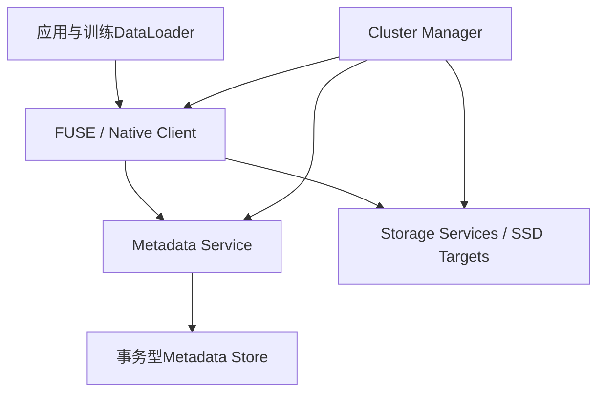

## 1. 大训练任务为什么需要重新设计共享存储

训练、数据处理、checkpoint 和推理 KV 缓存有不同 I/O 特征：随机小读、顺序大写、大量中间文件、周期性流量峰值和低延迟缓存回填可能同时出现。

如果只看 SSD 峰值带宽，容易忽略真正的瓶颈：客户端拷贝、metadata 请求、FUSE 锁竞争、网络拓扑、复制开销或恢复期间的流量倾斜。

3FS（Fire-Flyer File System）把现代 SSD 与 RDMA 网络组合成计算和存储分离的文件系统。学习它的价值不仅是“存储很快”，而是理解一个公开系统如何在接口、数据放置、一致性与故障恢复之间取舍。

本节核对官方快照 `22fca04564c7cc230fd8b9523b8b92864e1dad47`，日期为 2026-11-07。实现说明主要来自该快照的 `docs/design_notes.md`，性能数字仅按官方报告条件解读。

## 2. 四类组件与两条路径



| 组件 | 管理什么 | 不应误认为 |
|---|---|---|
| Cluster Manager | 成员、链配置、target状态与版本 | 每次数据读写都必须经过的代理 |
| Metadata Service | inode、目录、文件布局和操作语义 | 大块训练数据的承载层 |
| Storage Service | SSD上的chunk与副本协议 | 只有一个不关心一致性的块设备 |
| Client | 文件布局解释、请求批量与数据I/O | 单纯的HTTP下载器 |

Metadata service 后面使用事务型 KV 存储（项目使用 FoundationDB），从而让 metadata service 本身保持相对无状态。客户端打开文件拿到布局后，可以直接计算 chunk 的位置，减少 metadata 在数据热路径中的参与。

## 3. 文件怎样映射到 Chunk 和 Chain

文件分为等大小 chunk；chunk ID 由 inode ID 与 chunk index 等信息确定。多个 chunk 按配置条带化到复制链集合。

设 chunk 大小为 $C$，读请求字节范围为 $[o,o+ell)$：

$$
c_{first}=\left\lfloor\frac{o}{C}\right\rfloor,\qquad
c_{last}=\left\lfloor\frac{o+\ell-1}{C}\right\rfloor.
$$

例如 $C=4\ \mathrm{MiB}$，从偏移 3 MiB 读取 3 MiB，需要访问 chunk 0 的最后 1 MiB 和 chunk 1 的前 2 MiB。

应用的一次 read 可以拆成多个 chunk 请求；反过来，客户端也可以将很多小请求批量组织。必须区分应用请求数、chunk请求数和底层 RDMA/SSD 操作数。

### 3.1 Chain table 是有版本的

同一个 chunk 的副本按 chain 组织。链发生成员或顺序变化时，chain version 增加；请求中的版本与服务端当前认知不一致时会被拒绝并要求重新对齐。

这避免旧客户端在新拓扑上继续按过期顺序更新数据。它也意味着“网络可达”不等于“当前请求配置有效”。

## 4. 文件接口有用，但不是所有 POSIX 细节都相同

目录、rename、链接和熟悉的 file API 让数据管线容易集成。比如 checkpoint 可以先写临时目录，再在完成后发布到最终路径。

但具体保证需要看实现，不能将“提供文件接口”理解成所有本地文件系统行为都完全复制：

- 设计说明中不追踪只读打开的 fd，以降低大规模训练启动时的 metadata 压力。
- 写打开的文件有 session，删除与尚未结束的写入需要协调。
- 正在写入文件的长度在常规更新路径中是最终一致的。
- `close`/`fsync` 会通过查询存储信息取得更精确的文件长度，但有额外开销。

因此，不能只凭读取到一个路径和某次 `stat`，就判断某个活跃写入的训练产物已经完整发布。

## 5. 为什么 FUSE 会成为瓶颈

FUSE 降低了接入门槛，但可能增加内核与用户态之间的数据拷贝、请求排队和锁竞争。小而随机的读特别容易被这些成本主导。

假设一次 4 KiB 小读固定开销为 10 微秒，仅按串行请求估计：

$$
IOPS\le100000,\qquad BW\le100000\times4096\approx0.41\text{ GB/s}.
$$

即使 SSD 和网络有数十 GB/s 能力，这条串行小请求路径也无法利用它。并发、批量和减少中间拷贝会改变这个限制，但可能遇到共享队列锁或 CPU 内存带宽的新瓶颈。

该算例是机制说明，不是对所有 FUSE 版本的固定性能判断。官方报告中的 FUSE 测量还绑定特定 Linux 与工作负载。

## 6. Native 异步接口：Iov 与 Ior

3FS 的 native client 与 FUSE daemon 协作：文件元数据操作仍通过熟悉的接口进行，性能关键的数据 I/O 使用共享内存和异步请求结构。

| 对象 | 作用 | 生命周期要求 |
|---|---|---|
| Iov | 应用与客户端共享的大块I/O数据区 | 在I/O完成前不能复用相关区域 |
| Ior | 应用与客户端交换I/O请求的共享ring | 生产/消费顺序、容量与并发访问需协调 |
| fd注册 | 将普通打开的文件交给native路径 | 文件会话与注册状态需匹配 |
| io_depth | 控制请求批量与在途深度 | 太小吃不满，太大增加内存与排队 |

设计受到 `io_uring` 风格启发，但这不等于它就是 Linux `io_uring`，也不意味着 GPU tensor 可以直接作为任意 Iov 使用。

“zero-copy”描述特定应用/客户端共享数据路径，不能推导整个 SSD→网络→GPU 过程没有任何复制或转换。

### 6.1 在途内存的手算

若一个 loader 有 8 个 worker，每个 worker 同时保留 32 个请求，每请求平均 2 MiB，则仅 payload 就可能占：

$$
8\times32\times2=512\ \mathrm{MiB}.
$$

还需加入解压、tokenization、输出 batch、元数据和通信缓冲。提高 io_depth 并非免费，它将等待转为更多在途资源。

## 7. CRAQ 思路与本实现的读语义

链复制让写入依次传播，读可以从多个副本服务，以利用更多 SSD 的读带宽。3FS 的公开实现基于 CRAQ 思路，但对含 pending version 时的读取行为有自己的选择。

对一条 `A → B → C` 链：

1. A 检查链版本并拉取写入数据。
2. 对目标 chunk 加锁，构造新 pending 版本。
3. 向 B 转发，B 再构造 pending 并向 C 转发。
4. 尾部 C 将 pending 提交为 committed，并向前返回确认。
5. B、A 在收到确认后依次提交本地版本并释放锁。

数据版本与链版本是不同维度：一个描述 chunk 的内容更新，另一个描述副本拓扑。

### 7.1 读取为何不能随便返回旧 committed

假设 C 已提交 v1，而 A 仍有 committed v0 与 pending v1。如果 A 无条件返回 v0，就可能让客户端在已观察新状态后再次看到旧状态。

固定设计说明中的处理是：只有 committed 时正常返回；同时存在 committed 和 pending 时，严格读取返回特殊状态，让客户端等待或重试。

它没有照搬 CRAQ 论文中向尾部询问版本的全部机制。客户端也可显式请求 relaxed read 读取 pending，但这改变了读取语义，必须由应用选择。

### 7.2 一个最小状态例子

| 时刻 | A | B | C | A上的严格读取 |
|---|---|---|---|---|
| 开始 | committed v0 | committed v0 | committed v0 | v0 |
| 前向传播中 | v0 + pending v1 | v0 + pending v1 | v0 | 重试状态 |
| 尾部提交 | v0 + pending v1 | v0 + pending v1 | committed v1 | 重试状态 |
| 确认回传完成 | committed v1 | committed v1 | committed v1 | v1 |

这个表用于理解读写可见性，不是对真实网络、崩溃和所有并发交错的形式化证明。

## 8. 强一致需要说明对象和操作

同一个系统中，chunk 数据协议、目录事务、活跃文件长度和 relaxed read 可以有不同语义。

设计说明明确指出，常规写入中的文件长度由客户端周期性上报，可能滞后；`close/fsync` 才进一步查询精确长度。因此一句“3FS 强一致”不能代替每个操作的契约。

训练系统应分别定义：

- 什么事件表示一个 shard 的字节写入完成。
- 什么事件表示文件长度和元数据可被恢复者可靠检查。
- 什么事件表示所有 shard 的 manifest 已发布。
- 重试读、relaxed read 和缓存命中允许哪些状态。

第 14 章的 checkpoint 协议需要这些明确的存储保证，不能仅看到存储层支持 rename 就宣称完整训练状态自动具有事务性。

## 9. 失败检测与自我隔离

Cluster manager 用心跳检测 fail-stop。设计示例给出一个超时尺度 T：manager 在长时间没收到心跳后判故障，服务在较短时间无法续约时主动停止处理，避免隔离节点无限继续提供旧视图。

实际配置、时钟、网络延迟和成员一致性都影响保证，不能把心跳时长当作“任意网络分区都立即安全”的证明。

公开状态包括 serving、syncing、waiting、lastsrv、offline 等。它们表示能否读、是否参与写传播和是否正在恢复；恢复中的 target 不能因为进程活着就被当成完整读副本。

## 10. 恢复不是简单把坏节点重新加回链

恢复路径需要比较 chunk 的存在性、链版本和 committed/pending 版本，并传输必要的完整 chunk 替换。

```text
旧target离线
  → 链版本与顺序更新
  → 服务重启但尚不提供正常读
  → 交换chunk metadata
  → 比较版本并补齐/删除所需chunk
  → 与正常写入协调
  → sync-done
  → 进入可服务状态
```

只把“节点在线”写进发现服务，会忽略尚未补齐的数据。把 recovery 流量与前台流量完全隔离也未必容易，二者共享 SSD 和网络。

### 10.1 放置策略要考虑故障后的流量

某节点的副本如果总集中在另外两台节点，故障后读请求会涌向这两台，导致恢复期瓶颈。正常情况下平均负载均匀，不代表任一单点故障后仍均匀。

3FS 设计说明把恢复时的均衡放置视为组合设计问题。评估时应观察失去某个 storage target 后的流量增量，而非只看平稳状态下的总吞吐。

## 11. Checkpoint 的复制成本账本

假设应用写入 1 TiB 逻辑 checkpoint，保存三份副本：

| 口径 | 理想数据量 |
|---|---:|
| 应用逻辑写入 | 1 TiB |
| SSD副本写入合计 | 3 TiB |
| 链内额外传播 | 至少需将数据送达其余副本，按链路另记 |
| Metadata与协议 | 未包含在上述裸数据中 |

若客户端侧可提供 100 GiB/s 逻辑流量，存储侧物理写入能力为 240 GiB/s，则按三副本折算的存储逻辑上限为 80 GiB/s。

$$
T_{data}\ge\frac{1024}{\min(100,240/3)}=12.8\ \mathrm{s}.
$$

这仍未包含文件创建、精确长度更新、应用 staging、最终 manifest 和故障降速。也不能把每 rank 的写入速率相加后忽略共享链路。

## 12. KV Cache 外置的 break-even

外部存储能扩大可复用 KV 容量，但命中不等于必然更快。

一个简化读取成本为：

$$
T_{fetch}=T_{lookup}+T_{storage}+T_{host\to device}+T_{format}.
$$

假设一段 KV 为 2 GB，存储有效读取 10 GB/s，H2D 50 GB/s，查找等开销 10 ms，串行时约：

$$
10+200+40=250\ \mathrm{ms}.
$$

若重算只需 180 ms，本次命中反而不划算。理想流水可把部分阶段重叠，但还需考虑分层格式、网络竞争、传输粒度和 GPU 可消费时刻。

3FS 提供存储能力，缓存键、失效、模型/tokenizer身份、分层回填与请求取消仍属于上层 KV 系统。不能把“可存 KV”写成完整推理缓存服务已经包含在所有公开引擎中。

## 13. 官方性能数字怎样阅读

README 报告过一个 180 存储节点、每节点两张 200 Gbps 网卡和 16 块 SSD 的读压力场景，聚合吞吐约 6.6 TiB/s，并说明有训练后台流量。

从网卡标称值粗算存储侧聚合上限：

$$
180\times2\times200/8=9000\ \mathrm{GB/s}\approx8.19\ \mathrm{TiB/s}.
$$

这个量级核对有助于理解报告值，但不能证明每条链路都达到相同比例，更不能迁移到单机或普通以太网。

GraySort 报告还包含独立的 compute/storage 节点数、分区数和总数据量。排序结果属于 smallpond+3FS 组合，不能直接解释成任意 SQL、随机读取或 GPU KV 回填的性能。

## 14. 部署与复现必须分层

一个合理的复现阶梯：

1. 阅读固定设计说明与 API，先建立文件/chunk/链版本模型。
2. 在专用环境启动测试集群，验证文件基本语义与副本状态。
3. 固定块大小、并发、复制因子和数据集，测基础读写。
4. 加入单 target 故障与恢复，观察读重定向与后台流量。
5. 接入小型 DataLoader 或 checkpoint，验证端到端目标。
6. 最后评估大规模容量、NUMA、RDMA、metadata 和运维策略。

当前仓库没有部署真实 3FS/RDMA 集群。本节的算术和状态例子可以本地复算，但不能作为吞吐、持久化或故障恢复已实跑的证据。

### 14.1 构建配置也可能影响数据布局

当前 README 提醒历史上不同编译器的 `std::shuffle` 行为可能带来兼容问题，要求显式固定相关 shuffle 方法。新旧二进制都编译成功，不代表它们解释数据放置的方式相同。

这类条件应进入集群的版本与配置记录，而不是临时修一个编译错误后遗忘。

## 15. 自测与参考答案

**1. Metadata service无状态，是否代表系统没有持久状态？** 持久元数据放在事务型KV存储，数据在storage targets；“服务无状态”只描述该服务自身职责。

**2. 为什么有pending版本时严格读取可能重试？** 尾部可能已经提交新版本，直接返回本地旧committed会破坏所需的可见性关系。

**3. Chunk强一致是否意味着活跃文件长度每次stat都最新？** 不意味着。设计说明区分了常规长度上报和close/fsync的精确更新路径。

**4. Native zero-copy是否保证SSD到GPU完全不复制？** 没有，它限定在特定应用/客户端共享I/O路径；GPU回填与格式转换仍需单独设计。

**5. 1 TiB checkpoint三副本，为什么不能只拿1 TiB除SSD聚合写带宽？** SSD需要承载三份物理数据，还要检查客户端和网络瓶颈。

**6. 恢复节点能ping通是否可以马上接读请求？** 不够，需要确认chunk版本同步完成及对应public state允许服务。

**7. KV命中率越高，延迟一定越低吗？** 不一定，读取、传输和格式转换可能比重算更慢，需按长度和负载评估break-even。

## 官方来源

- [3FS 固定 README](https://github.com/deepseek-ai/3FS/blob/22fca04564c7cc230fd8b9523b8b92864e1dad47/README.md)：项目范围、报告环境与构建边界。
- [固定 Design Notes](https://github.com/deepseek-ai/3FS/blob/22fca04564c7cc230fd8b9523b8b92864e1dad47/docs/design_notes.md)：组件、元数据、Iov/Ior、复制与恢复协议。
- [USRBIO 接口文档](https://github.com/deepseek-ai/3FS/blob/22fca04564c7cc230fd8b9523b8b92864e1dad47/src/lib/api/UsrbIo.md)。
- [FIO USRBIO 测量入口](https://github.com/deepseek-ai/3FS/blob/22fca04564c7cc230fd8b9523b8b92864e1dad47/benchmarks/fio_usrbio/README.md)。
- [部署说明](https://github.com/deepseek-ai/3FS/blob/22fca04564c7cc230fd8b9523b8b92864e1dad47/deploy/README.md)。
