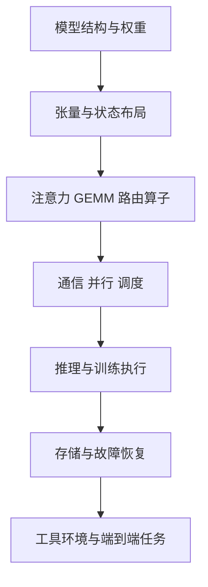

DeepSeek的开放技术不是一个模型名，而是一组彼此连接的研究与工程交付物。
本章先建立地图：哪些属于模型结构，哪些属于训练方法，哪些属于算子、通信、存储和agent运行环境。

核对截止：2026-11-07。
已核对到V4.1-Flash-1017以及当前官方Infra仓库的接口变化。

## 1. 本章先解决什么

你应能回答三个问题：

1. 一个技术名来自哪篇论文、哪个模型、哪个代码项目？
2. 已公开的是权重、参考实现、单项组件，还是完整系统？
3. 看到一个性能数字，需要哪些条件才能判断它对自己有用？

如果这三件事不清楚，后面容易把旧版本结论套在新接口上。

## 2. 阅读顺序

| 页面 | 学习目标 | 建议产物 |
|---|---|---|
| 1.1 模型与项目演进 | 建立历史与当前技术地图 | 一张模型—机制—仓库对照表 |
| 1.2 开放与披露边界 | 分清artifact和证据等级 | 一张可复现缺口清单 |

不要求先背所有发布日期。
先知道“这个名字解决哪个问题”，再根据需要查细节。

## 3. 从一次长任务看全局

假设用户要求agent修改大型代码仓库。
系统读取代码、生成修改、调用测试、观察截图，并继续修复。

模型需要处理越来越长的上下文。
推理引擎要管理KV与batch。
MoE专家需要跨设备通信。
存储系统要保存和复用状态。
工具环境要隔离任务并保留结果。

这几层共同决定任务能否完成以及总成本。
单独的模型权重无法代表整个系统。

## 4. 模型结构与系统组件如何相接

箭头表示依赖，不代表这些层只有单向影响。
硬件与服务工作负载也会反过来推动架构设计。

## 5. 为什么必须带版本

FlashMLA当前HEAD与2025年初始版本的设备支持不同。
DeepEP当前接口和通信后端也已变化。

V4.1与V4虽然名字相近，KV格式、共享方式和prefill流程已有重要差别。
因此本专题优先引用固定commit或HF revision。

## 6. 为什么必须带证据范围

同一结论可能来自：

- 作者论文。
- 可读参考代码。
- 高性能内核代码。
- CPU数学实验。
- 单GPU实测。
- 多机在线服务报告。

它们能回答不同问题。
一段CPU实验能证明矩阵推导，但不能证明H800或Blackwell吞吐。

## 7. 一个最小证据卡

| 字段 | 要写什么 |
|---|---|
| 对象 | 完整模型或项目名 |
| 版本 | commit、revision或论文版本 |
| 问题 | 它具体优化什么 |
| 证据 | 原始论文、源码、测试或实测 |
| 条件 | 硬件、dtype、shape、阶段 |
| 边界 | 不包含什么，尚未验证什么 |

以后阅读新论文或新仓库，都可以先填这张卡。

## 8. 先建立的四个区分

**总参数与活跃参数。**
前者影响存储，后者与当前计算相关；还要计入KV和通信。

**模型质量与系统吞吐。**
两者都重要，但不能互相代替。

**开放权重与完整训练复现。**
有权重能做很多实验，却不意味着原始数据和训练系统都公开。

**官方项目与生态适配。**
被官方推荐的独立框架仍有自己的归属和版本体系。

## 9. 本章学习检查

读完后，尝试用自己的话解释：

- 为什么V3/R1不等于2026年全部DeepSeek技术。
- 为什么NSA、DSA、CSA与CSA2不能混称。
- 为什么DeepInfer公开不自动意味着完整线上服务公开。
- 为什么一个MIT代码仓库可能另附模型协议。
- 为什么最新main未必能复现旧论文性能图。

如果仍不清楚，优先重读1.2的artifact矩阵和证据等级表。

## 10. 下一章的接口

第2章从MLA和MoE开始，把模型表示、缓存、路由与残差讲清楚。
再进入V4的长上下文设计和V4.1的CED、Engram、CSA2。

学习时始终保留两条线：数学如何定义，源码如何保存和更新状态。
这两条线接上以后，后续训练、推理和Infra章节才容易理解。

## 11. 官方入口

- [DeepSeek官方GitHub组织](https://github.com/deepseek-ai)。
- [官方模型目录](https://huggingface.co/deepseek-ai)。
- [官方更新日志](https://api-docs.deepseek.com/updates/)。
- [Open Infra索引](https://github.com/deepseek-ai/open-infra-index)。

这些入口用于查证，而不是替代本章中的固定版本记录。

## 早期专业化路线补充

[1.3 DeepSeek LLM、Coder与ESFT](./1.3-DeepSeekLLM-Coder与ESFT的早期技术路线.md)补齐通用预训练、项目级代码/FIM、Coder-V2持续预训练和专家相关性微调，避免历史项目只剩名称。先手算FIM输入顺序与ESFT累计质量阈值，再分析冻结参数的梯度和状态成本。
