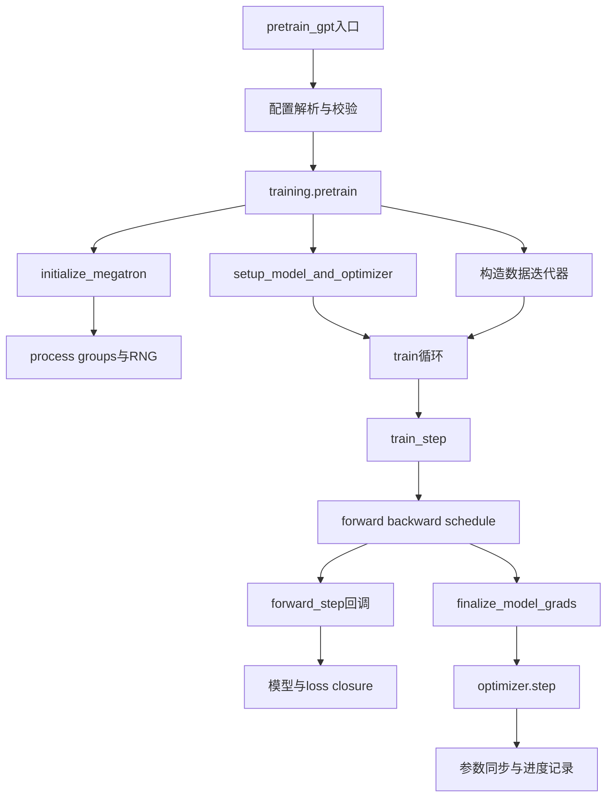

## 1. 阅读入口：先追踪一次更新，不先背全部参数

训练脚本的最外层看似只是循环调用`train_step`。

真正的一个step却包含多个microbatch、多个模型chunk、不同process group上的通信以及异步工作句柄。

读源码时应始终携带四个问题：

1. 当前对象代表全局batch还是一个microbatch？
2. 当前tensor是完整逻辑tensor还是本rank的切片？
3. 当前操作返回时，计算和通信是否已经完成？
4. 下一位消费者依赖哪个状态？

本篇源码固定于`48a887fecd01674346f724dcf44f417f455989f0`。

本轮只读核对固定提交，不把本地当前HEAD或0.19正式发布后的功能倒填进来。

## 2. 总调用图



这张图只画逻辑依赖。

overlap开启后，某些通信会在前后向中提前启动，但必须在消费者之前建立完成依赖。

因此“函数在图上靠后”不表示所有相关GPU工作都在那里才开始。

## 3. 应用入口与通用训练器怎样分工

`pretrain_gpt.py`提供GPT应用所需的模型provider、dataset provider、`forward_step`以及loss语义。

`megatron/training/training.py`负责训练初始化、主循环、保存、评测、日志与进度。

`megatron/core`负责可复用模型、并行层、调度器和状态管理。

| 层次 | 决定什么 | 不应替其他层猜什么 |
|---|---|---|
| 应用入口 | 输入字段、模型类型、目标函数 | 不重新实现所有pipeline协议 |
| training编排 | 训练阶段、迭代、checkpoint | 不把GPT语义硬编码进通用schedule |
| Core schedule | microbatch执行与P2P顺序 | 不决定语料来源 |
| 并行模块 | local shape、collective、参数布局 | 不独自推进全局数据游标 |
| 后端 | GEMM、attention、通信执行 | 不替应用定义loss mask |

这种分层让相同schedule可用于不同模型应用。

代价是控制流跨多个文件，必须追踪回调和闭包。

## 4. 初始化：先建立参与者，再建立模型

`initialize_megatron`首先确保默认分布式process group可用。

随后`initialize_model_parallel`建立TP、PP、DP、CP、EP等子组。

模型并行层在构造时需要这些group来决定local shape、初始化和通信。

如果先构造层、后建立group，层可能已经按错误world size分配参数。

### 4.1 同一个rank有多个身份

例如8卡、`TP=2, PP=2, DP=2`。

一个rank同时属于一个TP组、一个PP链和一个DP组。

这里为了手算，定义rank布局：

$$
r=t+2p+4d,
$$

其中$t,p,d\in\{0,1\}$。

该公式是本篇明确指定的教学布局，不能代替框架实际rank-order配置。

```text
TP组: [0,1], [2,3], [4,5], [6,7]
PP组: [0,2], [1,3], [4,6], [5,7]
DP组: [0,4], [1,5], [2,6], [3,7]
```

TP组协作计算同一层，PP链协作计算同一数据副本的不同层，DP组同步相同参数位置。

这些通信处理的数学对象不同，不能互换group。

### 4.2 Seed也有分层语义

冻结源码在基础seed上加入pipeline rank相关偏移，并可选加入DP rank偏移。

TP/EP等随机流通过RNG tracker管理。

这样既要保证应一致的初始化或dropout区域一致，也要区分应独立的数据副本或stage。

所以“每rank使用同一个seed”和“每rank任意不同seed”都不足以描述实际协议。

恢复时也不能只保存一个整数seed。

## 5. 模型构造与包装的顺序

主链可以概括为：

```text
setup_model_and_optimizer
  → get_model
  → model_provider（按PP/VPP chunk调用）
  → precision包装
  → DDP或FSDP包装
  → optimizer factory
  → scheduler
  → checkpoint load（按实际启动配置）
```

VPP存在时，一个物理rank可能持有多个model chunk。

每个chunk承担不同逻辑stage的层集合。

provider是否创建embedding、输出层以及MTP相关组件，由placement决定。

普通中间PP stage主要接收上游hidden state，而不是重新做token embedding。

### 5.1 包装并非只是类型变化

DDP包装器构造grad buffer、bucket、backward hook，以及某些路径的forward pre-hook。

DistOpt再根据buffer范围建立本rank更新状态。

如果先创建optimizer再改变参数storage和分片布局，optimizer可能引用旧对象或错误范围。

因此构造顺序是状态所有权协议的一部分。

## 6. 谁读取数据

冻结GPT入口通常由需要输入的TP rank读取iterator，然后在TP域广播所需字段。

CP路径再按上下文切分规则分配sequence。

dataset只在需要它的PP首/末或特定MTP stage构造。

其他stage仍有输入，只是它来自PP通信传递的activation。

| 数据对象 | 典型shape | 谁消费 |
|---|---|---|
| tokens | `[B_micro,S]` | embedding所在stage |
| labels | `[B_micro,S]` | loss所在stage |
| loss mask | `[B_micro,S]` | loss归一化 |
| positions | `[B_micro,S]`或packed表示 | 位置编码与attention |
| hidden activation | `[S_local,B_micro,H]` | 中间PP stage |

这些shape需结合SP、CP、packed THD和模型特性重新解释。

不能把表中的完整S机械套到所有rank。

## 7. forward_step返回的是计算与目标的连接点

典型概念接口：

```python
def forward_step(data_iterator, model):
    batch = get_batch(data_iterator)
    output = model(
        batch["tokens"],
        batch["position_ids"],
        batch.get("attention_mask"),
        labels=batch["labels"],
    )
    return output, make_loss_closure(batch["loss_mask"])
```

这是解释接口的伪代码，不是可直接替换冻结源码的完整实现。

真实实现还处理packed元数据、CP切分及特定MoE overlap计划。

loss closure保留当前microbatch的mask等上下文。

最后stage调用它把模型输出转换为可反向的loss及统计量。

非最后stage的output是向后续stage传递的activation。

因此不能在所有PP stage都无条件调用同一交叉熵。

## 8. schedule选择：三个主路径

`get_forward_backward_func`依据PP/VPP配置选择调度函数。

| 配置 | 路径 | 要管理的状态 |
|---|---|---|
| PP=1 | 无流水线 | microbatch累积与末尾同步 |
| PP>1且无交错 | 非交错1F1B | warmup、steady、cooldown、P2P |
| PP>1且交错 | interleaved schedule | 多chunk、虚拟stage、通信顺序 |

1F1B含义是在稳定阶段交替安排一次forward与一次backward。

它不意味着每个microbatch刚forward完就立即对同一个microbatch backward。

反向需要下游返回对应activation gradient。

schedule需要保存activation与microbatch身份，使收到的梯度回到正确计算图。

### 8.1 no_sync的职责

前面的microbatch可以累积到main_grad而不立即做最终DP同步。

最后microbatch才允许bucket按就绪条件发出同步。

`no_sync`控制的是这一同步窗口，不关闭TP、PP、CP必需通信。

把no_sync理解为“暂时所有GPU互不通信”会产生错误调度。

## 9. 完整手算：8卡如何完成一个global step

沿用`TP=2, PP=2, DP=2`。

设global batch为16条，microbatch为每DP副本2条。

microbatch数量为：

$$
m=\frac{B_{global}}{B_{micro}\times DP}
=\frac{16}{2\times2}=4.
$$

TP和PP不进入这个样本副本分母。

它们协作处理同一份样本，不产生独立样本副本。

### 9.1 数据分配

令每个global microbatch包含4条逻辑样本：

| microbatch编号 | DP副本0 | DP副本1 |
|---|---|---|
| 0 | 0,1 | 2,3 |
| 1 | 4,5 | 6,7 |
| 2 | 8,9 | 10,11 |
| 3 | 12,13 | 14,15 |

每个DP副本的TP ranks协作处理表中同样两条样本。

同一PP链的两个stage处理这些样本的不同层。

### 9.2 Shape账本

设$S=8,H=16,V=32$，不启用CP/SP。

```text
本地tokens: [2,8]
embedding: [8,2,16]
PP传输hidden: [8,2,16]
最后stage每TP rank的logits: [8,2,16]  # V/TP=16
token loss: [2,8]
```

logits与hidden在本例恰好尾维都为16，只是数值巧合，含义完全不同。

不要因为shape相同就混用接口。

### 9.3 有效token与loss

若没有padding和mask，global step包含：

$$
16\times8=128
$$

个有效token预测位置。

若某些位置屏蔽，则需要实际mask计数。

假设DP副本0总有效token为60、loss和120，副本1为64、loss和192。

正确全局均值：

$$
L=(120+192)/(60+64)=312/124\approx2.516129.
$$

等权平均两个局部均值为$(2+3)/2=2.5$，对应不同目标。

## 10. Backward完成后仍有工作

`finalize_model_grads`先确保DDP梯度同步完成。

随后根据布局处理TP复制参数、共享embedding等特殊归约。

按token目标训练时，还需要构造一致的全局有效token分母并缩放梯度。

只有这些依赖完成后，optimizer才能消费梯度。

一个CUDA Work handle存在不代表它已完成。

Python函数已返回也不自动代表当前stream与通信stream已经建立依赖。

### 10.1 三种“完成”

```text
autograd产生局部梯度
  → 梯度通信与特殊归约完成
  → optimizer更新完成
  → 更新参数的All-Gather完成
  → 下一forward可消费
```

DistOpt路径中的参数AG有时与下一forward overlap。

forward pre-hook必须等待即将使用的bucket完成。

若直接读取尚未gather的参数buffer，就会看见局部更新或旧值。

## 11. Optimizer成功与进度计数

混合精度路径可能因non-finite梯度跳过参数更新。

scheduler是否推进、日志中skipped iteration如何计数、consumed samples怎样处理，需要按冻结实现核对。

不能把“读取了一个batch”“完成了一次循环”“成功更新一次参数”混成一个step概念。

建议日志同时记录：

```text
loop iteration
optimizer successful updates
consumed samples
consumed valid tokens
skipped updates
current microbatch count
learning rate
loss scale（若有）
```

学习率按samples或tokens推进时，修改global batch会改变每次update对应的schedule跨度。

恢复还必须重建microbatch calculator与训练阶段。

## 12. 一个不依赖GPU的计数校验

```python
world = 8
tp, pp, dp = 2, 2, 2
global_batch, micro_batch, seq_len = 16, 2, 8
assert world == tp * pp * dp
assert global_batch % (micro_batch * dp) == 0
num_microbatches = global_batch // (micro_batch * dp)
seen = []
for mb in range(num_microbatches):
    block = list(range(mb * micro_batch * dp, (mb + 1) * micro_batch * dp))
    for rank_dp in range(dp):
        local = block[rank_dp * micro_batch:(rank_dp + 1) * micro_batch]
        print(mb, rank_dp, local)
        seen.extend(local)
assert sorted(seen) == list(range(global_batch))
print("valid tokens if unmasked", global_batch * seq_len)
```

这验证样本计数与分配，不模拟pipeline时间、通信或CUDA执行。

真实schedule验收应记录microbatch ID、chunk ID、send/recv匹配以及最终梯度。

### 12.1 动态GBS不是只修改一个数字

冻结`StepBatchsizeNumMicroBatchesCalculator`接受`THRESHOLD:BATCH_SIZE`台阶。
旧`rampup_batch_size`接口标记弃用，初始化引导使用`step_batch_size_schedule`。
参数校验不允许同时显式指定step schedule与固定global batch。

threshold的单位取决于是否提供`seq_length`。
提供时按tokens解释并用整数除法换成samples；未提供时按samples解释。
K/M/B/T只是数值倍率，不能凭是否有后缀判断单位。

例如seq_length=1024，schedule为：

```text
0:8 8192:16 16384:32
```

内部阈值变为samples的0、8、16。
若MBS=2、DP=2，三个台阶的microbatch数分别为2、4、8。
consumed_samples=12时选择GBS16，而不是把12当成token数。

固定实现先解析并排序，再要求首阈值为0、转换后的阈值严格递增、batch为正。
两个不同token阈值如果整除后落到同一个sample阈值，也会违反严格递增。
GBS能否被MBS×DP整除，在当前台阶的`update(consistency_check=True)`检查。
这样恢复后可以跳过不适合新DP规模的历史台阶，但不能跳过当前台阶的合法性。

训练循环的关键顺序为：

```text
update_num_microbatches(consumed_samples, consistency_check=False)
  → 与上一iteration的microbatch数比较
  → 普通路径要求变化为增加，并按配置保存checkpoint
  → 更新当前microbatch数
  → 再以consistency_check=True核验
  → 本轮schedule执行
```

冻结`training.py`对`rl_use_sequence_packing`有例外：它允许专用packing逻辑重新配置microbatch，并跳过上述自动checkpoint分支。
因此“microbatch数量永远禁止下降”不是该提交的完整结论。
普通训练、RL packing与恢复后初始化应分别检查，不能共享一个未经限定的断言。

下面只复算这个示例，不实现框架完整parser：

```python
token_schedule = [(0, 8), (8192, 16), (16384, 32)]
schedule = [(threshold // 1024, gbs) for threshold, gbs in token_schedule]
assert schedule == [(0, 8), (8, 16), (16, 32)]
def microbatches(consumed_samples):
    gbs = max((x for x in schedule if x[0] <= consumed_samples), key=lambda x: x[0])[1]
    assert gbs % (2 * 2) == 0
    return gbs // (2 * 2)
assert [microbatches(c) for c in (0, 7, 8, 12, 16)] == [2, 2, 4, 4, 8]
print("step schedule sample thresholds: PASS")
```

修改batch还影响LR scheduler的样本增量、PP填充程度和有效token统计。
不能只保留iteration整数而丢掉schedule与consumed_samples。
对应[固定calculator](https://github.com/NVIDIA/Megatron-LM/blob/48a887fecd01674346f724dcf44f417f455989f0/megatron/core/num_microbatches_calculator.py)及training主循环。

### 12.2 P2P协议：peer、顺序、shape与完成条件

`P2PCommunicator`先在注入的PP group内计算prev/next，再转换为global rank。
例如PP组为[1,5,9,13]，global rank5的下一stage是9，不是6。
末端是否实际发送还由schedule和当前stage职责决定。

冻结底层分batched和unbatched两条路径。
batched路径使用`batch_isend_irecv`组织操作。
unbatched路径依据**group-local PP rank**奇偶安排顺序：

| local rank | 存在对应tensor时的提交次序 |
|---|---|
| 偶数 | send_next → recv_prev → send_prev → recv_next |
| 奇数 | recv_prev → send_next → recv_next → send_prev |

这让相邻stage对齐收发依赖，不能把所有rank都改成“先发送再等全部接收”。
PP=2且非UCC时，一条方向还可使用WORLD communicator，源码说明是为独立方向提供overlap。
这是显式使用global peer的特定分支，不是所有P2P都应该改成WORLD。

variable sequence length路径先交换shape，再分配正确的recv tensor。
若发送端给[1024,2,4096]而接收端仍按[2048,2,4096]等待，静态配置的hidden size相同也没有用。
交换shape本身也引入小消息与同步，性能账本不能漏掉。

一条可诊断的日志应至少包含：

```text
PP group/global members
local stage与peer global rank
microbatch ID、chunk ID、direction、op_index
shape、dtype、send/recv buffer标识
通信完成事件与消费者stream
```

比较所有rank的第一处分叉，比只看最终超时更有价值。
`isend`返回Work仅表示已经发起，不能证明buffer已可覆写。
`batch_p2p_comm`与`overlap_p2p_comm`还有组合限制；冻结非交错路径不支持overlap P2P。
具体分支见[固定P2P实现](https://github.com/NVIDIA/Megatron-LM/blob/48a887fecd01674346f724dcf44f417f455989f0/megatron/core/pipeline_parallel/p2p_communication.py)。

### 12.3 Pseudo-deallocation保留的是什么

激活已经按schedule协议发送后，后续反向可能只需要输出tensor的grad_fn，而不再需要该输出的完整data。
冻结`deallocate_output_tensor`把`.data`替换为一个元素的storage，并拒绝直接处理view。
它没有detach或删除计算图。

普通`torch.autograd.backward`会检查output与grad的shape一致。
因此配套`custom_backward`直接调用C++ autograd engine，绕过这个Python检查。
这是一套配对的内存协议，不是可以插入任意模型的通用省显存技巧。

源buffer被异步发送使用期间，仍必须满足send完成与storage生命周期要求。
把“Python发送函数返回”当成“GPU已不再读取”会造成随机错误。
更换backend或改造schedule时，要同时验证保存tensor、view、event与backward路径。

### 12.4 Combined 1F1B不是第四个顶层selector

三个主schedule仍由PP/VPP选择。
`overlap_moe_expert_parallel_comm`可使no-pipeline或interleaved内部进入combined路径。
其目标是组合相邻microbatch的F(i+1)与B(i)，利用计算覆盖expert A2A。

模型必须提供schedule plan，节点通过stream/event表达依赖。
某些FSDP、重算和MTP组合受限制，因此不能对任意dense模型承诺收益。
没有可隐藏通信时，额外调度与buffer反而可能增加成本。
动态hybrid CP的特殊no-pipeline分派及group边界另见13.6。

## 13. 分阶段排障

| 停住的位置 | 优先检查 | 需要记录 |
|---|---|---|
| 初始化PG | rank/world/address与网络 | 每rank配置、组成员 |
| provider构造 | shape整除、后端依赖 | config与异常模块名 |
| 首次取batch | cache、数据owner、broadcast | sample ID与字段shape |
| PP通信 | send/recv次序或shape不一致 | mb/chunk/peer/op |
| 最后backward | bucket ready计数 | missing参数与no_sync状态 |
| optimizer | nonfinite、master范围、clip | 各阶段grad与state摘要 |
| 下一forward | param gather未完成 | bucket ID与wait时长 |

不要直接从“最后看到NCCL日志”推断网络有问题。

上游rank可能因数据异常没有进入同一个collective。

定位应从所有rank第一次分叉的事件开始。

## 14. 自测与详细答案

### 题1：global batch为什么不除以TP×PP？

因为TP和PP协作处理同一数据副本。

独立样本副本由DP提供。

microbatch数量在常见固定batch场景下为global batch除以microbatch和DP。

### 题2：forward_step为何返回loss closure？

schedule需要把模型应用的loss语义与通用执行顺序分开。

closure保存当前mask等上下文，只有合适的末端stage才能计算该loss。

这样Core schedule无需知道每种应用的标签格式。

### 题3：中间PP stage没有dataset是否意味着没有输入？

不是。

它接收上一stage的hidden activation。

不重复读取token是数据所有权优化，不是省略模型输入。

### 题4：no_sync会关闭TP通信吗？

不会，它控制当前包装器的梯度同步窗口。

TP/CP计算和PP传输仍是完成前后向所需的协议。

混淆这些通信会破坏数学和调度正确性。

### 题5：backward返回后能马上保存checkpoint吗？

还需明确保存点包含哪些状态。

若目标是optimizer-step边界，应完成梯度处理、更新和必要参数同步，并固定同一逻辑step的状态。

若要保存mid-step状态，必须额外定义梯度、microbatch和运行态恢复协议。

### 题6：某rank在collective超时一定是该rank的网络坏了吗？

不一定。

它可能是受害者，另一个rank已经退出、读取数据卡住或调用了不同collective。

应按group、序号、shape与时间戳对齐所有参与者，找最早分歧。

## 15. 来源映射与一手证据

扩写Megatron报告模块A第1—2、6—7节及模块C第0—2节；对应综述第1、5.2、5.5与10.2节。

- [冻结GPT应用入口](https://github.com/NVIDIA/Megatron-LM/blob/48a887fecd01674346f724dcf44f417f455989f0/pretrain_gpt.py)。
- [冻结training主循环](https://github.com/NVIDIA/Megatron-LM/blob/48a887fecd01674346f724dcf44f417f455989f0/megatron/training/training.py)。
- [冻结初始化](https://github.com/NVIDIA/Megatron-LM/blob/48a887fecd01674346f724dcf44f417f455989f0/megatron/training/initialize.py)。
- [冻结pipeline schedules](https://github.com/NVIDIA/Megatron-LM/blob/48a887fecd01674346f724dcf44f417f455989f0/megatron/core/pipeline_parallel/schedules.py)。
- [冻结梯度finalize](https://github.com/NVIDIA/Megatron-LM/blob/48a887fecd01674346f724dcf44f417f455989f0/megatron/core/distributed/finalize_model_grads.py)。

本篇未执行8卡训练；rank表、shape和计数为明确假设下的教学推导，真实版本需按自己的配置与日志验收。
