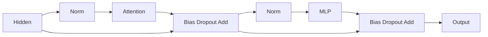

## 1. 为什么模型代码里看不到所有具体层

普通PyTorch模型常在构造函数里直接写`Linear`、`LayerNorm`和attention。

Megatron要让相同Transformer结构切换local实现、TE融合实现、dense MLP和MoE。

如果每个层都堆积后端分支，组合关系会迅速失控。

ModuleSpec把“构造什么模块”作为数据传给构造器。

但这并不意味着任意组合都合法。

shape、返回类型、process group、precision和checkpoint metadata仍然是硬约束。

本篇以冻结提交`48a887fecd01674346f724dcf44f417f455989f0`为源码依据。

本轮直接复核了`spec_utils.py`，以下特别区分函数与类的构造行为。

## 2. ModuleSpec的四个字段

| 字段 | 含义 | 常见误解 |
|---|---|---|
| `module` | 类、函数或模块路径与符号名 | 不一定是已构造nn.Module实例 |
| `params` | 模块构造参数 | 不表示forward输入 |
| `submodules` | 子模块插槽描述 | 不是自动完成所有递归构造 |
| `metainfo` | 附加描述信息 | 不直接传给构造函数 |

可以把spec理解成一棵模块构造树。

树的节点描述模块类型，子节点描述该模块内部使用的实现。

真正如何消费submodules由对应模块构造函数决定。

### 2.1 build_module的准确规则

冻结源码按以下顺序处理：

1. 如果传入的是函数，直接返回函数。
2. 如果spec.module是函数，也直接返回函数。
3. 如果传入类或spec.module是类，取该类。
4. 否则按路径import并解析符号。
5. 如果解析结果是函数，仍直接返回。
6. 若spec有submodules，以关键字传入构造器。
7. 传入params和调用点kwargs，实例化类。
8. 出错时在异常文本补上模块名。

特别注意：函数不会被build_module立即执行。

它可能是后续选择融合函数或执行回调的工厂。

### 2.2 同名参数不是静默覆盖

冻结代码使用类似：

```python
module(*args, **spec.params, **kwargs)
```

如果params与kwargs包含同一个key，Python会报重复关键字参数错误。

不能把它理解为`{**params, **kwargs}`那种后者覆盖前者的字典合并。

这类小差别经常造成“配置看起来正确，构造时突然失败”。

## 3. 用不依赖Megatron的示例理解构造

下面只演示语义，不实现完整ModuleSpec。

```python
from dataclasses import dataclass, field
from types import FunctionType

@dataclass
class Spec:
    module: object
    params: dict = field(default_factory=dict)
    submodules: object = None

class ToyLinear:
    def __init__(self, width, bias=False):
        self.width = width
        self.bias = bias

def activation_factory():
    return "chosen activation"

def build(spec, **kwargs):
    if isinstance(spec.module, FunctionType):
        return spec.module
    if spec.submodules is not None:
        kwargs["submodules"] = spec.submodules
    return spec.module(**spec.params, **kwargs)

layer = build(Spec(ToyLinear, {"width": 16}), bias=True)
assert (layer.width, layer.bias) == (16, True)
callback = build(Spec(activation_factory))
assert callback is activation_factory
assert callback() == "chosen activation"
try:
    build(Spec(ToyLinear, {"width": 16}), width=32)
except TypeError:
    print("duplicate kwargs rejected")
else:
    raise AssertionError("duplicate kwargs should fail")
```

运行结果应打印重复key被拒绝。

真实实现还处理动态import、异常上下文和更丰富的模块对象。

## 4. 从GPT spec到一个Transformer layer

GPT layer spec工厂为下列插槽选择具体实现：

```text
TransformerLayer
  input_layernorm
  self_attention
    linear_qkv
    core_attention
    linear_proj
  self_attn_bda
  pre_mlp_layernorm
  mlp
    linear_fc1
    activation
    linear_fc2
  mlp_bda
```

部分TE spec把norm和下一线性层融合，因此单独norm插槽可能成为identity。

融合之后，数学顺序仍要与目标模型一致。

不能因为某个Python norm节点消失就认为模型没有归一化。

### 4.1 TransformerBlock负责stage局部层列表

模型构造器根据PP/VPP布局挑选本rank应该拥有的layer specs。

TransformerBlock执行这些层，并在合适的stage应用最终norm。

中间stage接收的是上游hidden tensor。

首stage才进行常规token embedding；MTP等特定placement有额外规则。

## 5. 单层数据流：先把残差位置画对

pre-norm结构可写为：

$$
U=X+\operatorname{Dropout}(\operatorname{Attn}(\operatorname{Norm}_1(X))),
$$

$$
Y=U+\operatorname{Dropout}(\operatorname{MLP}(\operatorname{Norm}_2(U))).
$$

bias可能在融合BDA中追加；上式省略bias只是为了突出结构。



残差使用norm之前的输入。

如果误用norm后的tensor作为残差，shape可能完全合法但模型已改变。

因此shape检查通过只是正确性的第一层。

## 6. 完整shape手算：小型GQA层

设：

```text
sequence S = 8
microbatch B = 2
hidden H = 16
query heads nh = 4
KV groups ng = 2
head dimension d = 4
TP = 2
FFN hidden F = 24
```

假设不启用SP、CP、bias和dropout，采用SwiGLU。

输入hidden为`[8,2,16]`。

### 6.1 QKV逻辑宽度

$$
D_Q=n_hd=4\times4=16,
$$

$$
D_K=D_V=n_gd=2\times4=8,
$$

$$
D_{QKV}=16+8+8=32.
$$

column-parallel QKV权重逻辑shape为`[32,16]`。

每个TP rank持有`[16,16]`，输出mixed QKV为`[8,2,16]`。

### 6.2 分组拆分

每rank有2个Q heads和1个KV group。

```text
Q: [8,2,2,4]
K: [8,2,1,4]
V: [8,2,1,4]
```

同一个KV group服务本rank两个query heads。

概念attention score shape为`[2,2,8,8]`。

融合attention不一定把完整score矩阵写回HBM；这个shape是数学中间量。

attention输出合并heads后为`[8,2,8]`。

### 6.3 输出投影

逻辑投影权重为`[16,16]`。

row-parallel时每rank持有`[16,8]`。

每rank计算一个`[8,2,16]`的部分和。

无SP时对部分和做TP归约，得到完整hidden输出。

有SP时输出侧可能用Reduce-Scatter，使序列行继续分片。

这说明collective由layout决定，不能只看“这是linear”来判断。

## 7. SwiGLU：FC1为什么是两倍宽

定义：

$$
Z_1=XW_v^T,\quad Z_2=XW_g^T,
$$

$$
A=Z_1\odot\operatorname{SiLU}(Z_2),
\quad Y=AW_2^T.
$$

工程上把$W_v,W_g$合并为双宽FC1。

逻辑FC1 shape为`[2F,H]=[48,16]`。

TP=2后每rank为`[24,16]`，输出`[8,2,24]`。

拆分后value和gate各为`[8,2,12]`。

逐元素门控后仍为`[8,2,12]`。

FC2本地权重为`[H,F/TP]=[16,12]`。

输出再归约回hidden布局。

### 7.1 参数量手算

忽略bias，QKV有$32\times16=512$参数。

attention输出投影有$16\times16=256$参数。

SwiGLU FC1有$48\times16=768$参数。

FC2有$16\times24=384$参数。

四个线性层合计：

$$
512+256+768+384=1920.
$$

每TP rank线性参数为960。

假设两处RMSNorm每处H个scale，逻辑再加32参数，总计1952。

norm scales在两个TP rank复制时，每rank物理参数为992，集群物理总数为1984。

物理副本数大于逻辑参数量不是重复计错，而是复制布局的结果。

## 8. 普通MLP与SwiGLU的公平比较

普通两层MLP参数量约为：

$$
P_{plain}=2HF.
$$

SwiGLU约为：

$$
P_{swiglu}=3HF.
$$

若普通MLP采用$F=4H$，则参数量为$8H^2$。

为了接近相同参数量，SwiGLU可取$F\approx8H/3$，再按硬件对齐需求调整。

因此不能在相同F下比较后声称“换SwiGLU没有增加参数”。

对齐后的实际F、bias和padding都应进入最终账本。

## 9. GQA特殊情况：KV groups小于TP

上面的例子满足`ng>=TP`，每rank至少拥有一个KV group。

若ng小于TP，同一KV group需要服务多个TP rank上的query heads。

冻结源码对合法整除配置有额外QKV all-gather及切片逻辑。

因此减少KV groups可能降低模型状态，却增加某些路径的通信。

这也解释为什么不能只看KV cache大小评价训练配置。

GQA shape校验应同时检查nh、ng、TP与head dimension。

CrossAttention类是否支持同样组合还要另查，不可从SelfAttention直接推广。

## 10. TE adapter保持哪些合约

Transformer Engine负责高性能实现，但Megatron仍负责模型布局与调用合约。

| adapter方向 | 输入输出责任 | 额外边界 |
|---|---|---|
| Norm | LayerNorm/RMSNorm语义 | epsilon、dtype与版本 |
| Column linear | 分片输出与bias返回 | TP/SP、量化与通信 |
| Row linear | 部分和归约 | 输出布局与overlap |
| LayerNormLinear | 融合norm和线性 | 避免重复norm |
| DotProductAttention | QKV、mask、packed元数据 | 后端与CP支持 |
| Grouped expert linear | 多expert GEMM | expert TP与dispatcher职责 |

在常见MCore接口中linear返回`(output,bias)`。

若设置skip_bias_add，bias留给后续BDA融合处理。

把tuple当作Tensor，或linear内加一次bias后BDA再加一次，都会出错。

### 10.1 expert通信不能重复

expert模式下，token dispatcher已经承担某些通信职责。

TE adapter会调整parallel mode和local shape，避免内部再执行不合适的TP通信。

自定义expert backend时不能仅替换GEMM函数而忽略这层协议。

## 11. 选择TE不等于固定选择一个attention kernel

spec决定使用local或TE模块家族。

TE内部还可依据shape、mask、dtype和设备选择Flash、fused或unfused路径。

`auto`通常表示允许后端选择，不代表永远使用某一种kernel。

因此性能报告至少需要：

```text
MCore commit
TE version与build
PyTorch/CUDA/cuDNN版本
GPU型号与compute capability
实际attention backend
shape、mask、packed与CP配置
precision recipe
```

只有“安装了TE”无法复现实验。

## 12. 低精度与融合的三道门

第一道是代码接口：配置能否表达对应recipe。

第二道是依赖能力：TE和其他库是否实现该组合。

第三道是硬件运行：目标GPU是否具备对应kernel及预期吞吐。

例如源码中出现FP8或NVFP4名称，不代表RTX 3090能原生高吞吐执行相同路径。

本篇没有在Ampere、Hopper或Blackwell上运行TE精度与性能实验。

阅读冻结源码时，应报告接口和校验结论，不追加未验证的加速承诺。

### 12.1 CUDA Graph与参数同步

graph捕获可能绕开普通Python hook执行时机。

如果param All-Gather依赖forward pre-hook，需要集成层保证图重放时仍执行必要同步。

静态shape、buffer地址和生命周期也是graph正确性的组成部分。

不能只把forward包进capture就认为所有异步协议自然保留。

## 13. 一个shape与参数校验器

```python
S, B, H = 8, 2, 16
nh, ng, d, tp, F = 4, 2, 4, 2, 24
assert H == nh * d
assert nh % tp == 0 and ng % tp == 0
qkv_width = (nh + 2 * ng) * d
assert qkv_width == 32
linear_params = qkv_width * H + H * (nh * d) + 3 * H * F
assert linear_params == 1920
assert linear_params // tp + 2 * H == 992
print("Q", (S, B, nh // tp, d))
print("KV", (S, B, ng // tp, d))
print("FC1 output", (S, B, 2 * F // tp))
print("FC2 input", (S, B, F // tp))
```

这只检验形状与计数，不验证attention数值、TE融合或NCCL行为。

数值验收还应比较local参考实现的forward、grad与一次optimizer update。

## 14. 故障定位

| 症状 | 优先排查 | 最小证据 |
|---|---|---|
| 构造重复key错误 | spec.params与kwargs | 两处key集合 |
| 参数量差一倍 | GLU双宽FC1 | 实际F与weight shape |
| 只有TE路径loss错误 | norm/bias/mask合约 | local与TE逐层输出 |
| attention shape错误 | GQA/TP/packed布局 | QKV与cu_seqlens |
| expert collective hang | dispatcher与TE重复通信 | process group与操作序列 |
| graph模式参数陈旧 | pre-hook未执行或buffer复用 | AG完成事件与参数摘要 |

对数值问题，先关闭量化、graph和overlap，建立可观察基线。

再逐项恢复功能，以确定第一次改变数值的机制。

不能以“融合后浮点不同”为理由忽略数量级明显错误。

## 15. 自测与详细答案

### 题1：ModuleSpec里的function会立即执行吗？

冻结build_module直接返回该function。

调用者在适当时刻再执行它。

这与实例化class的路径不同。

### 题2：params与kwargs同名时谁覆盖谁？

冻结实现不会静默覆盖，而是Python重复关键字错误。

如果要修改默认值，应在调用之前构造明确且无冲突的参数集合。

### 题3：为什么SwiGLU的FC1是2F而FC2仍接F？

FC1产生value和gate两个F宽分支。

门控是逐元素乘法，合成结果宽度仍为F。

TP只进一步把对应输出和输入维度切分。

### 题4：物理参数总数为什么比模型参数多？

某些参数在并行rank之间复制，例如norm scales。

逻辑参数只计一次，物理内存要计所有副本。

两种口径应明确区分。

### 题5：TE spec是否保证使用FlashAttention？

不能保证。

实际后端取决于配置、shape、mask、dtype、库版本和硬件。

应从运行日志或profiler确认实际kernel。

### 题6：融合norm后layer norm节点消失，数学上是否也没了norm？

不一定，norm可能进入LayerNormLinear内部。

应按实际数据流和参考输出判断，不能只数Python子模块。

重复应用norm与遗漏norm都可能保持shape合法但改变模型。

## 16. 来源映射与一手证据

扩写Megatron报告Transformer模块第1—5节及shape计算题；对应综述3.1、7和8.1节。

- [冻结ModuleSpec实现](https://github.com/NVIDIA/Megatron-LM/blob/48a887fecd01674346f724dcf44f417f455989f0/megatron/core/transformer/spec_utils.py)：本轮直接复核构造规则。
- [GPT layer specs](https://github.com/NVIDIA/Megatron-LM/blob/48a887fecd01674346f724dcf44f417f455989f0/megatron/core/models/gpt/gpt_layer_specs.py)。
- [Attention实现](https://github.com/NVIDIA/Megatron-LM/blob/48a887fecd01674346f724dcf44f417f455989f0/megatron/core/transformer/attention.py)。
- [MLP实现](https://github.com/NVIDIA/Megatron-LM/blob/48a887fecd01674346f724dcf44f417f455989f0/megatron/core/transformer/mlp.py)。
- [TE adapter冻结实现](https://github.com/NVIDIA/Megatron-LM/blob/48a887fecd01674346f724dcf44f417f455989f0/megatron/core/extensions/transformer_engine.py)。

本篇验证范围是源码语义与CPU形状计算；实际后端、低精度收敛和多卡性能需要目标环境另行实测。
