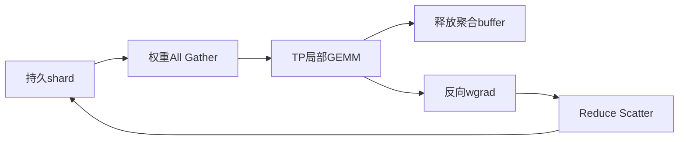

## 1. 本篇先建立版本边界

前几篇的源码主线固定于`48a887fecd01674346f724dcf44f417f455989f0`。

它是2026-07-10提交的主干快照，不能因为包版本字符串含0.19.0就视为正式release。

输入资料在2026-08-29另行核对了`core_v0.19.0`发布及版本化文档。

本轮2026-11-07重新打开NVIDIA的`0.19.0` Hybrid迁移和GTP页面核对功能合约。

本篇不宣称0.19.0是当前最新版本。

也不把文档中的新能力写成旧commit中已经存在的实现。

| 证据 | 本篇用途 |
|---|---|
| 冻结48a887f源码 | GPT、DistOpt与checkpoint基线 |
| 0.19.0 Hybrid迁移文档 | 模型词表、迁移格式与支持条件 |
| 0.19.0 GTP文档 | weight rematerialization合约与依赖门槛 |
| 本篇手算 | 分层映射、容量与通信推导 |
| 目标硬件实验 | 本篇未执行 |

GTP在该版本化文档中明确标为Experimental，要求TE至少2.19。

这两个限定应与功能名称一起记住。

## 2. HybridModel改变的是“一个layer”的含义

传统GPT block通常包含attention子层与MLP子层。

两者放在一个decoder layer编号下。

HybridModel把每一个position表示为一个layer family。

保持原始dense GPT结构时，一个block展开成attention与MLP两个positions。

```text
GPT block 0: Attention0 + MLP0
GPT block 1: Attention1 + MLP1

Hybrid positions:
0 Attention0
1 MLP0
2 Attention1
3 MLP1
```

因此layer count、checkpoint key、PP切分和性能统计都要重新解释。

不能仅把模型类名替换后继续使用所有旧计数。

## 3. Pattern词表与迁移能力不是同一张表

版本化文档的模型词表包括：

| 符号 | layer family |
|---|---|
| `*` | Self-Attention |
| `-` | Dense MLP |
| `E` | MoE |
| `M` | Mamba-2 |
| `G` | Gated Delta Network |
| `D` | DeepSeek Sparse Attention |

这些符号说明Hybrid可以表达哪些结构。

GPT checkpoint translation的支持范围更窄。

GPT没有GDN或DSA对应权重，就不能凭一个符号自动生成等价状态。

新增Mamba position也属于新初始化模块，而不是从GPT中神奇恢复出来。

### 3.1 迁移的配对规则

第i个`*`对应GPT第i层attention。

第i个`-`或`E`对应GPT第i层MLP。

配对按出现次序，不只是简单把数字layer index乘2。

是否保持原模型计算顺序，还要独立检查pattern。

即便所有张量都能映射，改变子层顺序也可能改变模型函数。

## 4. 手算三个GPT block的映射

源模型有三个dense GPT blocks。

架构保持pattern为：

```text
*-*-*-
```

映射表：

| 源 | 目标position | 逻辑参数 |
|---|---:|---|
| layer0.self_attention | 0 | QKV、output projection及相关norm |
| layer0.mlp | 1 | FC1、FC2及相关norm |
| layer1.self_attention | 2 | 同上attention状态 |
| layer1.mlp | 3 | 同上MLP状态 |
| layer2.self_attention | 4 | 同上attention状态 |
| layer2.mlp | 5 | 同上MLP状态 |

模型共有6个Hybrid positions，但没有因此把原来的线性参数复制两份。

假设每个attention部分有100M参数，每个MLP部分有200M参数。

源模型共$3\times(100+200)=900M$参数。

目标同样为$3\times100+3\times200=900M$。

逻辑层数翻倍与参数翻倍是两回事。

### 4.1 Norm与embedding也要进入映射

映射不只有QKV和FC权重。

还要检查norm、bias、final norm、embedding、output head、共享参数和特殊元数据。

一个没有加载的norm scale可能不会引起shape异常，却会改变输出。

应统计每个source key的目标去向，以及所有target key的来源。

## 5. 在线translation与离线conversion

### 5.1 在线translation

Hybrid目标构造自己的sharded state模板，然后把可映射key指向GPT checkpoint中的逻辑tensor。

加载器再按目标TP/PP/EP等布局读取切片。

符合格式条件时，可以迁移参数、FP32 master和Adam moments。

源checkpoint在磁盘上无需被改写。

### 5.2 离线conversion

离线工具生成key已属于Hybrid的独立权重产物。

它适合审计、归档或多次复用。

输入资料与版本化文档限定其为weights转换路径，而非完整训练状态迁移器。

不能因common metadata里还残留iteration就声称optimizer、RNG和rerun都已转换。

### 5.3 为什么optimizer格式会成为门槛

bucket-space状态按旧的扁平buffer排列编号。

Hybrid拆分模块后，bucket排列可能改变。

只按旧bucket offset加载，会把某个参数的moment写进另一个参数。

model-space状态按稳定逻辑参数身份与坐标描述，更适合迁移。

因此`torch_dist`在线optimizer迁移要求对应的fully-reshardable/model-space格式。

Megatron-FSDP的`fsdp_dtensor`路径有自己的映射；不能把Torch FSDP2的`torch_dcp`自动当作同等支持。

## 6. Resume与finetune语义需要明确选择

迁移器负责张量key和布局，不替用户决定训练阶段语义。

普通`--load`在兼容条件下按loader协议恢复iteration、optimizer、scheduler、RNG和rerun。

`--finetune`会让部分训练进度和随机状态重新开始。

在该版本化迁移合约中，`--finetune`不自动等于丢弃optimizer；若需要fresh optimizer还要明确`--no-load-optim`。

这与很多人凭名字猜测的行为不同。

离线weights warm start则应审计/reset counters并明确新的optimizer与RNG。

### 6.1 不受支持pattern应尽早拒绝

迁移前检查：

- attention与MLP positions数量是否一致且非零。
- attention数是否与源num_layers一致。
- 是否混合dense与MoE MLP。
- 是否出现GPT translator不支持的G、D或MTP suffix。
- 是否存在新初始化模块及其fresh optimizer状态。

错误应在开始长训练前暴露。

不能用`strict=False`把不明缺失吞掉。

## 7. PP负载：按position数量平分可能很差

继续三个GPT blocks的例子。

假设attention耗时2ms，MLP耗时5ms。

总计算时间为$3\times(2+5)=21ms$。

若按6个positions平均分给两个stage，每stage3个：

```text
stage0: * - *  → 2+5+2 = 9ms
stage1: - * -  → 5+2+5 =12ms
```

虽然position数相等，stage1仍慢33.3%。

若按完整GPT block划分为1个与2个，则7ms对14ms更不均衡。

更细的position让布局更灵活，但也要求更准确的stage cost model。

### 7.1 简化吞吐上限

理想稳定流水线的节拍主要受最慢stage限制。

上面两个方案对应12ms与14ms瓶颈。

仅从计算估算，第一方案的稳态吞吐上限高$14/12-1\approx16.7\%$。

这个数没有计P2P、activation存活、bubble和重计算。

不能把它写成实际迁移性能提升。

## 8. GTP：存储分片与GEMM分片分开

普通TP让每rank持有一个权重切片，并用该切片完成局部GEMM。

GTP在TP切片上再增加weight rematerialization维度。

记TP大小为t，额外维度为g：

$$
GTP=tg.
$$

每rank长期保存约$1/(tg)$的相应权重。

用到权重前，在g组内聚合成完整TP切片。

GEMM仍只使用$1/t$的权重，TP切分并未消失。

用后释放materialized buffer，反向把相应wgrad Reduce-Scatter回存储shard。



这里的GTP remat表示权重重新聚合，与activation checkpoint的前向重计算要区分。

## 9. 与FSDP、DistOpt的关系

| 机制 | 分片域 | 何时聚合权重 | 常见粒度 |
|---|---|---|---|
| TP | 模型并行 | 不重建完整模型权重 | GEMM维度 |
| DistOpt | optimizer的DP状态 | 更新后同步计算参数 | bucket |
| FSDP/ZeRO-3 | 数据并行状态 | 计算前unshard | module/unit或实现定义粒度 |
| GTP remat | TP之外的模型权重域 | 每次使用前聚合TP切片 | individual weight |

GTP的生命周期类似ZeRO-3，但分片轴和调度粒度不同。

不能把g直接当作新增DP样本副本数。

global batch计数仍由实际数据并行语义决定。

## 10. 完整手算：一个大矩阵的显存

设权重shape为`[8192,8192]`，BF16每元素2字节。

元素数：

$$
8192^2=67,108,864.
$$

完整权重字节数为134,217,728，即128MiB。

取TP=2，每个TP切片为64MiB。

再取g=4，每rank长期存储为16MiB。

### 10.1 用到该权重时的峰值

GEMM需要完整TP切片64MiB。

若持久16MiB shard与64MiB聚合buffer独立存在，该权重相关同时驻留为80MiB。

实现可能采用别名、复用或特定buffer池改变这个数字。

因此80MiB是“独立存储”假设下的简单账本，不是官方保证的峰值。

若还预取下一个64MiB权重，则需要进一步计入该buffer。

常驻节省并不等于峰值直接除以4。

## 11. 通信手算与暴露时间

理想ring下，聚合一个64MiB TP切片，g=4时每rank通信量约：

$$
V_{AG}=\frac{3}{4}\times64=48MiB.
$$

若有效单向带宽为200GiB/s，忽略launch与同步：

$$
T_{AG}=48/(200\times1024)s\approx0.2344ms.
$$

如果前一GEMM提供0.4ms重叠窗口，理想上这一AG可隐藏。

若跨机有效带宽只有25GiB/s，则同一AG约1.875ms。

对应暴露时间至少约$1.875-0.4=1.475ms$。

### 11.1 梯度dtype影响RS

若wgrad使用FP32，同一元素范围对应128MiB TP-local梯度。

RS流量约96MiB，不能沿用48MiB参数AG数值。

低精度通信还可能包含scale、量化元数据和其他处理。

总成本需要按实际dtype与recipe逐项计算。

### 11.2 关键路径公式

$$
T_{exposed}\approx
\max(0,T_{AG}-W_f)+\max(0,T_{RS}-W_b)+T_{contention}.
$$

$W_f,W_b$分别表示可用于覆盖通信的计算窗口。

异步只改变调度可能性；只有确实落入窗口才算隐藏。

首个权重、最后一段反向和冷启动常缺少足够前驱计算。

## 12. 配置原理与运行边界

版本化文档用总weight shard数表达TP与remat的乘积。

概念配置例子：

```text
tensor model parallel size = 2
tensor parallel num weight shards = 8
gtp weight remat size = 8 / 2 = 4
```

实际CLI名称、expert-side配置和组合限制应按所固定版本确认。

不能把这三个数随意独立设置。

### 12.1 启用前需要回答的问题

1. 长期权重、梯度和optimizer状态的减少是否足够解决显存瓶颈？
2. 最大materialized weight及预取buffer是否仍能放下？
3. g组是否位于足够快的物理互联域？
4. 每个大权重前有多长计算窗口？
5. recompute与graph路径是否保持相同通信依赖？
6. checkpoint是否记录正确的全局tensor坐标？

TE版本门槛通过不等于这些问题全部通过。

## 13. CPU计算器

```python
rows = cols = 8192
param_bytes = 2
tp, g = 2, 4
mib = 1024**2
full = rows * cols * param_bytes
local_tp = full // tp
stored = local_tp // g
ag = local_tp * (g-1) / g
assert full / mib == 128
assert stored / mib == 16
for gib_s in [200, 25]:
    time_ms = ag / (gib_s * 1024**3) * 1000
    exposed_ms = max(0, time_ms - 0.4)
    print(gib_s, round(time_ms, 6), round(exposed_ms, 6))
print("independent stored plus gathered MiB", (stored + local_tp) / mib)
```

输出AG时间约0.234375ms与1.875ms；第二项暴露时间约1.475ms。

这只是带宽下界与窗口模型，不含真实NCCL、TE或GPU测量。

## 14. 迁移与GTP应分开验收

先验证架构保持的Hybrid迁移，再验证新增权重分片。

如果同时改变模型类、PP布局、dtype、GTP和数据，发生loss差异时很难归因。

推荐逐层验收：

| 阶段 | 验收内容 |
|---|---|
| key与shape | 每个source tensor唯一映射 |
| forward | 固定batch的logits与loss |
| backward | 关键逻辑参数的global grad |
| optimizer | master、m/v、step与参数对应 |
| resume | 数据游标、RNG、scheduler及拓扑gate |
| GTP | g=1基线、聚合后weight、RS后grad |
| 性能 | 长期token/s、显存峰值和暴露通信 |

不同拓扑的浮点归约顺序可以导致非逐位一致。

应预先定义dtype容差、误差指标和质量验收标准。

## 15. 故障定位

| 症状 | 优先检查 |
|---|---|
| Hybrid加载缺key | pattern计数、norm/embedding映射 |
| model能加载而optimizer失败 | bucket-space与model-space格式 |
| warm start学习率异常 | 残留counters与scheduler语义 |
| GTP导入或启用失败 | TE版本及功能依赖 |
| 显存峰值没有预期下降 | materialization、预取和buffer池 |
| 开GTP后forward等待增加 | 每权重AG窗口与物理拓扑 |
| graph模式才出错 | event、buffer地址与同步边界 |

## 16. 自测与详细答案

### 题1：三层GPT迁移为六个Hybrid positions是否模型变大？

架构保持时只是把每个block拆成attention与MLP两个位置。

参数总量可以保持不变。

但PP切分和layer index会改变。

### 题2：Hybrid支持GDN是否意味着GPT权重能直接转GDN？

不能，模型表达能力与checkpoint转换支持是不同问题。

GDN的参数结构与GPT attention不相同。

需要明确的新架构初始化或训练方案。

### 题3：离线转换文件能加载，是否证明完整resume成功？

不能。

还需验证optimizer、scheduler、RNG、数据游标和iteration。

仅权重转换应按warm start语义处理。

### 题4：GTP=8、TP=2是否意味着8路数据并行？

不是，g=4是权重rematerialization维度。

它不自动增加独立数据副本。

global batch仍按实际DP布局计算。

### 题5：常驻权重从64MiB降到16MiB，峰值是否也变16MiB？

不是，GEMM前需要聚合完整64MiB TP切片。

还有预取buffer、梯度和其他状态。

峰值要按同时存活对象统计。

### 题6：文档说overlap，为什么还要算暴露通信？

overlap是调度机制，效果依赖窗口、带宽、消息大小和资源争用。

跨节点或首尾权重可能无法完全隐藏。

真实收益应在目标拓扑实测。

## 17. 0.19发布中的两类已知问题

本节2026-11-07直接读取[core_v0.19.0官方发布页](https://github.com/NVIDIA/Megatron-LM/releases/tag/core_v0.19.0)的Known Issues。
这里描述该release记录的特定栈，不表示所有新版依赖仍有相同问题。
本轮没有在本机重现收敛异常或传输损坏。

### 17.1 TE fused cross entropy的收敛gate

发布页记录：部分模型启用`cross_entropy_fusion_impl=te`会出现收敛稳定性问题。
官方给出的替代是使用`native`，或升级到包含修复的Transformer Engine 2.18。
这项2.18门槛针对该CE问题，不能代替本篇GTP所需的TE至少2.19等其他门槛。

工程验收应固定输入、权重、dtype、mask和有效token分母，比较native/TE：

1. 同batch的logits与loss。
2. 关键参数grad与一次optimizer update。
3. 多步loss、grad norm、overflow与验证指标。
4. 收敛护栏通过后再比较step time。

例如两个kernel在同一batch分别给出2.0000与2.0001的loss，只能说明这一次前向接近。
它不能替代反向、长尾logits、不同mask和多步训练验证。
更快的CE不能抵消模型质量退化，因此发布记录必须同时保存性能与质量差异。

### 17.2 NCCL 2.30.5/SPCX的高EP payload问题

发布页将问题限定为受影响的NCCL 2.30.5/SPCX组合。
高EP、variable-split、BF16 grouped All-to-All可能因transport请求状态异常发生payload丢失或损坏。
MoE alltoall dispatcher能够暴露它，但来源不应直接归因router算法。
官方列出的对照路线是禁外部网络plugin、改用NCCL内部IB，或使用HybridEP dispatcher。

发布页给出的内部IB环境配置为：

```bash
NCCL_NET_PLUGIN=none NCCL_NET=IB
```

这只是特定问题的官方对照配置，不应未经测量改写所有生产作业。
是否实际选择了预期transport，要以启动日志与环境为证。

排查顺序可以拆为四层：

| 边界 | 不变量 | 对照方法 |
|---|---|---|
| router | token到expert的映射合法 | 固定routing，远离top-k tie |
| permute | token身份和gate不丢失 | CPU reference与逆置换 |
| dispatch | 每条src→dst边计数一致 | send/recv splits、token ID与payload摘要 |
| transport | 同一合法payload传输保持内容 | 固定栈下切换plugin/backend |

例如send count矩阵为`[[1,2],[3,4]]`。
rank0接收split应为[1,3]，rank1应为[2,4]。
计数一致后，仍需比较实际token ID与payload；正确shape不能排除数据内容损坏。

如果切换transport后payload恢复正确，应保留原栈最小复现。
不要先调aux-loss系数掩盖异常，否则会把通信故障与训练配方变化混在一起。
采样checksum增加开销，应报告采样频率和覆盖边界，不能把稀疏采样无异常称为所有payload已证明正确。

### 17.3 功能进入release与稳定性是两张表

0.19发布项还包括Quantile Balancing、fused shared expert和streaming quantized checkpoint load。
MFSDP v2在该发布说明中仍标为开发中。
这些发布事实不等于任意组合的训练稳定性与性能已验证。

对每个候选配置应记录：固定MCore commit、功能状态、TE/CUDA/NCCL版本、transport/plugin、GPU架构、已知限制与实际验证结果。
某个gate通过只允许进入下一层验证，不替代其余gate。
尤其不要把0.19发布问题倒写成冻结48a887f调用链已经具有相同故障。

## 18. 来源映射与一手证据

扩写Megatron报告模块D第1—3、5—7节，以及跨模块洞察第8—9节；与综述11.1—11.3的框架边界相衔接。

- [NVIDIA 0.19.0 Hybrid迁移指南](https://docs.nvidia.com/megatron-core/developer-guide/0.19.0/user-guide/hybrid-model-migration.html)：本轮核对pattern、在线与离线路径及optimizer门槛。
- [NVIDIA 0.19.0 GTP文档](https://docs.nvidia.com/megatron-core/developer-guide/0.19.0/api-guide/core/generalized_tensor_parallel.html)：本轮核对Experimental、TE门槛及两个分片维度。
- [core_v0.19.0 release](https://github.com/NVIDIA/Megatron-LM/releases/tag/core_v0.19.0)：固定release入口，不作为当前最新版声明。
- 同一官方发布页的Known Issues用于本篇第17节；版本与workaround来自该页，本轮仅只读核对，未复现故障。
- [冻结基线源码](https://github.com/NVIDIA/Megatron-LM/tree/48a887fecd01674346f724dcf44f417f455989f0)：只用于比较旧版状态协议。

本篇没有执行Hybrid checkpoint迁移、GTP训练或目标硬件性能测试；容量与时间数字均为注明假设的教学计算。
