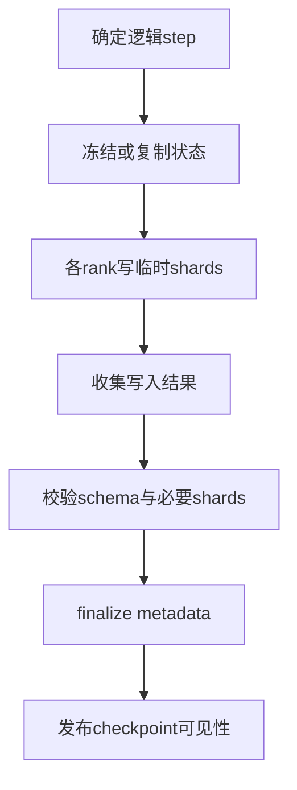

## 1. 文件保存成功，不等于训练状态保存成功

假设权重来自step100，Adam moments来自step99，数据游标却已经到step101。

三个文件都能读取，shape也完全正确。

恢复后的训练仍然不是任何一次真实执行曾经拥有的状态。

checkpoint首先要求逻辑一致，然后才要求字节完整和读取高效。

本篇采用optimizer-step边界保存。

mid-step保存需要额外定义累积梯度、microbatch、pipeline和随机状态，不能直接沿用同一个协议。

## 2. 一份完整训练状态树

```text
checkpoint
  model
    parameters
    buffers与必要的精度元数据
  optimizer
    master parameters
    moments
    update counters
    parameter groups
  scheduler
  loss scaler（若使用）
  randomness
    Python / NumPy / CPU / CUDA / named trackers
  data
    manifest / tokenizer / indices
    committed sample与token cursor
    mixture与packing状态
  runtime compatibility
    topology / code / dependencies / schema
  publication
    shard metadata / integrity / completion marker
```

梯度是否保存取决于边界。

普通完整update之后保存通常不需要未提交累积梯度。

仅权重导出适合推理或warm start，但不能承诺完整训练续跑。

## 3. 三种一致性需要分别验证

| 一致性 | 问题 | 典型证据 |
|---|---|---|
| 逻辑一致性 | 是否来自同一提交step | iteration与状态版本 |
| 结构一致性 | tensor shard是否覆盖正确坐标 | global shape、offset、replica |
| 内容完整性 | 文件字节是否完整未损坏 | 长度、校验和、manifest |

文件SHA正确不能证明参数来自正确step。

shard覆盖完整也不能证明RNG或数据游标正确。

恢复测试需要同时覆盖三者。

## 4. 冻结Megatron的保存主链

本篇源码固定于`48a887fecd01674346f724dcf44f417f455989f0`。

概念路径：

```text
save_checkpoint
  → 识别global/local/legacy路径
  → 收集RNG、rerun与必要的dataloader状态
  → generate_state_dict
  → model与optimizer的sharded state
  → serialization预处理
  → backend strategy写shards
  → finalize metadata与可选integrity
  → 更新完成标记/tracker
```

不同格式的分支不是完全相同的实现。

`torch_dist`、direct DCP、local checkpoint和legacy需要分别确认能力。

不能因为某个保存接口叫distributed，就假设所有格式都支持任意TP/PP变化。

## 5. 把全局tensor身份与当前rank分离

### 5.1 ShardedTensor

一份sharded tensor描述至少包括：

- 稳定的逻辑key。
- 全局shape与dtype。
- 本地tensor。
- 全局offset和分片信息。
- replica身份。

global shape说明完整数学对象是什么。

offset说明本地数据在该对象中的坐标。

replica信息帮助区分相同逻辑切片的副本与需要独立保存的分片。

### 5.2 ShardedObject

它描述按坐标分布的对象，例如rank-local诊断状态。

对象可能是Python结构，不能像规则tensor一样随意裁剪拼接。

因此world size变化时，ShardedObject未必有自动重分片语义。

### 5.3 Factory与非持久对象

ShardedTensorFactory可以在保存前展开复杂布局，在加载后merge回目标结构。

这对GLU等逻辑与存储布局不完全一致的参数有用。

LocalNonpersistentObject参与运行时state tree，却不作为落盘恢复来源。

不能看到它出现在state dict就认为它会被保存。

## 6. 同步保存与异步保存的不同承诺

同步保存通常在调用完成前等待主要写入工作结束。

异步保存可能先返回一个request或future。

这个返回值表示工作已提交，不表示checkpoint已经可恢复。

至少区分：

```text
snapshot selected
staging started
staging completed
storage write completed
metadata finalized
checkpoint published
```

具体后端可能合并某些阶段，但调用者必须知道自己的完成边界。

## 7. Staging首先是storage生命周期问题

训练参数会被下一次optimizer update原地修改。

如果后台writer仍直接引用这些storage，就可能写到混合step内容。

必须让保存数据在写入期间稳定。

常见策略是copy到独立CPU staging buffer。

也可以使用其他快照与引用生命周期机制，但都需要明确不变性保证。

### 7.1 浅拷贝不等于快照

```python
state = {"weights": [1.0, 2.0]}
shallow = dict(state)
state["weights"][0] = 9.0
assert shallow["weights"][0] == 9.0
```

复制外层字典不会复制内部可变列表。

Tensor state dict也可能仍引用模型storage。

生产快照必须按实际state对象选择clone、staging或后端提供的保证。

### 7.2 全异步staging的额外依赖

本轮核对的PyTorch官方教程区分staging completion与upload completion。

若D2H仍在读取GPU参数，下一次optimizer原地更新前必须等待必要的staging完成。

可以允许下一个forward/backward与copy重叠，但是否安全还取决于模型buffer等其他可变状态。

不能把“optimizer前等待”推广为对任意有状态模型都天然完整。

应审计所有可能被forward/backward修改的保存对象。

## 8. 一个可恢复发布协议

下面是存储无关的设计协议，不声称所有后端都使用同一种文件事务。



恢复器只选择已发布的checkpoint。

未完成目录即使包含很多大文件，也应视为候选失败产物。

### 8.1 不同存储的发布方式

文件系统可使用经过验证的rename/目录/标记协议。

对象存储可使用不可变对象加最后manifest发布，必要时使用条件写。

rename原子性、目录可见性和持久性语义必须按实际后端确认。

不能把本地POSIX行为直接假定为所有共享文件系统或对象存储的保证。

### 8.2 Metadata与tracker不能抢跑

metadata描述“哪些shard构成这份状态”。

tracker告诉loader“最新可恢复版本在哪里”。

如果tracker先指向新版本，而某rank还没写完，故障后就可能选中坏checkpoint。

正确发布顺序要求必要数据与metadata先完成，再公开可恢复性。

文件内容校验与shard访问完整性校验也是不同检查。

## 9. 背压：异步请求不能无限排队

设一次checkpoint staging为20GB，写入耗时120秒，保存间隔60秒。

如果每次都无条件提交新请求，平均产生速度超过完成速度。

积压将持续增长。

即使GPU计算没有阻塞，主机内存和存储最终也会过载。

基本约束为：

$$
\text{平均完成速率}\geq\text{平均提交速率}.
$$

可采用最多一个在途请求、有限队列或跳过/合并未开始保存等策略。

策略必须明确哪一份checkpoint最终成为durable版本。

## 10. 完整手算：12元素从3份重分片成2份

全局参数：

```text
W = [0,1,2,3,4,5,6,7,8,9,10,11]
```

旧布局：

```text
old0: [0,4)
old1: [4,8)
old2: [8,12)
```

新布局：

```text
new0: [0,6)
new1: [6,12)
```

### 10.1 new0读取哪些片段

它与old0交集为`[0,4)`，读取`[0,1,2,3]`。

与old1交集为`[4,6)`，读取`[4,5]`。

与old2没有交集。

拼接后得到`[0,1,2,3,4,5]`。

### 10.2 new1读取哪些片段

与old0没有交集。

与old1交集为`[6,8)`，读取`[6,7]`。

与old2交集为`[8,12)`，读取`[8,9,10,11]`。

拼接后得到`[6,7,8,9,10,11]`。

### 10.3 Optimizer必须做同样映射

如果W的Adam m/v与master按同一全局参数坐标组织，它们也可以应用对应交集。

若optimizer只按旧内部bucket布局编号，就需要先转换到可解释的model-space。

加载权重成功不能证明optimizer范围映射正确。

## 11. CPU重分片模拟

```python
full = list(range(12))
old_ranges = [(0, 4), (4, 8), (8, 12)]
old_data = [full[a:b] for a, b in old_ranges]
new_ranges = [(0, 6), (6, 12)]

outputs = []
for t0, t1 in new_ranges:
    target = [None] * (t1 - t0)
    coverage = [0] * len(target)
    for (s0, s1), shard in zip(old_ranges, old_data):
        a, b = max(t0, s0), min(t1, s1)
        if a >= b:
            continue
        target[a-t0:b-t0] = shard[a-s0:b-s0]
        for pos in range(a-t0, b-t0):
            coverage[pos] += 1
    assert all(n == 1 for n in coverage)
    assert target == full[t0:t1]
    outputs.append(target)
assert outputs == [list(range(6)), list(range(6, 12))]
print(outputs)
```

coverage检查比“拼接后长度正确”更强。

它可以发现重复覆盖与缺失覆盖。

但此模拟没有文件I/O、故障注入、replica、二维tensor或真实DCP planner。

## 12. DP重分片与TP/PP变化是不同能力

冻结DistOpt至少区分：

| 格式 | 主要表示 | 典型能力边界 |
|---|---|---|
| dp_reshardable | 内部bucket shard | DP变化，不能任意改变TP/PP |
| fully_reshardable | canonical model-space | 支持更广模型并行重分片，成本较高 |
| fsdp_dtensor | DTensor参数状态 | 特定FSDP路径与版本合约 |

fully-reshardable需要额外gather、reshape或CPU/GPU暂存。

保存更灵活不代表保存更便宜。

local non-persistent checkpoint也不能自动视为跨TP/PP迁移的规范产物。

## 13. RNG、rerun与数据有独立gate

### 13.1 RNG

冻结loader在TP/PP改变时忽略旧RNG。

DP变化也不能自动保证随机流连续。

尤其按DP rank保存的RNG列表，其长度和身份绑定旧DP布局。

新DP rank可能没有对应旧stream，甚至出现索引越界。

要么定义显式迁移，要么明确reseed并放弃逐位连续承诺。

### 13.2 Rerun状态

rerun包含rank-local对象与诊断上下文。

冻结加载条件要求world、TP、PP和DP等拓扑匹配。

它不具备普通ShardedTensor那样的任意切片重组语义。

### 13.3 数据进度

顺序sampler可以从全局游标构造新rank视图。

随机sampler的epoch、bucket和置换可能依赖DP。

同时，已读取与已提交样本不相同。

必须把游标绑定到保存的optimizer状态，而不是最新预取位置。

## 14. 训练恢复有三个等级

1. **可加载**：模型与需要的状态结构能读取。
2. **语义续训**：数据、optimizer和schedule遵守预期训练目标。
3. **逐位连续**：在支持条件下恢复后每一步数值与不中断运行相同。

改变拓扑、kernel或归约次序可能保持第二级但失去第三级。

没有定义验收等级时，“可恢复”容易被不同团队理解成不同承诺。

## 15. Checkpoint间隔的推导

设一次保存的可见开销为C秒，平均故障间隔为M秒，保存间隔为I秒。

在简化独立故障模型中，保存开销占比近似$C/I$。

故障平均损失约半个间隔，浪费占比近似$I/(2M)$。

因此：

$$
W(I)=\frac CI+\frac{I}{2M}.
$$

求导：

$$
W'(I)=-\frac{C}{I^2}+\frac1{2M}=0.
$$

得到：

$$
I^*=\sqrt{2CM}.
$$

若C=8秒、M=7200秒，$I^*\approx339.41$秒。

对应两项浪费各约2.357%，合计约4.714%。

实际还需加入恢复、排队、异步争用、相关故障与失败保存成本。

异步保存的C应取对训练的实际可见成本，不能直接用后台写入总时长。

## 16. 故障定位与恢复验收

| 症状 | 优先核对 |
|---|---|
| tracker存在但缺shard | finalize与发布顺序 |
| hash通过但loss突跳 | 逻辑step、数据游标、RNG和scheduler |
| model加载而optimizer范围错 | checkpoint optimizer格式与参数组 |
| 保存后主机OOM | staging并发、pinned pool和page cache |
| DP扩容后RNG错误 | 旧DP随机流列表与新映射 |
| load很慢 | metadata storm、读放大、重分片暂存 |

恢复后的最小canary应比较：

```text
checkpoint ID与iteration
model与optimizer关键摘要
下一批logical sample IDs
RNG与microbatch配置
一次forward loss
一次backward grad norm
一次update后参数
必要collective与吞吐
```

先验证canary，再恢复长周期运行。

## 17. 自测与详细答案

### 题1：async_save返回后能立即更新参数吗？

取决于staging是否已获得独立稳定快照。

若后台仍读取原storage，必须先等待必要依赖完成。

应使用后端明确提供的staging完成语义。

### 题2：为什么metadata完成还要关心tracker？

metadata描述一份状态的结构，tracker决定恢复器选择哪份状态。

tracker提前发布会使恢复器选择尚未完整写入的版本。

两者的顺序是恢复协议的一部分。

### 题3：W重分片成功是否意味着Adam也成功？

不意味着。

master、m/v、step和参数组都需要与W的逻辑身份匹配。

bucket-space与model-space格式的迁移能力不同。

### 题4：DP变化时保留旧seed能保证同一随机轨迹吗？

不能，stream身份、调用次数和数据到rank映射都可能变化。

需要迁移完整随机状态与消费协议，或明确重新播种。

模型tensor可重分片不包含这项保证。

### 题5：为什么保存间隔不能只按经验设1小时？

保存成本与系统故障频率决定浪费平衡。

规模变化会改变故障频率和I/O成本。

应先建成本模型，再用真实运行数据校准。

### 题6：文件都能打开是否足够作为恢复测试？

不够，读取成功只覆盖一部分内容完整性。

还需验证逻辑step、坐标覆盖、optimizer、数据、RNG与一次继续更新。

只有这样才能发现静默错配。

## 18. 来源映射与一手证据

扩写综述10.2—10.6与9.7节；对照Megatron报告模块C第4、6.3节及C4—C5交叉验证记录。

- [冻结checkpoint编排](https://github.com/NVIDIA/Megatron-LM/blob/48a887fecd01674346f724dcf44f417f455989f0/megatron/training/checkpointing.py)。
- [冻结mapping结构](https://github.com/NVIDIA/Megatron-LM/blob/48a887fecd01674346f724dcf44f417f455989f0/megatron/core/dist_checkpointing/mapping.py)。
- [冻结serialization](https://github.com/NVIDIA/Megatron-LM/blob/48a887fecd01674346f724dcf44f417f455989f0/megatron/core/dist_checkpointing/serialization.py)。
- [PyTorch异步DCP教程](https://docs.pytorch.org/tutorials/recipes/distributed_async_checkpoint_recipe.html)：本轮核对staging与upload独立完成边界，API需匹配安装版本。
- [ByteCheckpoint原始论文](https://www.usenix.org/conference/nsdi25/presentation/wan-borui)：并行无关checkpoint设计案例。

本文没有在真实存储上验证断电持久性、原子提交或跨TP/PP恢复；代码只验证小向量重分片与浅拷贝语义。
