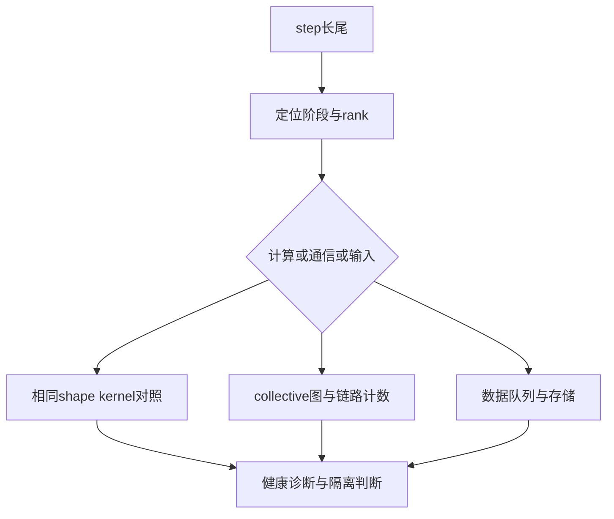
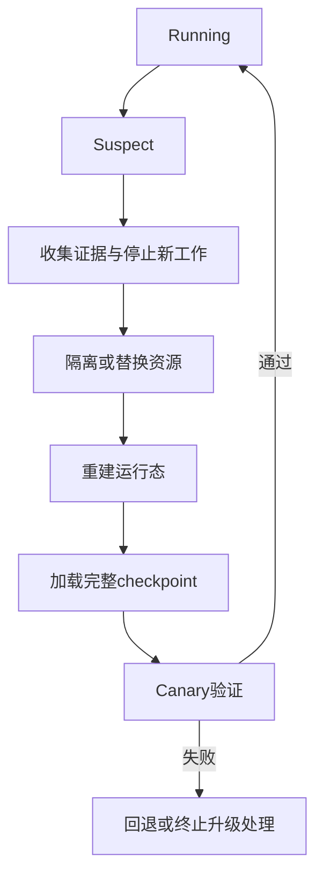

## 1. 最危险的故障不一定会让进程退出

GPU掉线通常会让collective报错。

另一种情况是某个rank仍在工作，但速度只有正常值的一半。

还有一种情况是训练吞吐与进程都正常，却产生了错误数值。

三种故障需要不同的证据与处理方式。

不能用一个“自动重启”开关替代所有诊断。

本篇Megatron源码分析固定在`48a887fecd01674346f724dcf44f417f455989f0`。

该快照rerun机制明确带有alpha与规模验证限制。

本篇没有执行真实硬件故障注入或生产自动恢复。

## 2. 先给故障分类

| 类别 | 行为 | 常见信号 |
|---|---|---|
| Crash-stop | 进程或设备停止服务 | rank消失、退出码、Xid、OOM |
| Hang | 无进展且不主动退出 | watchdog、heartbeat timeout |
| Fail-slow | 继续完成但异常变慢 | 同角色rank长尾、step P99 |
| 数值异常 | NaN、Inf或异常loss | finite检查、grad norm、logits |
| SDC | 错误未由底层检测并报告 | 校验不符、重复计算分叉 |
| 数据故障 | 输入损坏或顺序错 | checksum、sample ID、parser错误 |
| 控制面故障 | 作业无法发现或调度资源 | rendezvous、DNS、scheduler日志 |

数值异常不自动等于SDC。

学习率过高、mask错误、错误标签和不稳定kernel也可能产生NaN。

SDC的“静默”描述检测状态，不直接说明错误来源。

## 3. 规模怎样放大故障概率

若每台设备在时间窗口内独立不故障的概率为p，N台全部不故障的概率为：

$$
P_{all}=p^N.
$$

例如p=0.9999、N=10000：

$$
P_{all}\approx e^{-1}\approx0.3679.
$$

至少一台故障的概率约63.2%。

现实中的电源、机架、交换机和软件故障具有相关性。

独立模型只能帮助建立直觉，不能替代实际故障域统计。

### 3.1 指数失效近似

若每设备故障率为$\lambda$，独立系统总故障率约为$N\lambda$。

系统MTBF近似缩短为单设备MTBF除以N。

当存在共享故障域时，应额外建模公共事件。

这也是为什么跨故障域checkpoint和reserve capacity不能只按GPU数量规划。

## 4. Fail-slow：同步训练等待最慢参与者

设一次同步阶段各rank耗时为$t_1,\ldots,t_N$。

其完成时间至少是：

$$
T\geq\max_r t_r.
$$

平均值接近正常，仍可能由一个慢rank决定全局节拍。

### 4.1 完整手算

8个同角色rank的计算阶段耗时为：

```text
[100, 101, 99, 100, 100, 102, 98, 180] ms
```

中位数为100ms，平均值为110ms，最大值180ms。

慢rank相对中位数慢80%。

若其余rank都在同步点等待，这阶段节拍从约100ms变成180ms。

单位时间有效产出比例变为$100/180\approx55.6\%$。

只看110ms平均值会严重低估对全局的影响。

## 5. 比较同角色peer，不比较不等价rank

PP首stage有embedding，末stage有loss与output head。

MoE rank可能承受不同token负载。

不同CP片段的计算量也可能受布局影响。

因此baseline应至少按以下标签分组：

```text
stage / virtual chunk
parallel role
layer或operator
message size
sequence length bucket
expert token count
GPU型号与节点拓扑
```

把不同角色混在一起求全局均值，可能把正常结构差异误报为故障。

### 5.1 简单相对分数

可定义：

$$
s_r=\frac{t_r}{\operatorname{median}(t_{peer})}.
$$

它用于候选排序，不是硬件判决器。

阈值应结合历史分布、持续时间和工作量变化校准。

短暂通信拥塞与长期降频需要不同处理。

## 6. 从症状到证据的诊断链



计算慢：检查时钟、功耗、温度、利用率、kernel shape和内存状态。

通信慢：检查group、消息大小、算法、拓扑、NIC计数和其他rank是否迟到。

输入慢：检查cache、page fault、worker、变换和H2D。

不能看到NCCL耗时增长就排除上游计算或数据问题。

通信时间可能包含等待最后参与者进入的时间。

## 7. SDC检测需要多个层次

### 7.1 静态内容校验

文件hash与传输校验发现存储或搬运中的字节变化。

但错误计算结果被正常写入后，hash仍可自洽。

### 7.2 计算结果检查

finite、norm、范围与统计摘要可发现明显异常。

有限且范围正常的错误仍可能逃过检测。

### 7.3 冗余或重放

用相同输入重复执行，或在另一设备上执行参考计算。

比较结果能定位不一致，但必须先控制合法非确定性。

### 7.4 真实工作负载覆盖

诊断应覆盖训练使用的dtype、shape、kernel、持续时间与通信路径。

一个小型合成GEMM通过，不保证所有attention或低精度路径健康。

[SDCs in the Wild](https://www.usenix.org/conference/osdi26/presentation/zheng)提供了真实工作负载回放的研究案例；这里不把论文环境的检测收益当成本机结果。

## 8. Rerun在诊断什么

冻结Megatron的rerun主要面对当前step的loss或梯度验证拒绝。

它可以保存必要随机状态与已取microbatches，重放当前step。

它不能自动恢复任意进程崩溃，也不能回到数小时前查找潜伏错误的首次注入点。

若错误发生在更早step，当前step的确定重放可能稳定复现已经污染的状态。

因此“重放一致”不证明历史状态一直正确。

## 9. 同GPU与跨GPU重放的归因矩阵

| 初次异常 | 同GPU重跑 | 换GPU重跑 | 候选解释 |
|---|---|---|---|
| 有 | 不同或正常 | 未必需要 | 瞬态、非确定性或未恢复状态 |
| 有 | 相同 | 不同或正常 | 设备相关的持续问题候选 |
| 有 | 相同 | 相同 | 数据、软件、阈值或共同状态问题候选 |
| 有 | 相同 | 实际仍同设备 | 不能形成跨设备对照 |

这是候选归因，不能单靠一张表给硬件定罪。

重放环境、RNG、外部状态、输入原地修改都可能制造伪差异。

应继续使用标准设备诊断与工作负载回放确认。

## 10. 冻结rerun的fatal与nonfatal控制流

所有rank需要通过world域同步决定是否重跑或退出，以保持控制流一致。

主要路径可概括为：

```text
INITIAL_RUN
  validation通过 → 继续
  validation拒绝 → 同机rerun

同机结果不同
  nonfatal → 记录并继续
  fatal → exit 17，不新保存诊断checkpoint

同机结果相同
  nonfatal → 记录并继续
  fatal → 保存诊断checkpoint，exit 16请求换设备重跑
```

跨设备重跑后，fatal验证失败走exit17。

若实际调度仍落到同一可疑设备，可能再次exit16请求重启。

具体退出码是该冻结实现的协议，不能推广为所有框架的通用约定。

第一iteration也有特殊限制，因为optimizer状态尚可能未形成可恢复快照。

## 11. In-place rerun到底保存什么

本轮直接复核冻结`_save_state`：

```text
Python random state
NumPy RNG state
Torch CPU RNG state
当前CUDA RNG state
可选state_save_func返回的其他状态
```

该函数没有自动遍历所有外部状态。

尤其不能据此声称它显式保存了Megatron CUDA RNG tracker的全部named streams。

使用这些stream或自定义可变状态时，需要集成层补充并验证。

### 11.1 数据迭代器的保存范围

RerunDataIterator缓存当前step已经取出的microbatches。

rewind后从缓存重放，不继续读取下一个batch。

冻结实现使用浅拷贝保护顶层容器结构。

嵌套Tensor如果被下游原地修改，缓存仍可能受污染。

因此重放协议要求输入与内部可变对象的生命周期可控。

### 11.2 Control flow也必须确定

同一次validation调用应以相同顺序再次出现。

如果第一次用了4个microbatch，重跑却因动态条件用了5个，缓存与collective协议都可能失败。

随机状态相同只是必要条件之一。

## 12. 一个可运行的重放边界演示

```python
import copy
import random

rng = random.Random(7)
state = rng.getstate()
first = [rng.random() for _ in range(4)]
rng.setstate(state)
second = [rng.random() for _ in range(4)]
assert first == second

batch = {"tokens": [1, 2, 3]}
shallow = copy.copy(batch)
deep = copy.deepcopy(batch)
batch["tokens"][0] = 9
assert shallow["tokens"][0] == 9
assert deep["tokens"][0] == 1
print("RNG replay matches; shallow nested state does not isolate")
```

这验证Python RNG与嵌套可变对象，不包含CUDA或Megatron tracker。

生产代码不应简单对所有GPU对象deepcopy来替代经过设计的重放方案。

需要根据对象类型、内存成本与异步生命周期选择保存策略。

## 13. NVRx是多个组件，不是一个恢复算法

| 组件或机制 | 主要职责 | 不自动解决 |
|---|---|---|
| Rerun state machine | 当前step数值重放与归因 | 通用rank崩溃恢复 |
| NVRx async checkpoint strategy | 异步保存request与I/O协作 | loss异常诊断与PG重建 |
| NVRx FT rank monitor | section超时与故障监控 | 判断数值异常来自数据还是硬件 |
| NVRx in-process restart | 清理并重建运行态、重新分配rank | 无checkpoint时恢复已丢失训练状态 |
| Training checkpoint | 持久训练状态载体 | 自动检测和调度节点 |

把这些职责分开后，才能明确谁发现问题、谁决定退出、谁替换资源、谁恢复状态。

否则容易出现所有组件都假设“另一个组件会处理”的空洞。

## 14. In-process restart的真实清理边界

本轮复核冻结`inprocess_restart.py`看到的职责包括：

```text
abort Transformer Engine相关运行态
abort Torch distributed process groups
reset异步checkpoint worker
销毁training与rerun全局状态
执行CUDA健康检查
按active与reserve ranks重新分配
重新初始化并进入训练入口
```

进程内重启仍需要清除旧通信上下文。

旧PG上的in-flight collective不能混入新rank布局。

异步checkpoint请求也必须明确取消、失败或完成，不能遗留后台worker继续写错版本。

reserve ranks缩短重新申请资源的时间，但会产生预留容量成本。

## 15. 自动恢复状态机



每个状态要有超时与有限重试次数。

无限重启可能重复污染同一个checkpoint，也可能耗尽整个集群预算。

“自动化”需要更明确的退出条件，而不是取消人工判断点。

## 16. 恢复时间的完整手算

假设：

```text
检测 20s
停止与清理 10s
分配或切换 30s
加载checkpoint 60s
编译与warmup 40s
canary验证 10s
```

总恢复时间为170秒。

如果只优化load到30秒，总恢复时间仍有140秒。

恢复速度改善约17.65%，不是50%。

这说明应优化完整关键路径，而不只优化最显眼的I/O阶段。

若这些阶段部分重叠，不能直接相加；应按实际依赖图计时。

## 17. 阈值过敏也会造成故障

假设每step有0.1%概率误触发一次额外重跑，step计算时间1秒。

仅一次in-place重跑的期望开销约0.001秒/step，即0.1%。

若每次误报还触发170秒恢复，则期望开销约0.17秒/step，即17%。

实际误报具有相关性时可能更糟。

因此阈值、fatal级别与恢复动作必须配套评估。

先在确定性统计模式下观察合法波动，再设自动退出策略。

## 18. 排障剧本

| 现象 | 不应立即下结论 | 下一步 |
|---|---|---|
| 同GPU重跑不同 | 一定瞬态硬件错误 | 检RNG tracker与输入原地修改 |
| 换GPU仍异常 | 一定是坏样本 | 检共享污染状态、软件与阈值 |
| checkpoint恢复成功 | 已经恢复正常训练 | 执行sample/RNG/loss/grad canary |
| NCCL超时 | 当前报错rank坏网卡 | 对齐所有rank最早分歧 |
| fail-slow告警 | 一定要替换机器 | 先归一化工作量与角色 |
| 重启后仍分到原GPU | 已完成跨设备验证 | 检资源映射与quarantine |

## 19. 自测与详细答案

### 题1：有限的loss值能排除SDC吗？

不能，错误数值也可能有限且处于正常范围。

需要内容校验、统计、冗余或重放等互补手段。

每种手段都有覆盖边界。

### 题2：同GPU重跑结果不一样能直接判为硬件瞬态吗？

不能，未保存随机流、异步状态或输入原地修改也能造成差异。

先验证重放协议本身，再进行硬件归因。

### 题3：NVRx async checkpoint会自动换坏卡吗？

不会，异步保存后端负责保存工作。

监控、退出、资源替换和重新初始化属于其他组件。

集成时必须明确职责和事件传递。

### 题4：进程内重启是否可以不读checkpoint？

只有另有经过验证的存活状态协议时才可能。

普通重建不能凭空恢复已丢失的optimizer与数据提交状态。

持久checkpoint仍是常见恢复依据。

### 题5：为什么按全体rank平均耗时诊断fail-slow容易误报？

rank角色和工作量可能不同。

PP末端、MoE负载和不同shape本来就有不同基线。

应比较同角色、同输入规模的peer并看持续偏差。

### 题6：当前step重放一致能证明模型没有历史污染吗？

不能，先前已污染的权重可能被确定性地重复使用。

需要较早checkpoint对照或更细的错误发现与回溯机制。

rerun的时间范围是当前step，不是全部训练历史。

## 20. 来源映射与一手证据

扩写综述10.1、10.6—10.8节；对照Megatron报告模块C第6节及C5交叉验证。

- [冻结rerun状态机](https://github.com/NVIDIA/Megatron-LM/blob/48a887fecd01674346f724dcf44f417f455989f0/megatron/core/rerun_state_machine.py)：本轮复核RNG保存和浅拷贝microbatch缓存。
- [冻结in-process restart](https://github.com/NVIDIA/Megatron-LM/blob/48a887fecd01674346f724dcf44f417f455989f0/megatron/training/inprocess_restart.py)：本轮复核abort与重建职责。
- [冻结FT integration](https://github.com/NVIDIA/Megatron-LM/blob/48a887fecd01674346f724dcf44f417f455989f0/megatron/training/ft_integration.py)。
- [冻结NVRx checkpoint adapter](https://github.com/NVIDIA/Megatron-LM/blob/48a887fecd01674346f724dcf44f417f455989f0/megatron/core/dist_checkpointing/strategies/nvrx.py)。
- [GREYHOUND](https://www.usenix.org/conference/atc25/presentation/wu-tianyuan)、[Holmes](https://www.usenix.org/conference/nsdi25/presentation/yao)：慢节点与通信图诊断的原始研究。

本篇的概率、时间与误报成本均为教学算例；未验证真实集群的检测率、误报率或恢复SLA。
