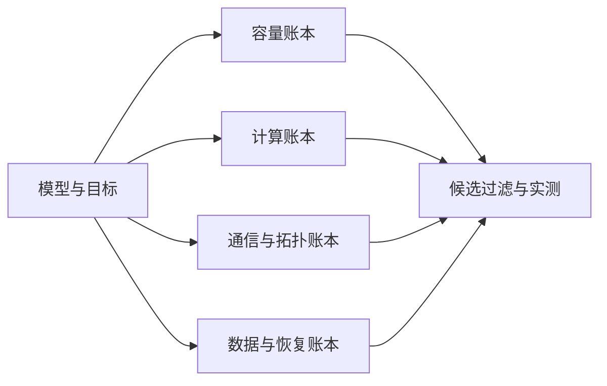

## 1. 本篇给设计过程，不给万能flags

模型大小相同，层数、GQA、FFN、长度分布和硬件仍可能不同。

因此以下五类任务都是带明确假设的教学设计。

配置需要在目标commit、依赖与拓扑上通过数值、容量和性能验证。

不把“候选可计算”写成“生产最优”。

## 2. 先写训练合同

| 类别 | 必须确定 |
|---|---|
| 目标 | 预训练、续训、长扩展或后训练 |
| 模型 | 层数、hidden、heads、FFN、专家结构 |
| 数据 | tokenizer、总token、来源与长度分布 |
| 优化 | optimizer、schedule、有效token batch |
| 平台 | 显存、节点内互联、NIC与存储 |
| 时间 | 截止日期与可用GPU-hours |
| 恢复 | RPO、RTO、checkpoint格式 |
| 验收 | 质量、短任务回归、性能与故障演练 |

缺少这些约束时，直接回答“TP=8”没有足够依据。

## 3. 所有候选共用四张账本



容量账本区分常驻、激活、临时聚合和通信buffer。

计算账本含线性项、attention pairs、重计算与MoE实际assignment。

通信账本记录group、shape、dtype、频率和暴露窗口。

恢复账本记录状态格式、数据游标、RNG及拓扑变更边界。

## 4. 并行度等式只在明确布局下使用

对正交dense布局：

$$
W=TP\times PP\times CP\times DP.
$$

SP常是TP组内激活布局，不再乘进W。

EP可能从数据并行及相关维度重新组织，不能总是再乘一次。

expert的ETP与EDP也需要单独核对。

每个候选应输出实际rank组，而不只输出乘积。

### 4.1 Batch定义

固定长度时：

$$
G=B_{micro}\times DP\times M.
$$

CP ranks协作处理同一序列，不是新的独立样本副本。

变长场景还需统计有效loss token。

## 5. 场景一：70B Dense、8K—32K

假设64卡、每节点8卡，BF16参数、FP32梯度与Adam状态。

先比较两套CP=1、普通DistOpt候选。

| 候选 | TP | PP | DP | TP/PP后参数Q | 状态近似 |
|---|---:|---:|---:|---:|---:|
| A | 8 | 4 | 2 | 2.1875B | 26.25GB |
| B | 4 | 4 | 4 | 4.375B | 39.375GB |

状态使用$Q(6+12/DP)$，只适用于本例CP=1且相应optimizer分组。

还未计激活、通信、workspace与stage不均。

### 5.1 手算A

$$
Q=70B/(8\times4)=2.1875B.
$$

DP=2时每参数状态为$6+12/2=12$字节。

所以状态约26.25GB。

### 5.2 为什么B可能仍值得测试

TP较小使每rank GEMM更大，可能提高计算效率并减少TP通信组规模。

DP增加还会改变microbatch数量与PP bubble。

但状态更大，需要足够激活余量。

不能只因为A显存更低就宣布A更快。

## 6. 场景一的batch与bubble

设global batch=512、microbatch=2。

A的microbatch数为$512/(2\times2)=128$。

B为$512/(2\times4)=64$。

在理想等时PP=4模型下，bubble相对理想计算约为：

$$
\rho=(PP-1)/M.
$$

A约2.34%，B约4.69%。

这个简单模型未包含P2P、stage不均、VPP和overlap。

它用于提醒：增加DP会减少每副本microbatch，可能增加相对bubble。

### 6.1 主要验收

- TP组是否留在节点内高速域。
- 首末stage的embedding与LM head是否失衡。
- 激活checkpoint是否真正解决峰值。
- 参数AG是否被下一forward覆盖。
- 相同global token目标下的长期吞吐。

## 7. 场景二：70B Dense、128K阶段

这一阶段不能只修改seq_len。

attention二次项、激活和CP通信都更重要。

考虑256卡教学候选：

```text
TP=4, PP=4, CP=4, DP=4
4×4×4×4=256
```

每DP副本的一条128K序列由4个CP ranks协作。

每rank逻辑本地sequence约32K，具体zigzag或packed布局另定。

### 7.1 参数状态不会被CP自动除4

CP主要切序列与相关激活。

同一参数在CP成员间往往仍复制。

optimizer实际分片域可能合并DP与CP，因此必须用真实group size d计算：

$$
M=Q(6+12/d),\quad Q=70B/(4\times4)=4.375B.
$$

若d=4，约39.375GB；若实现确实使用d=16，则约29.531GB。

这两者是不同group假设，不能根据CP值直接选一个更小数字。

## 8. 场景二的通信与位置设计

比较P2P ring、AllGather和A2A型CP时，应记录实际本TP rank的KV宽度。

GQA的KV groups数量可能限制head分片方案。

TP下KV复制也可能让通信量不按全局KV heads简单相除。

同时要验收：

```text
全局position与RoPE recipe
causal与文档边界mask
跨CP切片labels
全局有效token分母
dropout与重计算RNG
```

### 8.1 长度课程

采用8K、32K、64K、128K桶可以分别测量容量与吞吐。

长桶占比按有效token定义，并另算attention计算占比。

每桶报告loss、任务能力与P99 step time。

平均token/s不能掩盖最长桶的失败。

## 9. 场景三：400B级Dense

假设1024卡，候选`TP=8,PP=16,DP=8,CP=1`。

每rank模型分片：

$$
Q=400B/(8\times16)=3.125B.
$$

DistOpt状态：

$$
3.125B\times(6+12/8)=23.4375GB.
$$

这个状态下界并不意味着训练简单。

16个PP stages带来更复杂的层划分、P2P、bubble与恢复。

### 9.1 Stage均衡

按层数平均分配并不保证时间相等。

embedding、output projection、不同attention形态与MoE层都可能改变成本。

应使用测得的每层forward/backward时间与显存存活信息做划分。

一个特别慢的末stage会限制整个pipeline。

## 10. 场景三的checkpoint预算

若完整训练状态按18 bytes/param粗算：

$$
400\times10^9\times18=7.2TB.
$$

真实checkpoint格式可能不保存完整grad buffer，也可能存在复制去重或额外元数据。

所以7.2TB是状态账本，不等于精确落盘大小。

需要列出实际保存对象，再测staging、写入、finalize与load峰值。

### 10.1 增加卡数之前

先在缩比模型或少节点验证单步数值与恢复。

再增加节点检查通信暴露与强缩放效率。

如果每次扩容都把global batch改变，性能比较同时改变了优化行为。

应明确是在固定任务强缩放，还是改变batch的弱缩放实验。

## 11. 场景四：1T总参数、约37B活跃MoE

总参数决定专家权重、optimizer与checkpoint容量。

活跃参数主要决定每token GEMM工作。

用1T代替37B估算主要线性计算，会放大约27倍。

但用37B估算总存储，又会严重低估容量。

### 11.1 双网格教学例子

假设256卡、PP=4，每stage有64卡。

dense侧可使用：

```text
TP=4, DP=16
4×16=64
```

expert侧可使用：

```text
ETP=1, EP=8, EDP=8
1×8×8=64
```

这说明expert并行是同一组设备的另一种组织视图。

不能把EP=8再乘到256卡上。

具体折叠与通信依赖需按框架实现核对。

## 12. MoE的容量与尾部

假设某层64个experts、EP=8、ETP=1。

每rank持有8个专家，但路由token数量不一定平均。

top-k平均assignment为：

$$
\bar n_e=kN/E.
$$

真正时间常受$\max_e n_e$或最慢rank总assignment影响。

还需区分dropless、capacity drop和padding策略。

### 12.1 简单尾部例子

8个rank期望各处理1000个assignment。

若某rank处理2400、其余约800，平均仍接近1000。

仅看平均token/expert会低估2.4倍局部工作量。

应记录per-expert与per-rank分布，以及A2A split matrix。

## 13. MoE的设计与验收

- EP组尽量匹配足够快的通信域，但要实际比较跨节点布局。
- ETP太大可能让expert GEMM过小，太小可能放不下权重。
- router的质量、均衡和dispatch性能分开评估。
- checkpoint用稳定expert identity描述，不依赖临时rank编号。
- 改变EP/ETP时同时验证optimizer状态与路由参数。
- 低精度或新optimizer先做缩比收敛对照。

MoE吞吐优化若通过丢弃更多token实现，需要报告质量与有效训练目标变化。

## 14. 场景五：百万上下文

这里用$S=2^{20}=1,048,576$表示1Mi-token，避免与十进制1M混用。

教学网格：

```text
1024卡
TP=4, PP=4, CP=32, DP=2
```

每CP rank约32768个序列位置，具体布局仍需因果均衡。

这只是shape上的可分割候选。

并不保证完整dense attention的计算预算可接受。

### 14.1 第一问应该是任务依赖

目标任务是否需要每层对全部百万token执行full attention？

如果检索能缩短输入，应建立RAG对照。

如果主要是局部依赖加少量远程证据，可以评估滑窗、全局层或路由稀疏。

若采用递归或混合架构，则需要新的状态并行与质量验证。

## 15. 场景五的成本转移

| 技术 | 主要解决 | 不自动解决 |
|---|---|---|
| FlashAttention | score物化与HBM流量 | dense二次FLOPs |
| CP | 序列激活分摊 | 模型学习远距依赖 |
| Recompute | 激活保存 | 计算预算 |
| CPU offload | HBM容量 | PCIe/NUMA带宽 |
| 稀疏attention | 部分pair计算 | 索引质量与任务能力 |
| 长度课程 | 控制长样本预算 | 最大长度本身的可运行性 |

任何方案都应记录把成本转移到了哪里。

把OOM修成数据搬运瓶颈不算完成性能优化。

## 16. 统一候选评分表

| 维度 | 硬约束或测量 |
|---|---|
| 形状 | head、FFN、layer与expert整除 |
| 容量 | 每阶段真实峰值 |
| 数值 | logits、loss、grad、update容差 |
| 通信 | 每组物理跨度与关键路径 |
| Batch | 有效token与优化语义 |
| 恢复 | 格式、游标、RNG与canary |
| 性能 | 长期goodput与time-to-quality |

先淘汰不合法与不可恢复候选，再对剩下的进行性能排序。

cost model只能筛选，真实benchmark负责校准。

## 17. 可运行候选检查器

```python
candidates = [
    {"name": "70B-A", "P": 70e9, "world": 64, "tp": 8, "pp": 4, "cp": 1, "dp": 2, "shard": 2},
    {"name": "70B-B", "P": 70e9, "world": 64, "tp": 4, "pp": 4, "cp": 1, "dp": 4, "shard": 4},
    {"name": "400B", "P": 400e9, "world": 1024, "tp": 8, "pp": 16, "cp": 1, "dp": 8, "shard": 8},
]
for c in candidates:
    assert c["world"] == c["tp"]*c["pp"]*c["cp"]*c["dp"]
    local_params = c["P"]/(c["tp"]*c["pp"])
    state_gb = local_params*(6+12/c["shard"])/1e9
    print(c["name"], state_gb)
assert 4*16 == 1*8*8
assert 4*4*32*2 == 1024
```

输出状态分别为26.25、39.375、23.4375GB。

这个检查器只验证显式输入的乘积和理论状态，不能自动证明head整除、后端支持或显存可运行。

## 18. 设计失败时的定位顺序

第一步区分初始化失败、容量失败、数值失败与性能失败。

第二步找第一个不满足的合约，而不是同时调整多个并行度。

第三步恢复最小正确baseline。

第四步只改变一个主要维度，保留同任务口径。

第五步把淘汰原因写入decision record。

### 18.1 最小decision record

```text
候选配置与实际group
容量预测与实测误差
算子和collective trace
数值与恢复结果
长短任务结果
长期吞吐
放弃原因与回滚点
```

## 19. 自测与详细答案

### 题1：为什么更大TP可能省显存却更慢？

本地GEMM变小，逐层通信占比增加，也可能跨节点。

应同时比较kernel效率、通信与峰值容量。

### 题2：CP=4能把全部模型状态直接除4吗？

不能，CP首先切序列和激活，参数可能仍复制。

optimizer是否借助DP+CP分片，要看实际group。

### 题3：MoE EP为何不能总乘进world size？

expert网格可能重用dense DP等设备维度。

应分别列dense与expert视图并验证都覆盖同一设备集合。

### 题4：1T MoE checkpoint为什么不能按37B active估算？

所有专家参数与必要optimizer状态都要保存。

active只描述每token选择的部分计算。

### 题5：每stage层数相同是否等时？

不一定，embedding、head、attention、MoE和长度配置会改变工作量。

需要每层时间与状态存活信息。

### 题6：候选模拟排名第一能直接开大训练吗？

不能，模型可能遗漏网络争用、kernel fallback和恢复成本。

应经过数值、真实数据、目标拓扑与故障canary。

## 20. 来源映射与一手证据

扩写指定综述13—14、17—18节；对照Megatron报告系统设计题1—15及公式底稿。

- [Megatron多维并行](https://arxiv.org/abs/2104.04473)。
- [MoE Parallel Folding](https://arxiv.org/abs/2504.14960)：不同层组织不同并行视图。
- [DeepSeek-V3](https://arxiv.org/abs/2412.19437)：MoE系统与算法协同案例，不作为本篇配置的实测依据。
- [ByteScale](https://arxiv.org/abs/2502.21231)：混合长度与动态划分案例。
- [SimAI](https://www.usenix.org/conference/nsdi25/presentation/wang-xizheng-simai)：用于理解性能模型与真实系统校准。

五类方案均为设计练习，未在64—1024卡集群运行，也未证明生产最优。
