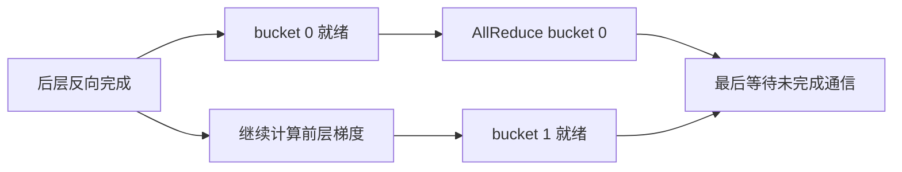

## 1. 把一次 AllReduce 拆到每一个数

AllReduce(sum) 的结果很简单：所有 rank 拿到逐位置的和。难点在于理解每张卡怎样在不收齐全部原始输入的情况下完成它，以及通信到底占用多少带宽。

本节用四个 rank、每个 rank 四个标量分片做完整推导。它是逻辑 Ring 的教学模拟，真实 NCCL 可能使用多个 channel、slice、协议和其他算法；不能从六个逻辑轮次推断实际只有六次 kernel launch。

### 1.1 输入和目标

| rank | chunk 0 | chunk 1 | chunk 2 | chunk 3 |
|---|---:|---:|---:|---:|
| 0 | 0 | 1 | 2 | 3 |
| 1 | 100 | 101 | 102 | 103 |
| 2 | 200 | 201 | 202 | 203 |
| 3 | 300 | 301 | 302 | 303 |
| 最终和 | 600 | 604 | 608 | 612 |

环方向为 `0 → 1 → 2 → 3 → 0`。每个 rank 只和左右两个邻居交换数据；chunk 编号表示数据位置，不代表当前持有它的 rank。

为了便于推导，下面每轮先读取所有发送端的旧状态，再统一更新接收端。这样不会发生 Python 按顺序循环时错误地使用“同一轮刚收到的新数据”。

## 2. ReduceScatter 的三个轮次

令 rank 为 $r$，轮次 $s$ 从 0 开始。发送给 $(r+1)\bmod4$ 的 chunk 编号是：

$$
c_{send}=(r-s)\bmod4.
$$

从前驱收到的 chunk 编号是 $(r-s-1)\bmod4$。接收端把收到的部分和**加到自己同一 chunk**，不是拼接到数组末尾。

### 2.1 第一轮的四次累加

| 接收 rank | 来自谁 | chunk | 本地值 + 收到值 | 更新后 |
|---|---|---|---|---:|
| 0 | 3 | 3 | $3+303$ | 306 |
| 1 | 0 | 0 | $100+0$ | 100 |
| 2 | 1 | 1 | $201+101$ | 302 |
| 3 | 2 | 2 | $302+202$ | 504 |

现在每个被更新的 chunk 含两个 rank 的贡献。下一轮继续把这些部分和传下去，而不是重新发送初始值。

### 2.2 第二轮和第三轮

第二轮，rank 0 把 chunk 3 的部分和 306 发给 rank 1，rank 1 加上自己的 103，得到 409。与此同时：

- rank 1 的 chunk 0=100 发给 rank 2，得到 $200+100=300$。
- rank 2 的 chunk 1=302 发给 rank 3，得到 $301+302=603$。
- rank 3 的 chunk 2=504 发给 rank 0，得到 $2+504=506$。

第三轮再加入最后一个贡献：

- chunk 0：rank 2 把 300 发给 rank 3，得到 $300+300=600$。
- chunk 1：rank 3 把 603 发给 rank 0，得到 $1+603=604$。
- chunk 2：rank 0 把 506 发给 rank 1，得到 $102+506=608$。
- chunk 3：rank 1 把 409 发给 rank 2，得到 $203+409=612$。

此时每个 rank 都掌握一个完整归约分片：

| rank | 已完成的 chunk | 值 |
|---|---|---:|
| 0 | 1 | 604 |
| 1 | 2 | 608 |
| 2 | 3 | 612 |
| 3 | 0 | 600 |

**这里的分片归属发生了循环偏移。** 这是所选环调度的内部所有权，不是 `reduce_scatter` 公共 API 的 rank 对齐输出约定。若要单独返回 ReduceScatter 结果，必须安排或转换到 API 要求的分片归属；作为 AllReduce 的内部阶段，只要后续正确分发即可。

## 3. AllGather 的三个轮次

每个 rank 从自己的完整分片开始向后转发。发送 chunk 编号改为：

$$
c_{send}=(r+1-s)\bmod4.
$$

这个阶段收到的是**已经完整的和**，必须复制覆盖对应 chunk，不能继续相加。

以 rank 0 为例：它最初已有 chunk 1=604，随后从 rank 3 依次得到 chunk 0=600、chunk 3=612、chunk 2=608，最终按索引排列为 `[600,604,608,612]`。

完整发送表如下，`c2=506` 表示发送 chunk 2，值为 506：

| 阶段 | 轮次 | rank 0 发出 | rank 1 发出 | rank 2 发出 | rank 3 发出 |
|---|---:|---|---|---|---|
| RS | 1 | c0=0 | c1=101 | c2=202 | c3=303 |
| RS | 2 | c3=306 | c0=100 | c1=302 | c2=504 |
| RS | 3 | c2=506 | c3=409 | c0=300 | c1=603 |
| AG | 1 | c1=604 | c2=608 | c3=612 | c0=600 |
| AG | 2 | c0=600 | c1=604 | c2=608 | c3=612 |
| AG | 3 | c3=612 | c0=600 | c1=604 | c2=608 |

表中的每一列都走同一个固定邻居：rank 0 发给 1，rank 1 发给 2，rank 2 发给 3，rank 3 发给 0。两阶段一共六轮，每个 rank 每轮发送和接收一个标量分片。

## 4. 从四个标量推广到任意字节数

设完整输入为 $M$ **字节**，$N$ 个 rank，每块 $M/N$ 字节。理想 Ring：

$$
V_{send}=2(N-1)\frac{M}{N},\qquad V_{recv}=V_{send}.
$$

| 口径 | 表达式 |
|---|---|
| 每 rank 发送 | $2(N-1)M/N$ |
| 每 rank 接收 | $2(N-1)M/N$ |
| 每 rank 发送加接收 | $4(N-1)M/N$ |
| 所有 rank 发送合计 | $2(N-1)M$ |

传输的是 tensor 的通信 dtype，不一定是 optimizer 使用的 dtype。7B 个 BF16 元素为 14 GB；同样数量的 FP32 元素为 28 GB。GB 按 $10^9$ 字节，GiB 按 $2^{30}$ 字节，报告中要写明。

大 $N$ 时每 rank 发送接近 $2M$，但总流量随 rank 数增加，通信轮数也增加。不能从“发送量渐近不变”推导“加卡没有通信代价”。

## 5. 延迟与带宽一起决定时间

一个简化单环模型为：

$$
T\approx2(N-1)\alpha+\frac{2(N-1)M}{NB_{eff}}.
$$

$\alpha$ 是每一轮的固定延迟，$B_{eff}$ 是对该发送口径实际可用的带宽。模型忽略了部分并行通道、协议细节、网络竞争和设备资源争用，用于量级判断。

### 5.1 一个有单位的算例

假设 $N=8,M=1\ \mathrm{GiB}=1073741824$ 字节，$\alpha=5\ \mu s$，$B_{eff}=50\ \mathrm{GB/s}$：

$$
V_{send}=1.75\ \mathrm{GiB},
\quad T_{latency}=70\ \mu s,
\quad T_{wire}\approx37.581\ \mathrm{ms}.
$$

合计约 **37.65 ms**。这是指定假设下的估算，不是某块网卡或本机的测量值。

若输入只有 4 KiB，带宽项极小，14 轮启动延迟就可能主导。Tree 等低轮数算法可能更合适；实际选择还受拓扑和实现影响。

### 5.2 algbw 与 busbw

NCCL Tests 把处理的输入字节除以时间称为 algorithm bandwidth。AllReduce 的 bus bandwidth 还乘上与算法数据搬运量相关的因子：

$$
B_{alg}=M/T,\qquad B_{bus}=B_{alg}\frac{2(N-1)}N.
$$

例如 8 rank、1 GiB、实测假设为 40 ms，则 $B_{alg}\approx26.84$ GB/s，$B_{bus}\approx46.98$ GB/s。它们来自同一次测量，只是归一化口径不同；不能把二者误当成两个链路的独立带宽。

也不能把 busbw 直接当成每条物理链路都达到该速率。对于多机多网卡，应说明聚合方式、拓扑和瓶颈端口。

## 6. Bucket 是启动延迟与重叠窗口的交换

DDP 不会等所有梯度都算完再统一做一次巨大归约。参数梯度被组织为 bucket；满足依赖后，一个 bucket 可以开始通信，而其他梯度继续计算。



| Bucket 大小 | 潜在收益 | 潜在代价 |
|---|---|---|
| 较小 | 较早开始通信，有更多重叠机会 | 更多通信启动、小消息效率低 |
| 较大 | 减少固定开销，带宽更容易利用 | 等待更多梯度，末尾暴露通信可能变长 |

假设反向计算共 50 ms，通信耗时合计 30 ms。如果全部在最后才开始，总时间约 80 ms；如果依赖和资源允许隐藏其中 20 ms，则总时间约 60 ms。不能直接取 `max(50,30)`，因为不一定在时间 0 就有全部梯度可发送。

重叠还可能争抢 GPU SM、HBM 或互联。应观察关键路径，而非仅看“通信 stream 和计算 stream 同时存在”。

## 7. 异步返回、等待与设备完成

这三个事件不能混为一谈：

1. Python/C++ 调用返回，CPU 线程可以继续。
2. 通信工作已提交，相关 stream 建立了依赖。
3. 设备完成运算，结果对后续消费者安全可用。

CPU/Gloo 上 `work.wait()` 与 CUDA/NCCL 上的 stream 同步语义不能机械等同。GPU 张量消费者若在不同 stream，必须遵循所用后端的依赖约定；CPU 要读取结果或结束计时，则需要确保设备完成。

教学模式：

```python
# x 为 CPU tensor，进程组为 Gloo；这是本章实验的范围。
work = torch.distributed.all_reduce(x, async_op=True)
# 只能在这里做不依赖 x 新值的工作。
work.wait()
# 现在再读取 x，避免与正在写入的通信工作竞争。
```

不要在异步通信完成前复用或修改发送 buffer，也不要把 host 调用耗时当作整个 GPU 集合通信耗时。

## 8. 怎样设计可比较的通信测试

建议记录以下实验条件：

| 项目 | 原因 |
|---|---|
| GPU/CPU、rank 数和物理拓扑 | 决定可用互联与竞争关系 |
| NCCL/Gloo、CUDA、框架版本 | API 相同不保证执行路径相同 |
| shape、dtype、reduce op、通信组 | 决定字节数与协议 |
| warm-up、迭代数、同步和计时边界 | 排除首次初始化并避免漏计异步时间 |
| algbw/busbw、发送/收发口径 | 防止带宽数值无法比较 |
| 各 rank 耗时及最大值 | 集体操作受慢 rank 约束 |

先检查结果，再测速度。小数组使用确定值，可以明确判断是求和、平均还是拼接。大随机张量则应建立独立 oracle 和误差容限，浮点归约顺序改变可能导致末位差异。

## 9. 实验与排障入口

纯标准库模拟：

```bash
python3 labs/distributed/mechanics_lab.py --output .local/ring-trace.json
python3 -m unittest discover -s labs/distributed -p 'test_*.py' -v
```

它输出上表完整轨迹，并对多个 rank 数检查最终和。真实两进程 Gloo 原语验证在 `labs/distributed/ddp_lab.py`，运行方式见第 4.3 节。

| 症状 | 首先核对 |
|---|---|
| 一个 rank 挂住，其他超时 | 最早异常、参与者集合与 collective 顺序 |
| 数字翻倍或重复累加 | AllGather 阶段是否误做加法、SUM 后是否多除/少除组大小 |
| 带宽比预期高两倍 | 是否混用了发送量、收发量和双向标称值 |
| 小 tensor 很慢 | 固定延迟、调度与初始化是否主导 |
| 加卡后更慢 | 强扩展计算窗口、跨机拓扑、慢 rank 与 bucket 就绪顺序 |

不要仅增加 timeout 掩盖参与者不一致。对真正的慢链路，应使用同一环境下的独立通信测试隔离训练计算。

## 10. 自测与参考答案

**1. RS 三轮结束后 rank 0 为什么持有 chunk 1？** 本文采用的发送索引是 `(rank-round)%N`，完成分片因此发生循环偏移。这是内部调度选择，不能冒充公共 API 的标准分片输出。

**2. AG 结束时如果结果比 600 大很多，最可能错在哪里？** 把完整归约分片继续加到旧部分和上了。AG 阶段应该复制覆盖。

**3. 8 rank、1 GiB 输入，每 rank 发送加接收是多少？** $4\times7/8=3.5$ GiB；所有 rank 的发送合计为 14 GiB。

**4. GPU 利用率高是否证明通信全被隐藏？** 不能。通信 kernel 本身也占 GPU，重叠可能抢资源；需要观察 optimizer step 的关键路径和末尾等待。

## 参考资料

- [NCCL Collective Operations](https://docs.nvidia.com/deeplearning/nccl/user-guide/docs/usage/collectives.html)：输入输出、rank 顺序与语义等价。
- [NCCL Tests performance](https://github.com/NVIDIA/nccl-tests/blob/master/doc/PERFORMANCE.md)：algbw/busbw 口径，源码默认分支会更新。
- [PyTorch 2.9 Distributed communication](https://docs.pytorch.org/docs/2.9/distributed.html)：异步操作与 stream 约定；本地实验版本另行记录。
- [PyTorch DDP design note](https://docs.pytorch.org/docs/2.9/notes/ddp.html)：bucket 的设计背景；该设计说明自身标注基于较早版本，不应视为当前实现所有细节。
