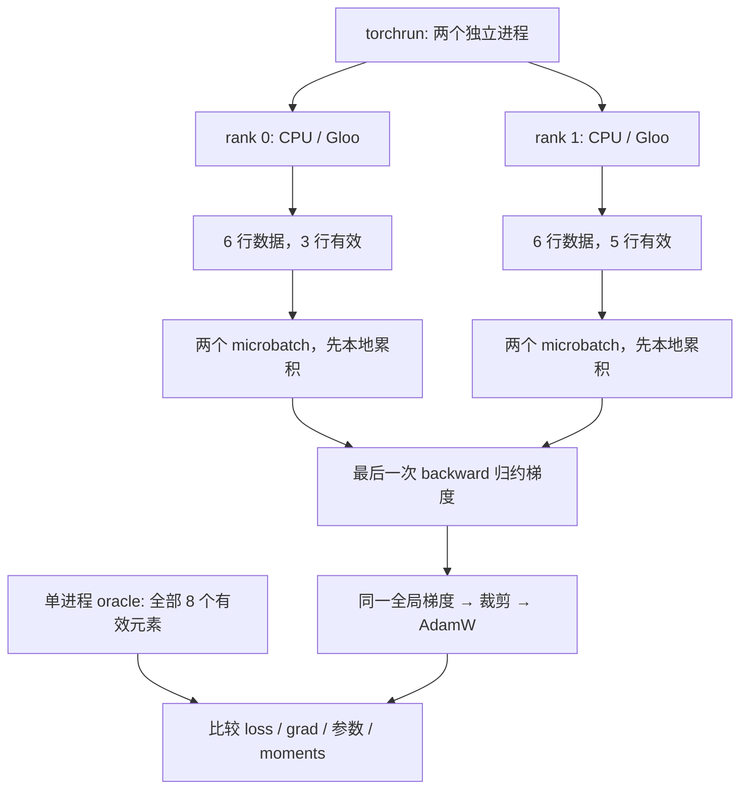

## 1. 先验证正确性，再讨论加速

多进程训练的第一份证据应该是“算出了同一个目标的梯度”，而不是“所有进程都启动了”。loss 看似下降，也不能排除每张卡实际在重复数据或使用错误归一化。

本节配套 `labs/distributed/ddp_lab.py`，通过 `torchrun` 启动两个独立 CPU 进程，真实执行 Gloo 通信和 PyTorch DDP。数据和模型都在脚本里生成，无需下载数据集或权重。

验证内容包括：

- 四种集合通信的实际输入与输出。
- 两个不同大小的有效数据分片，以及两个 microbatch 的梯度累积。
- `no_sync()`、全局有效元素均值与全局 norm clipping。
- 连续三次 AdamW 更新、优化器状态和模型副本一致性。
- 保存内存快照后恢复单进程 oracle 的 model 与 AdamW 状态。

最后一项是**内存状态恢复检查**，不包含磁盘提交、进程崩溃、分布式 checkpoint、RNG 或数据队列的完整恢复。这些属于第 11.2 节的扩展验收。

## 2. 环境与启动命令

需要具有 CPU/Gloo 支持的 PyTorch 环境。先检查准备使用的解释器：

```bash
python -c "import torch; print(torch.__version__); print(torch.distributed.is_gloo_available())"
```

从仓库根目录执行：

```bash
python -m torch.distributed.run --standalone --nproc-per-node=2 \
  labs/distributed/ddp_lab.py \
  --output labs/distributed/results/latest-ddp.json
```

`--standalone` 为本机教学任务提供独立会合服务，`--nproc-per-node=2` 启动两个进程。本实验主动要求 world size=2，传其他值会失败，因为数据分片例子就是按两 rank 设计的。

### 2.1 多个 Python 环境怎样选择

系统 `python3` 没有 torch，不代表整台机器没有 PyTorch。检查你实际准备使用的虚拟环境，始终让安装依赖、运行脚本和 `torch.distributed.run` 使用同一个解释器。

仓库提供 npm 入口：

```bash
# 环境已经激活，python3 能导入 torch 时：
npm run lab:ddp

# 或显式指定自己的解释器路径：
AIINFRA_PYTHON=/path/to/your/environment/bin/python npm run lab:ddp
```

第二条中的路径是占位示例，必须替换。runner 不自动安装依赖，也不访问 GPU。若暂时没有 PyTorch，可先运行纯标准库实验：

```bash
npm run test:distributed
npm run lab:distributed
```

纯标准库部分模拟 Ring、TP 矩阵与在线 softmax，用于数学核对，不能代替下面真实多进程通信的证据。

## 3. 全局 rank、数据和模型的对应关系



模型只有一个 `Linear(2,1)`，三个可训练参数。初始化为：

$$
w=[0.1,-0.2],\qquad b=0.05.
$$

目标由固定规则生成：

$$
y=0.7x_0-0.4x_1+0.2.
$$

使用 float64 是为了让数值误差很小，突出分布式缩放错误；生产 BF16 的合理容限需要另行确定。

## 4. 四种通信的预期输出

首先执行 `check_collectives()`，所有 rank 按相同顺序参与四种 collective。

### 4.1 AllReduce

rank 0 输入 `[1.0]`，rank 1 输入 `[2.0]`，执行 SUM。两者均应拿到 `[3.0]`。代码使用 `async_op=True` 后 `work.wait()`，展示 CPU/Gloo 上先等通信完成再读结果的方式。

### 4.2 AllGather

输入分别为 `[0]` 和 `[1]`，每个 rank 均应得到 `[0,1]`。这个操作只按 rank 顺序拼接，不做求和。

### 4.3 ReduceScatter

输入分别是 `[0,1]` 和 `[10,11]`，先逐位置求和得到 `[10,12]`，再按 rank 分片：

| rank | 获得的分片 |
|---|---:|
| 0 | 10 |
| 1 | 12 |

这里使用真正的 `reduce_scatter_tensor`，其返回分片按 rank 对齐。第 2.2 节教学 Ring 内部阶段的循环偏移不能直接当作这个 API 的输出布局。

### 4.4 All-to-All

输入仍为 rank 0 的 `[0,1]` 与 rank 1 的 `[10,11]`。每个输入数组的第 $j$ 项发给目标 rank $j$：

| 接收 rank | 来自 rank 0 | 来自 rank 1 | 输出 |
|---|---:|---:|---|
| 0 | 0 | 10 | `[0,10]` |
| 1 | 1 | 11 | `[1,11]` |

这就是专家路由中“每个源向每个目的发不同数据”的最小例子；真实 MoE 还需要 token permutation、变长 split、专家计算和逆排列。

## 5. 数据 mask 是实验的关键

每 rank 有六行输入，切成两个三行 microbatch。mask 为：

```text
rank 0: [1,1,0 | 1,0,0]   有效数 3
rank 1: [1,1,1 | 1,1,0]   有效数 5
```

所有输入均参与前向，但只选 mask 为真的元素构造训练目标。全局有效数通过一次整型 AllReduce 得到 8。

期望目标是全局八个有效平方误差的均值：

$$
L=\frac18\sum_{valid}(\hat y-y)^2.
$$

因此局部每个 microbatch 使用 `loss_sum * world / global_count`。DDP 在归约时平均 rank 梯度，最终缩放为 $1/8$。推导见第 3.2 节。

## 6. 单进程 oracle 怎样建立

同一个进程里再创建一份相同初值的模型，把两 rank 的数据与 mask 拼在一起，直接计算全局均值目标。

这不是在比较“两个实现都使用相同局部归一化”。oracle 没有 DDP，也没有 microbatch 累积，计算路径足够不同，能发现丢失 world size 或分母错误。

```python
all_x = torch.cat([dataset(r)[0] for r in range(world)])
all_y = torch.cat([dataset(r)[1] for r in range(world)])
all_mask = torch.cat([dataset(r)[2] for r in range(world)])
reference_loss = ((oracle(all_x) - all_y).square().flatten()[all_mask]).mean()
reference_loss.backward()
```

真实 DDP 路径做两次 backward，但第一次的 forward/backward 都位于 `no_sync()` 内。同步完成后、裁剪之前，逐参数比较 `.grad`，否则裁剪可能掩盖某些尺度错误。

## 7. 为什么还要故意运行一个错误版本

脚本另建模型，先对各 rank 的局部有效元素求均值，再平均两个 rank 的梯度。这是一个在普通等长数据上容易漏检的错误。

当前数据上，它相对全局 oracle 的最大梯度偏差约为 **0.0620833**。脚本断言这个偏差大于 $10^{-3}$，确保实验确实能识别错误，而不是数据巧合使错误公式也通过。

正确版本的对应误差只有约 $1.11\times10^{-16}$。两者相差的原因是目标权重，而不是 Gloo 不准确或 float64 更容易收敛。

## 8. 更新、优化器状态与副本检查

得到正确梯度后，分布式路径与 oracle 都执行一次 norm=0.2 的全局梯度裁剪，再执行 AdamW，学习率=0.01，weight decay=0.02。

每步比较：

- 更新前全局 mean loss。
- 裁剪前梯度。
- 更新后模型参数。
- Adam 的 `step`、`exp_avg`、`exp_avg_sq`。

只比第一步参数不够，因为后续错误可能隐藏在优化器状态里。脚本连续执行三步，确保动量真正被使用。

最终再 AllGather 各 rank 的参数，检查两个 DDP 副本完全一致。两个副本一致只是必要条件：错误梯度也可能在两者之间一致，所以必须同时与独立 oracle 比较。

## 9. 参考运行记录

参考结果保存在 `labs/distributed/results/reference-ddp.json`，环境为 Python 3.12.13、PyTorch 2.13.0+cu132，实际使用 CPU/Gloo，没有调用 CUDA 训练。

| step | 全局 mean loss | 最大梯度误差 | 最大参数误差 |
|---:|---:|---:|---:|
| 1 | 0.1378 | $1.11\times10^{-16}$ | $6.94\times10^{-18}$ |
| 2 | 0.12143014696 | $1.11\times10^{-16}$ | $1.39\times10^{-17}$ |
| 3 | 0.10610377756 | $5.55\times10^{-17}$ | $1.39\times10^{-17}$ |

三步后的参数约为：

```text
w0 =  0.12993547193372562
w1 = -0.16988492183421666
b  =  0.0799626554733823
```

测试容限为 $10^{-12}$，只针对该小型 float64 任务。更换硬件、dtype、优化器或算子，需要结合目标与独立基准重新确定容限。

## 10. 恢复检查覆盖了什么

第一步更新后，脚本深复制 oracle 的 `state_dict` 与 optimizer 状态，创建新模型和新 AdamW，再继续计算第二、三步。与不中断 oracle 的参数与 optimizer state 完全一致。

这个实验确认：恢复模型和 AdamW 状态后，**在固定输入、确定性计算下**可以继续同一更新链。

它不声称：

- JSON、磁盘 checkpoint 或多 rank 分片已经持久化。
- 中途杀进程后可以恢复网络或通信组。
- dropout、随机数据顺序、异步队列已经恢复。
- 改变 DP/TP/PP 后逐 bit 相同。

这些扩展应逐项添加证据，不能由一个内存 `load_state_dict` 成功推出。

## 11. 三个可控练习

建议先复制实验到 `.local/` 中修改，保留参考版。

| 练习 | 修改 | 应观察的现象 |
|---|---|---|
| 分母错误 | 去掉局部 loss 中的 `world` | DDP 又平均一次，梯度缩小两倍，oracle 检查失败 |
| 累积错误 | 每个 microbatch 前清梯度 | 前半段贡献丢失，与全 batch 目标不同 |
| 恢复错误 | 不加载 optimizer state | 后续 moments/参数与不中断 oracle 不同 |

不要通过让某个 rank 跳过 collective 来做无超时的演示。脚本进程组有 60 秒超时，但正常数值实验不需要制造长时间 hang。

## 12. 自测与参考答案

**1. 为什么不用两条完全相同的数据分片？** 那样错误的数据切分或局部均值可能恰好得到相同梯度；不等有效数和不同输入能暴露问题。

**2. loss 归约为什么传总和与总数，而不是各 rank 的均值？** 总和/总数保留每个有效元素相同权重，均值的平均会无意让每个 rank 同权。

**3. 两个 rank 参数相同，能证明训练正确吗？** 不能。它们可能同步了同一个错误梯度，还需检查目标和单进程 oracle。

**4. `torch.__version__` 含 cu132，是否说明实验用 GPU？** 不是。它描述安装包；脚本明确创建 CPU tensor 并使用 Gloo。设备和实际后端决定执行路径。

## 参考资料

- [PyTorch 2.9 DDP API](https://docs.pytorch.org/docs/2.9/generated/torch.nn.parallel.DistributedDataParallel.html)：DDP 的数据、归约与 `no_sync` 契约。
- [PyTorch distributed](https://docs.pytorch.org/docs/2.9/distributed.html)：集合通信及参与者规则。
- 本仓库 `labs/distributed/ddp_lab.py` 和 `results/reference-ddp.json`：本节实际执行与数值证据。
