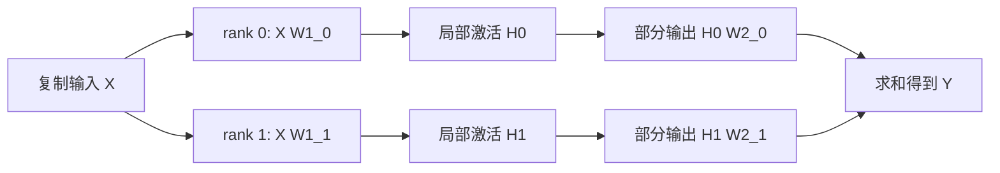

## 1. TP 切的是同一个算子的工作

数据并行让不同 rank 看不同样本；张量并行让一组 rank 合作处理**同一批样本的同一个层**。它们的进程组与通信语义不同。

考虑线性变换：

$$
Y=XW,\qquad X\in\mathbb R^{N\times H},\quad W\in\mathbb R^{H\times F}.
$$

这里 $N$ 可以是 batch 与 sequence 合并后的 token 数。先固定数学上权重为 `[输入维, 输出维]`；PyTorch `nn.Linear.weight` 实际存储为 `[输出维, 输入维]`，切分实现时必须做这个映射。

一份权重太大，或者中间激活太宽时，可以沿 $F$ 或 $H$ 切分。切哪个轴，决定了结果是“互不重叠的输出块”还是“还需要相加的部分和”。

## 2. Column Parallel：切输出特征

令 TP 组大小为 $K$，将权重按输出维切分：

$$
W=[W_0,W_1,\ldots,W_{K-1}],\qquad W_k\in\mathbb R^{H\times F/K}.
$$

每个 rank 拿到同一输入 $X$，本地计算：

$$
Y_k=XW_k.
$$

最终 $Y$ 是沿特征维拼接这些块，而不是把它们相加：

$$
Y=[Y_0,Y_1,\ldots,Y_{K-1}].
$$

### 2.1 为什么前向可以不通信

如果输入已经在 TP 组内复制，且下游接受输出特征分片，Column Parallel 前向不必立即 AllGather。

若每层后都把输出收集成完整 tensor，会丢掉很多 TP 的好处。真正的设计重点是让相邻算子保持兼容布局。

### 2.2 反向的输入梯度需要求和

上游给出各自的输出梯度块 $dY_k$：

$$
dW_k=X^T dY_k,\qquad dX_k=dY_kW_k^T.
$$

完整输入梯度为：

$$
dX=\sum_{k=0}^{K-1}dX_k.
$$

每个 $dX_k$ 都是相同 shape `[N,H]` 的**部分和**，不是互不重叠的 shard。因此这里需要归约求和；基础 TP 常用 AllReduce，使各 rank 再次拿到一致输入梯度。

## 3. Row Parallel：切输入特征

将权重按输入维切分，同时输入也沿特征维切分：

$$
W=\begin{bmatrix}W_0\\W_1\\\vdots\\W_{K-1}\end{bmatrix},
\qquad X=[X_0,X_1,\ldots,X_{K-1}].
$$

各 rank 计算：

$$
Z_k=X_kW_k,\qquad Y=\sum_k Z_k.
$$

这里 $Z_k$ 全部具有完整输出 shape，但每个 rank 只算了输入特征的一部分贡献。它们不能直接沿特征维 concat，必须相加。

### 3.1 反向为什么无需在同一位置再 AllReduce

所有 rank 已拥有相同的上游梯度 $dY$，则：

$$
dX_k=dYW_k^T,\qquad dW_k=X_k^TdY.
$$

$dX_k$ 是输入特征的真正分片，直接返回前一层对应分片即可。这里不需要重复汇总同一个 $dY$。

所以“前向有 AllReduce，反向就在原地再做一次 AllReduce”并不成立。通信要由逻辑张量的导数和布局推导。

## 4. 两层 MLP 为什么天然能配对

Transformer 的简化 MLP 为：

$$
H=\phi(XW_1),\qquad Y=HW_2.
$$

第一层采用 Column Parallel，得到 $H_k$；激活函数按元素计算，不需要知道其他分片。第二层采用 Row Parallel，正好消费 $H_k$。



两层之间没有必要先 AllGather 中间激活，再重新切开。若激活函数需要跨特征归约，如某种全特征归一化，则需额外分析，不可直接套用“激活函数都免费”。

## 5. 手算一个 TP=2 的完整前向

取一行输入：

$$
X=[1,2],\quad
W_1=\begin{bmatrix}1&0&2&-1\\0&1&1&1\end{bmatrix},
\quad
W_2=\begin{bmatrix}1&0\\0&1\\1&1\\2&-1\end{bmatrix}.
$$

使用 ReLU，第一层所有输出都为正，便于核对反向：

$$
XW_1=[1,2,4,1],\qquad H=[1,2,4,1].
$$

按中间维分给两张逻辑卡：

| rank | $W_1$ 列分片 | 本地 $H_k$ | $W_2$ 行分片 | 部分输出 |
|---|---|---|---|---|
| 0 | 前两列 | $[1,2]$ | 前两行 | $[1,2]$ |
| 1 | 后两列 | $[4,1]$ | 后两行 | $[6,3]$ |

最后相加：

$$
Y=[1,2]+[6,3]=[7,5].
$$

全矩阵计算 $HW_2$ 也得到 `[7,5]`。注意这里参与相加的是两个完整输出形状的部分贡献。

## 6. 沿同一个例子走反向

假设损失对输出的梯度为：

$$
dY=[1,-1].
$$

### 6.1 第二层的梯度

$$
dH=dYW_2^T=[1,-1,0,3].
$$

各 rank 只需各自权重行，分别得到：

```text
rank 0：dH0 = [1, -1]
rank 1：dH1 = [0, 3]
```

权重梯度是外积：

$$
dW_2=H^TdY=
\begin{bmatrix}1&-1\\2&-2\\4&-4\\1&-1\end{bmatrix}.
$$

每个 rank 计算自己持有的两行，不需要在 TP 组内归约这些互不重叠的参数梯度。

### 6.2 第一层的梯度

由于 ReLU 输入全为正，$d(XW_1)=dH$：

$$
dW_1=X^TdH=
\begin{bmatrix}1&-1&0&3\\2&-2&0&6\end{bmatrix}.
$$

每个 rank 得到自己的两列。输入梯度则不同：

```text
rank 0：dX0 = [1, -1]
rank 1：dX1 = [-3, 3]
求和： dX  = [-2, 2]
```

完整公式 $dX=dHW_1^T$ 也是 `[-2,2]`。这一处归约就是 Column Parallel 反向的关键通信。

### 6.3 一张前反向速查表

| 操作 | 本地结果的逻辑含义 | 基础 TP 的通信 |
|---|---|---|
| Column 前向 | 输出特征 shard | 下游接受 shard 时无通信 |
| Column 反向输入梯度 | 完整输入梯度的部分和 | AllReduce |
| Row 前向 | 完整输出的部分和 | AllReduce |
| Row 反向输入梯度 | 输入特征 shard | 无额外 TP 归约 |

参数梯度还可能需要在**对应 DP 组**内归约，因为不同数据副本计算了同一逻辑参数 shard 的不同样本梯度。那不是上表中的 TP 归约。

## 7. Autograd 中的复制与求和不能机械互换

Megatron 为布局边界定义了与逻辑模型相符的前反向规则。典型映射可概括为：

```text
进入 TP 分支：前向 identity，反向 sum
离开 TP 部分和：前向 sum，反向 identity
```

为什么第二条不是“sum 的导数还是 sum”？因为离开边界后的逻辑输出虽然物理复制，但表示的是**同一个逻辑损失的同一份梯度**。如果把每个复制副本再作为独立贡献求和，会多乘 TP 组大小。

这不是说任意数学 AllReduce 的自动微分都应是 identity。具体规则取决于复制 tensor 代表一个逻辑值，还是多个独立损失的输入。

因此手写 TP 时，不能把普通 `dist.all_reduce(tensor)` 插进计算图就假定反向完整正确。需要经过验证的 differentiable collective、DTensor 布局规则或自定义 autograd 映射。

## 8. Transformer 里的 Attention 与 SwiGLU

### 8.1 Attention 的 head 切分

Q/K/V 投影可以按 head/特征切分。若每个 head 的注意力独立、序列输入完整，则每个 rank 能计算自己的注意力 head，再由输出投影组合。

基础 dense Transformer block 通常具有两对“Column → 本地计算 → Row”：一对在 Attention，另一对在 MLP。

因此经典无 SP 路径常出现前向 2 次、反向 2 次 TP AllReduce。但这是基于特定 block 结构与布局的计数，不包含 embedding、loss、GQA 特例和融合改写。

### 8.2 SwiGLU 的两个输入投影

SwiGLU 形如：

$$
H=\operatorname{SiLU}(XW_g)\odot(XW_u),\qquad Y=HW_d.
$$

$W_g$ 与 $W_u$ 应沿相同中间维切分，使同一 rank 拿到相同特征范围的 gate/up 输出，才能本地点乘。随后 $W_d$ 按匹配的输入行切分。

如果两个投影的分片顺序不同，shape 可能仍能广播成功，但数学上已经把不同特征错配。

### 8.3 Bias 何时加

Row Parallel 的输出 bias 是完整逻辑输出的一份偏置。若每个 rank 在部分输出中都加完整 bias，再 AllReduce，会得到 $K$ 倍 bias。

可在归约后只按逻辑语义加一次，或让实现采用明确等价的分摊方案。列并行 bias 则通常跟随输出特征一起分片。

## 9. TP 的通信字节量怎样估算

设激活 shape 为 `[b,s,h]`，每元素 $d_a$ Bytes，完整通信张量：

$$
A=bshd_a.
$$

理想 ring AllReduce 每 rank 发送量为：

$$
2\frac{K-1}{K}A.
$$

经典 block 每轮前反向合计 4 次这样的归约，则：

$$
V_{block}\approx8\frac{K-1}{K}A.
$$

取 $b=1,s=2048,h=4096,d_a=2,K=4$：

```text
完整激活 A = 16 MiB
一次 AllReduce 每 rank 发送 = 24 MiB
一个 block 前反向四次 = 96 MiB
```

只统计前向则是 48 MiB。发送与接收量在对称 ring 下各有一份，不能把收发合计不加说明地叫单向传输量。

## 10. 为什么 TP 增大后可能更慢

TP 增大后，本地矩阵更窄，计算量减少，但激活归约的完整张量大小未必按相同比例缩小。

同时还可能出现：

- 小 GEMM 效率下降，Tensor Core 利用率降低。
- collective 启动延迟占比上升。
- 更多 rank 争用网络和内存带宽。
- head 数、FFN 维度或词表无法均匀切分。

所以 TP 常优先映射到高带宽、低延迟域，但**不是只能使用 NVLink，也不是只能放在单机 8 卡内**。跨节点 TP 在合适网络和规模下可以成立，必须由实际计算/通信比决定。

## 11. CPU 数学核对代码

下面只验证两卡逻辑切分的前向，不创建进程组：

```python
x = [1, 2]
w1 = [[1, 0, 2, -1], [0, 1, 1, 1]]
w2 = [[1, 0], [0, 1], [1, 1], [2, -1]]
h = [max(0, sum(x[i] * w1[i][j] for i in range(2)))
     for j in range(4)]
partial = []
for rank in range(2):
    indices = range(2 * rank, 2 * rank + 2)
    partial.append([sum(h[i] * w2[i][j] for i in indices)
                    for j in range(2)])
y = [sum(row[j] for row in partial) for j in range(2)]
assert h == [1, 2, 4, 1]
assert partial == [[1, 2], [6, 3]]
assert y == [7, 5]
print(h, partial, y)
```

下一节会在布局层面加入 SP，并给出 PyTorch TP 配置路径。

## 12. 自测与参考答案

**1. 两个 shape 相同的本地输出，如何判断需要拼接还是相加？**

看它们覆盖的逻辑索引。不同输出特征范围是 shard，应拼接；相同输出索引上的不同输入贡献是部分和，应归约。

**2. 为什么参数梯度不在 TP 组中一律 AllReduce？**

大部分 TP 参数在不同 rank 上对应不同逻辑元素；把它们相加会混淆参数。相同 shard 的数据副本梯度应在 DP 组处理。

**3. 前向两次 AllReduce 是否意味着反向在原位各做一次？**

不是。Column 的输入梯度与 Row 的部分输出分别形成归约边界，应由链式法则与布局推导。

**4. TP=4 时 Row bias 在四个部分和里都加了一次，会发生什么？**

归约后得到四倍 bias。应调整偏置插入位置或采用等价的分摊设计。

## 参考资料与源码入口

- [Megatron-LM 原论文](https://arxiv.org/abs/1909.08053)：两层线性配对与模型并行边界。
- [固定快照 mappings.py](https://github.com/NVIDIA/Megatron-LM/blob/7d6895ac6a3ee9e16c53f573f363d2a52b88bf94/megatron/core/tensor_parallel/mappings.py)：`_CopyToModelParallelRegion` 与 `_ReduceFromModelParallelRegion` 的前反向语义。
- [同快照 layers.py](https://github.com/NVIDIA/Megatron-LM/blob/7d6895ac6a3ee9e16c53f573f363d2a52b88bf94/megatron/core/tensor_parallel/layers.py)：`ColumnParallelLinear`、`RowParallelLinear`、输入梯度归约及 SP 分支。
- [PyTorch TP 官方教程](https://docs.pytorch.org/tutorials/intermediate/TP_tutorial.html)：用 DTensor/ParallelStyle 表达分片布局。

源码核对日期为 2026-10-30；本节矩阵与通信数值是教学推导，没有作为实际多卡吞吐结果。
