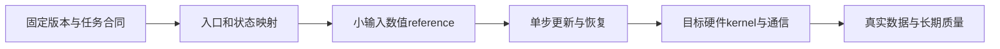

## 本章解决的问题

熟悉Megatron并不等于已经理解全部训练生态。

其他系统可能把并行布局交给DTensor、把模型状态拆成JAX PyTree，或使用插件调用现有后端。

同一个“训练框架”名称下，还可能存在开发主干、稳定包、历史入口和硬件分支。

本章从真实对象、入口与状态出发比较它们。

目标是能判断一个模型怎样接入、哪种配置需要验证，以及哪些状态可以迁移。

## 四篇专题

### 17.1 TorchTitan与原生PyTorch训练生态

从固定Python recipe、ConfigLoader、Trainer与TrainingEngine开始。

解释DeviceMesh、声明式分片与不同数据复制视图。

再追踪训练step、optimizer、DCP完整checkpoint和weights export。

正文给出mesh与状态数例，并区分开发快照和verified recipe。

### 17.2 MaxText与JAX的分片和训练系统

先区分物理mesh、模型逻辑轴与NamedSharding。

沿当前NNX GraphDef/State、训练step、Optax、Grain与Orbax理解状态。

解释编译缓存、异步执行计时、RNG与数据iterator恢复。

源码固定到本轮核对的NNX版本，不沿用已迁移的旧入口。

### 17.3 开放训练框架选型与集成契约

逐项展开Nanotron、OLMo-core、Colossal-AI、InternEvo、FlagScale和LLM Foundry。

每项明确对象、源码入口、并行职责、恢复合约与适用边界。

用token batch单位和weights/full resume反例检查跨框架迁移。

同时记录仓库迁移、归档与plugin版本关系。

### 17.4 AMD、TPU、Trainium与异构训练边界

把设备、编译器、kernel、collective和checkpoint组成平台能力矩阵。

解释ROCm/HIP/RCCL、TPU/JAX以及Neuron/NxD的职责。

不同厂商混合训练需要显式跨后端通信与状态协议。

不能以相同PyTorch API或相同dtype名称推断完整兼容。

## 统一比较框架

| 对象 | 应回答的问题 |
|---|---|
| 入口 | 谁读取配置，谁构造模型，谁驱动step |
| 模型 | 参数名、shape、tied weight与自定义模块怎样表达 |
| 布局 | 全局tensor与local shard由谁维护 |
| 执行 | eager、图捕获、编译与通信如何协作 |
| 更新 | 梯度归约、optimizer与schedule属于谁 |
| 数据 | batch单位、sampler与有效token怎样计数 |
| 恢复 | model、moments、RNG、游标能否共同恢复 |
| 后端 | 哪些硬件、kernel与精度组合有证据 |

一个框架可在部分行非常强，却不自动覆盖所有需求。

选型应由训练任务合同驱动。

## 两个必须分开的迁移

第一种是模型函数迁移。

它要求权重映射、QKV布局、norm、position与输出在容差内一致。

第二种是训练状态迁移。

它还要求optimizer、scheduler、RNG和数据进度具有相容语义。

weights-only转换成功，只完成了第一种的一部分。

## 同名字段的单位问题

某个框架的global batch可能按样本计。

另一个框架可能按token计。

microbatch可能是每rank、每副本或整个mesh的量。

训练时长可能使用steps、epochs、samples或tokens。

迁移前应写出单位和换算公式，而不是直接复制数值。

## 从源码核对到目标平台实验

不同平台的初始化、编译和首次加载成本也要计入。

不能只比较已经预热的最短kernel时间。

## 本轮发现的版本变化

TorchTitan的当前源码采用Python recipe及新的分片组织。

MaxText的当前源码已使用NNX与新的目录入口。

FlagScale官方地址和插件分工发生过迁移。

LLM Foundry官方仓库在本轮查询中已归档。

这些事实都有固定SHA或官方来源，不从旧资料的名称列表推断当前状态。

具体依赖和能力以各专题证据表为准。

## 学习产物

- 一张各框架的对象与入口调用图。
- 一份同一模型的logical tensor schema。
- 一张样本、token与累积步数单位表。
- 一份完整resume与weights export差异表。
- 一张硬件、kernel、dtype、collective与恢复能力矩阵。
- 一个小输入的forward、grad和update对照。

这些产物比一个简单的“支持/不支持”列表更便于复核。

## 学习验收

1. 说明TorchTitan与PyTorch分布式组件的分工。
2. 从NamedSharding推导一个tensor的local shape。
3. 解释NNX模型图与持久变量状态为什么需要分开。
4. 找到一个框架的真实step与checkpoint入口。
5. 正确换算不同框架的token batch与样本batch。
6. 区分统一runner、硬件plugin和底层训练实现。
7. 解释跨硬件迁移为何不能只换device字符串。
8. 列出当前机器能够验证与尚未验证的层次。

## 来源与实验边界

本章补齐指定综述§8.3、§8.8、§11.1—11.5的生态维度。

每篇单独记录实际读取的官方版本与代码路径。

原资料的2026-08截点与本轮2026-11核对分开。

CPU oracle用于layout、计数、成本和恢复关系。

没有安装并运行全部框架，也没有进行跨厂商集群训练。

官方报告的性能属于其硬件和配方，不是本机复现结果。

## 一手参考入口

- [TorchTitan](https://github.com/pytorch/torchtitan)。
- [MaxText](https://github.com/AI-Hypercomputer/maxtext)。
- [PyTorch DTensor](https://docs.pytorch.org/docs/stable/distributed.tensor.html)。
- [JAX显式分片](https://docs.jax.dev/en/latest/notebooks/explicit-sharding.html)。
- [AMD ROCm文档](https://rocm.docs.amd.com/)。
- [AWS Neuron文档](https://awsdocs-neuron.readthedocs-hosted.com/en/latest/)。

这些是生态入口，正文使用更具体的固定版本证据。
