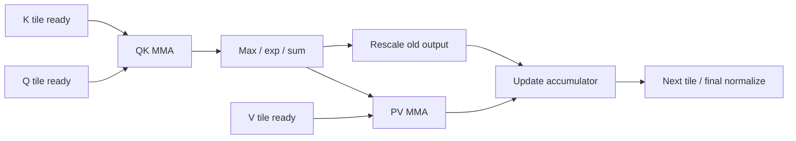

## 1. 为什么降低 HBM 流量之后还要继续优化

FA1/FA2已经避免把完整attention score写入HBM。
但一个tile仍需依次经历QK、softmax、PV和输出重标度。
Tensor Core变快后，指数、reduction、片上搬运和同步可能成为主导项。
FA3/FA4的重要变化，是围绕这些执行单元重新安排工作。

本节从用户参考资料的论文表重新访问：

- [FA3 原论文v1](https://arxiv.org/html/2407.08608v1)：Hopper异步执行与低精度。
- [FA4 原论文v1](https://arxiv.org/html/2603.05451v1)：Blackwell非对称硬件增长下的算法/流水设计。

实现额外固定为官方仓库`Dao-AILab/flash-attention`的`7c53542eab6a1c4fe760d1101b8d57d6307d1dbe`，提交日期2026-11-06。
论文版本、该源码快照和某服务引擎实际backend是三层证据。
本机未运行Hopper/Blackwell kernel；下文只有CPU数学与资源oracle。

## 2. 不变的数学目标

对一个query tile：

$$
S_j=Q_iK_j^\top/\sqrt d,\qquad
O_i=\operatorname{softmax}(S)V.
$$

分块实现维护行最大值m、指数和l、未归一化输出u。
新块最大值为b，取 $m'=\max(m,b)$：

$$
l'=e^{m-m'}l+\sum_t e^{S_{j,t}-m'},
$$

$$
u'=e^{m-m'}u+\sum_t e^{S_{j,t}-m'}V_{j,t}.
$$

最后 $O=u/l$。
这是精确dense attention的分块重排，不减少全局query-key交互的二次项。
低精度、指数近似和执行次序则需要单独数值验证。

## 3. 一个 tile 的依赖图



同一tile的softmax不能早于QK结果，PV不能早于概率。
因此异步指令不会消除数据依赖。
想隐藏等待，需要跨tile、跨query tile或跨warpgroup寻找独立工作。
还必须多保存一些中间状态。

## 4. FA3：生产者与消费者分工

Hopper提供TMA和异步WGMMA等能力。
生产者warp负责发起较大块的数据搬运，消费者负责MMA与softmax。
这与让同一批线程反复“搬→等→算”不同。
TMA可以减少参与地址搬运的线程与寄存器压力，但仍需等待数据就绪。[Hopper指南](https://docs.nvidia.com/cuda/hopper-tuning-guide/index.html)

一个循环buffer的状态是：

```text
EMPTY
  → producer issues load
  → FILLING
  → transaction completes / ready barrier
  → READY
  → consumer reads
  → CONSUMING
  → last consumer completes
  → EMPTY
```

Producer不能仅因发出了load就宣布ready。
Consumer也不能在最后一次MMA读取结束前释放stage。
循环槽还需要正确的phase/代际，避免把上一轮的barrier误认成本轮完成。

### 4.1 固定源码对应点

`hopper/mainloop_fwd_sm90_tma_gmma_ws.hpp`定义K/V等pipeline状态和TMA transaction bytes。
源码根据布局/分页等条件选择TMA或其他受支持的搬运路径。
因此不能把“FA3使用TMA”扩展成“所有输入的每次搬运都用TMA”。
具体tile、GQA、paged KV和head维边界应以实例化的配置为准。

## 5. 两层重叠：跨 warpgroup 与跨迭代

FA3论文讨论两类互补安排。
一种让两个consumer warpgroup交替占用MMA与softmax资源。
另一种在同warpgroup中准备下一tile的QK，同时推进上一tile的PV和softmax相关工作。
它们都依赖额外buffer和精确wait位置。

示意时间线不代表真实cycle：

```text
时间窗口       0          1          2          3
Producer      load K0V0  load K1V1  load K2V2  load K3V3
Consumer A    QK A0      softmax A0 PV A0      QK A1
Consumer B               QK B0     softmax B0 PV B0
```

不同query tile之间可以有独立累加器。
同query的online statistics则仍要按逻辑顺序更新。
“ping-pong”表达资源交错，不允许交换因果mask或改变token位置。

### 5.1 Pipeline depth 的代价

取K/V tile为`128×128`、BF16。
每份K或V是32KiB，两者一个stage为64KiB。
两stage需要128KiB，三stage需要192KiB，尚未加Q及其他shared对象。

如果多保留一个FP32 score tile`128×128`，逻辑中间状态增加64KiB。
这类score主要涉及寄存器布局，不能直接与shared容量混成一项。
寄存器spill、共享容量、occupancy和tile大小一起限制可用深度。
阶段更多不一定更快。

## 6. FA3 的 FP8 是另一组约束

低位MMA更快，并不让softmax指数单元同比加速。
还要满足FP8 operand layout和accumulator转换规则。
论文用块级量化和incoherent processing改善相应误差分布。
这些属于数值/布局设计，不能简单写成把所有tensor cast成FP8。

需要分别验证：

| 项目 | 原因 |
|---|---|
| Q/K/V范围与scale | outlier与量程 |
| MMA输入/累加dtype | 实际指令和误差 |
| P的表示与转换 | 小概率和饱和 |
| Layout转换 | 额外搬运和寄存器 |
| 长序列误差 | 累加与softmax极值 |
| 模型质量 | 算子误差不等于任务质量 |

论文配置中的误差或速度不自动迁移到其他head维、模型或硬件。

## 7. FA4：瓶颈向指数与片上通路移动

FA4原论文主要分析B200/GB200：MMA吞吐增长快于部分非矩阵资源。
因此只把FA3原有tile搬到新卡，可能无法充分使用新增算力。
其设计同时调整MMA/softmax重叠、指数计算与重标度，以及反向的片上数据流。

官方固定CuTe目录README目前描述Hopper与Blackwell实现。
这不意味着论文中的SM100/TMEM/2-CTA路径适用于每个Hopper或所有Blackwell型号。
源码还分别有`sm90`、`sm100`、`sm120`文件，具体支持应看dispatch和配置校验。

### 7.1 当前 SM100 实现的角色

固定`flash_fwd_sm100.py`可见softmax、correction、MMA、load和epilogue的warp角色。
TMEM承载相应MMA结果/中间值，softmax与修正阶段按pipeline消费。
这是比“FA4更快”更可核验的描述：每个角色负责什么数据、等哪个事件。

```text
load warp       → Q/K/V shared tiles
MMA role        → score / output tiles in TMEM
softmax roles   → probabilities and row statistics
correction role → output rescaling
epilogue        → normalize / store
```

上述是固定SM100路径的角色概括，不是公共API或所有配置的线程数保证。

## 8. 指数函数也有资源选择

FA4论文使用部分软件指数计算，把一些工作分散到FMA/整数通路，而其余仍走硬件指数单元。
软件近似会增加寄存器、指令和不同误差，全部替换未必划算。
因此要比较完整softmax阶段，而不是只看单个exp实现。

数学上可分解：

$$
2^x=2^{\lfloor x\rfloor}2^{x-\lfloor x\rfloor}.
$$

整数部分对应指数尺度，小区间小数部分可做多项式近似。
本文不复制论文系数，也不声称普通Taylor多项式能替代其优化实现。
误差应在最终dtype、mask和任务上下文下验收。

## 9. 条件重标度为何仍能保持正确归一化

Online softmax并不要求每块都立即把参考尺度更新成当前最大值。
它要求分子u和分母l使用同一个尺度。
如果暂时保留旧尺度a，则新增贡献使用 $e^{S-a}$，旧u/l均不缩放。
需要换尺度到a'时，旧u和l同时乘 $e^{a-a'}$。

$$
\frac{c u}{c l}=\frac{u}{l}.
$$

因此跳过的是某些中间scale变更，不是忽略新score或只修正分母。
FA4源码使用log2尺度和阈值，不能把base-e阈值直接照抄过去。
更重要的是，参考尺度落后会让未归一化P超过1，必须检查存入低精度时是否溢出。

### 9.1 一个低精度反例

若附加offset=4、允许参考尺度落后8个log2单位，P可能达到 $2^{12}=4096$。
E4M3FN最大有限值448容纳不下它。
若P转换时饱和而FP32分母仍计入完整值，输出会被错误缩小。
固定`flash_fwd_sm100.py:87—100`专门解释了这个约束。
所以“最终归一化会消掉公共尺度”只在中间表示未破坏数据时成立。

## 10. CPU oracle：普通与延迟重标度

下面使用base-2 score与Python浮点，比较数学语义。
它不模拟BF16/FP8舍入，也不执行真实softmax kernel。

```python
import math

scores = [0,1,2,3,4,5,14,15]
values = [2,4,1,3,5,2,7,1]
blocks = [(scores[i:i+2],values[i:i+2]) for i in range(0,8,2)]

def online(threshold):
    anchor = None
    denom = numer = 0.0
    rescales = 0
    for ss,vv in blocks:
        top = max(ss)
        if anchor is None:
            anchor = top
        elif top-anchor > threshold:
            factor = 2.0**(anchor-top)
            denom *= factor
            numer *= factor
            anchor = top
            rescales += 1
        weights = [2.0**(x-anchor) for x in ss]
        denom += sum(weights)
        numer += sum(p*v for p,v in zip(weights,vv))
    return numer/denom,rescales

m = max(scores)
p = [2.0**(x-m) for x in scores]
reference = sum(w*v for w,v in zip(p,values))/sum(p)
ordinary,n0 = online(0)
delayed,n8 = online(8)
assert math.isclose(ordinary,reference,rel_tol=1e-14)
assert math.isclose(delayed,reference,rel_tol=1e-14)
assert (n0,n8) == (3,1)
assert 2**(4+8) > 448

stage_bytes = 2*128*128*2  # K+V, 128x128, BF16
assert stage_bytes == 64*1024
print("result",reference,"rescale_counts",n0,n8)
print("KV shared KiB for 2/3 stages",2*stage_bytes/1024,3*stage_bytes/1024)
```

代码验证保持同尺度的u/l可以减少重标次数。
真实GPU还需验证低精度范围、warp统一条件、mask与最后归一化。
不能把3次变1次直接当整kernel快3倍。

## 11. 反向为什么又是另一条流水

令 $P=softmax(\alpha QK^\top)$，上游梯度为dO：

$$
dV=P^\top dO,\qquad dP=dOV^\top,
$$

$$
D_i=\sum_jP_{ij}dP_{ij},\qquad dS=P\odot(dP-D),
$$

$$
dQ=\alpha dSK,\qquad dK=\alpha dS^\top Q.
$$

若不保存完整P，反向还要用Q/K与行统计重建它。
多个MMA、dS写入、dQ累加会改变shared/TMEM/原子操作的瓶颈。
不能用forward的最好tile直接推定backward最优。

FA4的2-CTA路径让配对CTA协作处理更大tile，减少部分重复片上访问与梯度累加开销。
配对必须在同一合法cluster模式下共同存活，不能只发一个CTA却使用跨CTA操作。
其dQ规约维与输出切分还需要额外重排/通信，原论文§3.2对此专门展开。

Deterministic backward需要定义累加顺序及相应存储/调度。
它不是跨所有GPU、版本与precision逐bit相同的普遍保证。

## 12. 故障与验证矩阵

| 触发 | 必须检查 |
|---|---|
| 环形buffer快速复用 | producer没有覆盖未消费stage |
| 尾tile/causal边界 | mask、合法load与统计初值 |
| 全mask行 | 不出现`-inf - -inf`错误传播 |
| 增加pipeline depth | shared/register/spill与实际时间 |
| 延迟重标+低精度P | 中间范围不饱和，u/l同尺度 |
| 2-CTA模式 | cluster、peer存活与barrier配对 |
| 反向并行累加 | dQ/dK/dV reference与确定性口径 |

遇到hang先检查barrier参与者、phase和最后消费事件。
遇到数值错误先固定输入，再分开比较QK、统计、P转换与PV。
不要把同步错误统称“FP8精度差”。

## 13. 六道追问与答案

### Q1：FA3/FA4把dense attention变成线性了吗？

没有。
它们改变存储、数据流和流水，完整dense交互的二次计算仍然存在。
低精度与指数近似也要单独说明数值边界。

### Q2：异步WGMMA为何还需要wait？

发出指令和结果可读不是同一时刻。
Softmax必须等QK，buffer复用必须等最后读者。
Wait应放在真实依赖处，而非每条指令后都串行等待。

### Q3：为什么Tensor Core更快后softmax更重要？

非矩阵资源没有按相同比例扩张。
同一attention工作中，指数/reduction/片上搬运占比会增加。
需要新的资源平衡，而非只追MMA峰值。

### Q4：延迟重标是否可以只改分母？

不可以。
分子与分母必须使用同一参考尺度，变更时一起缩放。
中间P转换不能溢出，否则最终除法无法修复饱和损失。

### Q5：更深流水为什么可能变慢？

更多stage和score提高shared/register压力，可能降驻留或触发spill。
调度与barrier也有开销。
必须结合实际shape做消融。

### Q6：RTX3090能验证哪些内容？

能运行数学oracle并学习tile、online softmax和支持的SM86路径。
不能把TMA/WGMMA/TMEM/SM100 2-CTA执行写成本机验证。
论文或仓库支持声明不能代替实际hardware capability检查。

## 14. 阅读路径与证据范围

先读FA3 §3.1—3.3，再读FA4 §3.1—3.2，最后对照固定代码。
训练综述§6.5给论文入口；推理宝典ATTN-001—006、KERN-017—026提供边界问题；Megatron报告模块B提醒“选择TE”不等于实际选中某FA kernel。

- [固定SM90主循环](https://github.com/Dao-AILab/flash-attention/blob/7c53542eab6a1c4fe760d1101b8d57d6307d1dbe/hopper/mainloop_fwd_sm90_tma_gmma_ws.hpp)：重点读276—293的pipeline及搬运条件。
- [固定SM100前向](https://github.com/Dao-AILab/flash-attention/blob/7c53542eab6a1c4fe760d1101b8d57d6307d1dbe/flash_attn/cute/flash_fwd_sm100.py)：读87—100的范围限制、310—350的角色与配置。
- [固定Softmax实现](https://github.com/Dao-AILab/flash-attention/blob/7c53542eab6a1c4fe760d1101b8d57d6307d1dbe/flash_attn/cute/softmax.py)：读305—410的阈值、row max/sum更新。
- [Blackwell官方指南](https://docs.nvidia.com/cuda/blackwell-tuning-guide/index.html)：型号间资源差异，不把全部Blackwell视为相同SM。

本节没有安装flash-attn、运行GPU profile或验证模型质量。
实现升级后须重查dispatch、支持矩阵和数值策略，不能把这里的行号当稳定API。
