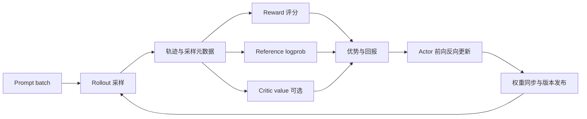

模型能续写文字，不等于能按要求完成任务。一个回答可能语法流畅，却答非所问；也可能最终答案正确，却调用了错误的工具。后训练要做的是把任务要求变成学习信号，再用这些信号调整已有模型。

从系统角度看，最重要的变化是**训练与生成形成闭环**。训练端更新参数后，推理端必须拿到相应版本的权重；推理端生成回答后，训练端必须知道这些回答由哪个策略、哪种采样设置产生。

本文先用一个简单问题贯穿流程，再逐层拆开角色和数据契约。

## 1. 同一个问题，四种训练方式

假设问题是“计算 17 + 25，只输出整数”。考虑三种回答：`42`、`43`、`答案是42`。

### 1.1 预训练：从文本统计中学习

预训练数据可能包含“17 + 25 = 42”。模型通过下一 token 预测学习文本规律：

$$
L_{\mathrm{pretrain}}=-\frac{1}{N}\sum_{t=1}^{N}\log\pi_\theta(z_t\mid z_{<t})
$$

这里 $z_t$ 是文本 token，$N$ 是参与损失的位置数。数据通常事先准备好，不需要每一步先让当前模型做题。

预训练损失下降说明模型更能拟合训练文本分布；它不直接保证“只输出整数”这个交互要求得到满足。

### 1.2 SFT：学习指定的示范回答

SFT 数据是一对问题与示范，例如：

```json
{"prompt": "计算 17 + 25，只输出整数", "answer": "42"}
```

训练时通常只在选定的 assistant 回答位置计算交叉熵：

$$
L_{\mathrm{SFT}}=-\frac{\sum_t m_t\log\pi_\theta(z_t\mid z_{<t})}{\sum_t m_t}
$$

$m_t\in\{0,1\}$ 表示该位置是否属于监督目标。是否监督所有 assistant 轮次、是否包含结束标记，取决于数据模板与训练设置，必须明确。

SFT 的信号是“这个位置应该生成哪个 token”。即使其他表达也正确，当前样本仍只提供一个指定目标。

### 1.3 偏好学习：比较完整回答

偏好数据可写成：

```json
{
  "prompt": "计算 17 + 25，只输出整数",
  "chosen": "42",
  "rejected": "答案是42"
}
```

偏好比较回答整体的质量：两个回答可能都包含正确数字，但前者更符合格式要求。偏好数据既能训练奖励模型，也能用于 DPO 等直接偏好优化方法。

注意：**固定偏好数据上的 DPO 通常不需要训练循环内的在线 rollout**。在线生成偏好对再训练 DPO 也是可能的，但那是数据收集流程的选择，不能把 DPO 与“永远离线”画等号。

### 1.4 在线 RL：先试，再按结果调整概率

模型对问题采样多个回答，评分器给出：

| 回答 | 正确性 | 格式合规 | 教学奖励 |
|---|---:|---:|---:|
| `42` | 1 | 1 | 1.0 |
| `43` | 0 | 1 | 0.0 |
| `答案是42` | 1 | 0 | 0.5 |

模型没有收到“每个位置唯一正确的 token”，而是收到整条行为的评价。策略梯度把这种评价转成概率调整。这个评分表只是教学设定，实际奖励权重需要用任务评测检验。

[InstructGPT](https://arxiv.org/abs/2203.02155) 给出了示范微调、偏好建模和 RLHF 的经典阶段组织方式。它是一条重要路线，并不意味着所有后训练项目都必须完整经过这些阶段。

## 2. 不要把反馈来源与优化算法混在一起

| 名称 | 回答的问题 | 典型内容 |
|---|---|---|
| RLHF | 反馈来自哪里？ | 人类偏好，常由奖励模型近似 |
| RLAIF | 反馈来自哪里？ | AI 评审产生的偏好或评分 |
| RLVR | 奖励能否程序化验证？ | 算术判题、代码测试、形式化检查 |
| PPO | 如何稳定更新策略？ | 旧策略概率比、裁剪目标、常配价值学习 |
| GRPO | 如何估计相对优势并更新？ | 同一问题多次采样、组内比较、裁剪目标 |
| DPO | 如何用偏好对优化策略？ | 直接比较策略与参考的序列对数概率差 |

例如，“用 GRPO 做 RLVR”描述了两层信息：奖励由可验证任务提供；更新规则采用 GRPO。GRPO 也可接受神经奖励模型的分数，RLVR 也不局限于 GRPO。

“能程序化验证”也不意味着验证器完美：解析规则、数值容差、测试覆盖和执行超时都可能影响得分。

## 3. 把一轮 RL 画成五个角色



### 3.1 Actor 与 Rollout：训练与采样职责

Actor 是需要优化的策略 $\pi_\theta$。训练时，它对**已经生成的回答**重新前向，计算这些 token 的当前 log probability，再据此反向传播。

Rollout 负责根据策略采样新回答。它可能使用独立推理引擎，也可能直接调用训练模型的生成接口。独立引擎更擅长连续批处理、KV Cache 管理，但引入权重同步和数值一致性问题。

它们可能是相同架构和同源权重，却不一定共享同一份内存，也不一定使用相同算子和精度。

### 3.2 Reference：回答“偏离起点多少”

Reference 输出同一轨迹下的参考 log probability，用于约束策略偏离。它通常在一个训练阶段内冻结，也可以在明确的外层阶段边界刷新。

Reference 与 old policy 不同：old policy 负责描述这一批回答的采样基准；reference 负责定义期望保留的行为分布。下一轮 rollout 通常刷新 old policy，却不必刷新 reference。

### 3.3 Reward：回答“这条回答好不好”

Reward 可以是：

- Python 规则或数学答案验证器；
- 有隔离措施的代码执行环境；
- 输入完整问题和回答、输出标量的奖励模型；
- 对中间步骤评分的过程奖励模型。

奖励模型在 Actor 更新时通常不反向；如果项目也更新奖励模型，那属于另一个有独立数据和目标的训练阶段。

### 3.4 Critic：回答“这个前缀后面预计能拿多少分”

Critic 估计 $V_\phi(s_t)$，帮助把实际结果与原先预期比较，降低策略梯度方差。

PPO 常用 Critic 与 GAE，但“使用 PPO clip”不必然要求一个独立且与 Actor 同大的 Critic。价值头可共享骨干；也存在采用其他优势估计的裁剪策略方法。

GRPO 使用组内回答的相对分数作为优势来源，通常省掉独立价值网络。

## 4. 三份概率与一个采样分布

为防止读源码时混淆，先固定名字：

| 名称 | 本文符号 | 何时计算 | 是否需要梯度 |
|---|---|---|---|
| 采样概率 | $\log\mu(y_t\mid s_t)$ | rollout 时，由实际采样机制定义 | 否 |
| 旧策略概率 | $\log\pi_{\mathrm{old}}(y_t\mid s_t)$ | 冻结的采样基准快照 | 否 |
| 当前策略概率 | $\log\pi_\theta(y_t\mid s_t)$ | 每个训练 minibatch 重新计算 | 是 |
| 参考概率 | $\log\pi_{\mathrm{ref}}(y_t\mid s_t)$ | 对同一轨迹评分 | 否 |

在理想同步、温度为 1、没有截断采样变换且数值实现一致时，$\mu=\pi_{\mathrm{old}}$。生产设置可能包含 temperature、top-p、top-k、权重滞后或不同算子，因此必须核对记录的 logprob 属于哪种分布。

若 top-k 把某些 token 概率设为 0，还会改变支持集；仅保存一个温度参数不能自动恢复所有重要性采样的理论条件。

## 5. 一轮训练的数据账本

设 $B=8$ 个问题，每题生成 $G=4$ 条回答；prompt padding 长度 $P=64$，response padding 长度 $T=128$。

$$
N=B\times G=32
$$

| 字段 | 形状 | 含义 |
|---|---|---|
| `prompt_ids` | `[32, 64]` | 每个问题按组复制 |
| `response_ids` | `[32, 128]` | 生成 token，短回答补 padding |
| `response_mask` | `[32, 128]` | 真正参与策略损失的位置 |
| `old_logprobs` | `[32, 128]` | 所采样 token 的冻结 logprob |
| `ref_logprobs` | `[32, 128]` | 同一 token 的参考 logprob |
| `rewards` | `[32]` 或 `[32, 128]` | 序列奖励或 token 奖励 |
| `advantages` | `[32, 128]` | token 级训练权重 |
| `group_id` | `[32]` | 回答属于哪个问题 |
| `policy_version` | 元数据或 `[32]` | 生成这些回答的权重版本 |

`[32,128]` 只保存采样 token 的标量 logprob，不能误认为保留了 `[32,128,V]` 的完整词表分布。若词表 $V=128000$，FP32 全词表张量约为 2.10 GB，而一个 FP32 logprob 张量仅 16 KiB。

这个估算只是张量存储大小，不包含模型、激活、KV Cache 或临时工作区。

### 5.1 三种 batch 不同

- **Prompt batch**：这一轮从任务分布取多少题。
- **Rollout batch**：一共生成多少条回答，通常为 $B G$。
- **Update minibatch**：一次优化器更新使用多少条轨迹或多少个有效 token。

例如 32 条轨迹按 8 条一个 minibatch，遍历一轮数据会产生 4 个优化器 step。若每个 minibatch 再分成两个 microbatch，则产生 8 次前后向调用，但仍是 4 次优化器 step。

再重复优化两个 epoch 会产生 8 次优化器 step，数据仍来自那 32 条旧轨迹；重复训练不会自动生成新样本。

## 6. On-policy 与 off-policy 的工程含义

On-policy 的核心是采样策略与目标更新的策略之间关系受控。同步 PPO/GRPO 通常在收集一批轨迹后，对其做有限次数更新，再重新采样。

因此，“PPO 属于 on-policy 方法”和“PPO 在多个 minibatch 中使用旧策略样本”并不矛盾：它通过 old/current ratio 与有限复用控制偏移，而不是使用无限增长的历史 replay buffer。

异步系统中，Actor 已更新到版本 105，而某批样本来自版本 101，便需要显式处理 staleness：限制滞后、保存行为概率、进行适当校正或丢弃过旧数据。

只在日志中写 `on_policy=true` 不能消除版本差，也不能纠正采样设置导致的分布差异。

## 7. 系统时间与显存为什么更复杂

同步迭代时间可先拆成：

$$
T_{\mathrm{iter}}=T_{\mathrm{rollout}}+T_{\mathrm{score}}+T_{\mathrm{train}}+T_{\mathrm{sync}}+T_{\mathrm{other}}
$$

如果四项主要耗时分别为 20、4、10、2 秒，总计 36 秒。只把训练加速两倍，总时间变成 31 秒，加速约 1.16 倍；不是整体两倍。

显存峰值则取决于角色是否同时驻留。Rollout 要保留 KV Cache，训练要保留激活与优化器状态；分时复用时，需要确认旧阶段的缓存实际释放、异步通信实际完成后，下一阶段才开始占用。

这些数字是用于分析的假设，不代表任何模型或 GPU 的实测性能。

## 8. 自测与参考答案

**题 1：规则奖励的 GRPO 是否需要奖励模型和 Critic 两份大模型？**

答：通常都不需要。规则直接输出分数，GRPO 由组内奖励构造优势；但可能仍需要参考模型和独立采样副本。

**题 2：为什么不能把 ref logprob 当作 PPO ratio 的分母？**

答：ratio 描述当前策略相对生成这批轨迹的旧策略的变化；reference 定义约束目标，可能在很多轮前就被冻结。

**题 3：一轮取 16 个问题，每题 8 个回答，每个 update minibatch 32 条，训练两个 epoch，会做多少次 optimizer step？**

答：共有 128 条轨迹；每 epoch 4 步，共 8 步。忽略最后不满批次，并假定每个 minibatch 对应一次优化器更新。

**题 4：奖励上升是否说明泛化能力上升？**

答：不一定。模型可能利用评分漏洞、记住题目或增加长度。应在独立题集上用固定推理预算比较质量，并查看分项奖励和样例。

## 📚 参考资料与证据边界

- [Training language models to follow instructions with human feedback](https://arxiv.org/abs/2203.02155)：经典 RLHF 阶段组织。
- [Direct Preference Optimization](https://arxiv.org/abs/2305.18290)：偏好对与策略优化的关系。
- [DeepSeekMath](https://arxiv.org/abs/2402.03300)：组相对优势与 Critic-free 设计。
- [PPO 原论文](https://arxiv.org/abs/1707.06347)：采样与多轮 minibatch 更新。
- 本文数据结构是跨框架的教学契约，不对应某个仓库的唯一字段命名；具体字段与开关须以固定版本代码为准。
