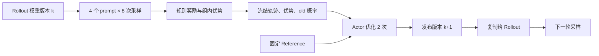

## 1. 实验要回答的系统问题

只看 loss 函数，无法判断“这批回答究竟由哪份权重生成”。本实验保留一条 RL 更新链必须有的对象：采样策略、训练策略、固定参考策略、奖励规则、轨迹、优化步骤和发布版本。

执行入口：

```bash
python3 labs/llm_rl/rl_lab.py \
  --steps 80 \
  --seed 7 \
  --output labs/llm_rl/results/latest.json
```

只需要 Python 标准库，无需安装 PyTorch。脚本默认配置为 4 个 prompt、每组 8 条回答、每条回答 1 个动作、同一 batch 更新 2 次、学习率 0.8、KL 系数 0.02。学习率只适用于这个小型参数表，不能直接迁移到 Transformer。

本实验是**上下文 bandit**：只有一次动作，没有中间状态或延迟奖励。GRPO 的组内基线和 PPO 裁剪仍然能计算，但 GAE、长序列 credit assignment、token 长度偏置不会出现在训练过程中。

## 2. 模型、环境和参数分别是什么

### 2.1 一张可训练的 logits 表

模型参数 $Z\in\mathbb R^{4\times4}$。第 $i$ 行对应 prompt $i$，四列对应动作 0、1、2、3：

$$
\pi_\theta(a=j\mid x=i)=\operatorname{softmax}(Z_i)_j.
$$

初始化全部为零，每个动作概率都为 $1/4$。固定 reference 也是均匀分布。

环境接受规则为：

$$
a^*(i)=(i+1)\bmod4,
\qquad r(i,a)=\mathbf1[a=a^*(i)].
$$

例如 prompt 0 的正确动作是 1，prompt 3 的正确动作是 0。模型只看 prompt 索引，奖励函数在动作采样后判分。

这里策略表最终会记住四个正确动作；**没有独立测试分布，也没有语言理解**。预期奖励提升说明更新方向正确，不代表获得了数学推理或泛化能力。

### 2.2 Actor、rollout 与 reference 的生命周期

| 对象 | 初始化 | 一轮内是否更新 | 作用 |
|---|---|---|---|
| `actor_logits` | 全零 | 每个优化 epoch 更新 | 正在训练的策略 |
| `rollout_logits` | Actor 的独立副本 | 训练完成后统一复制 | 生成本轮轨迹 |
| `reference` | 初始 softmax 概率 | 从不更新 | KL 约束锚点 |
| `old_probability` | 每条轨迹采样时记录 | 从不覆盖 | PPO 比率分母 |

引用同一个 Python list 不能模拟独立 rollout。代码使用 `copy.deepcopy`，测试同时检查数值相同与对象不同。

## 3. 一轮训练中的全部数据



### 3.1 采样阶段

`collect()` 按 rollout 分布抽样。每条轨迹保存：

```python
{
    "prompt": 0,
    "action": 1,
    "reward": 1.0,
    "advantage": 1.0,          # 示意值；实际由当前组奖励计算
    "old_probability": 0.25,
    "behavior_version": 0,
}
```

如果以后 `actor_logits` 变了，也不能从当前 actor 重新获取分母。否则概率比永远接近 1，裁剪失去相对于采样快照的意义。

### 3.2 优势阶段

同一 prompt 的 8 个奖励构成一组。不同 prompt 的成功率可能不同，不能把全部 32 个奖励一起标准化后还称为同一个 GRPO 目标。

`zero_group_fraction` 记录本轮四个组里奖励完全相同的比例。实验保留这些组，不做动态过滤，因此它们的 policy-gradient 项为零，但全分布 KL 仍可能提供梯度。

### 3.3 训练阶段

令 $N=4G$，$p_i$ 为当前策略对第 $i$ 个 prompt 的完整动作分布，$q_i$ 为 reference：

$$
L=-\frac1N\sum_{n=1}^{N}
\min(\rho_n A_n,\operatorname{clip}(\rho_n,0.8,1.2)A_n)
+\frac\beta4\sum_{i=0}^{3}D_{KL}(p_i\Vert q_i).
$$

这与生产 GRPO 实现有两处主动简化：所有回答长度固定为 1；KL 对四个动作精确求和，不使用 sampled-token 的估计器。因而应称为 **GRPO 风格的教学目标**，不能声称复刻某个框架的默认 loss。

### 3.4 发布阶段

一次 `step()` 对同一 batch 优化两次，然后版本号只增加一次。此处版本计数表示“对 rollout 发布了几份策略”，不是梯度更新总次数。

同一 batch 的第二次优化仍使用第一次采样保存的 `old_probability`。发布后，新一轮轨迹的 `behavior_version` 才变成 `k+1`。

## 4. 真正更新的参数怎样手算

Softmax 的一个重要导数是：

$$
\frac{\partial\log p(a)}{\partial z_j}
=\mathbf1[j=a]-p(j).
$$

在未被裁剪的分支，单条轨迹对 loss 的梯度：

$$
\frac{\partial L_{PG}}{\partial z_j}
=-\frac1N A\rho\big(\mathbf1[j=a]-p(j)\big).
$$

设 $N=32,p(j)=1/4,A=1,\rho=1$，对抽到的正确动作：

$$
\frac{\partial L}{\partial z_a}
=-\frac{1}{32}\times\frac34=-0.0234375.
$$

其他每个动作梯度为 $+0.0078125$。学习率 0.8 下，这一条轨迹贡献：正确动作 logit 增加 0.01875，其他动作各减少 0.00625。真实更新还会把 batch 内其余轨迹和 KL 梯度加上。

### 4.1 完整 KL 的导数

记 $K=\sum_jp_j\log(p_j/q_j)$，则：

$$
\frac{\partial K}{\partial z_j}
=p_j\left[\log\frac{p_j}{q_j}-K\right].
$$

初始 $p=q$，KL 及其梯度都是零。之后 actor 偏向奖励更高的动作，KL 项拉回参考分布。它和 reward 梯度形成权衡，不能把 KL 变大本身视为实现错误。

代码采用普通梯度下降，没有 Adam 状态、master weights 或自动混合精度，因此 checkpoint 也无需保存不存在的优化器动量。迁移到真实训练时必须把这些新增状态加入恢复清单。

## 5. 本地参考运行与指标解释

仓库保留 `labs/llm_rl/results/reference-run.json`。在 Python 3.12.3、seed=7、默认配置下实测：

| 指标 | 实测值 |
|---|---:|
| 初始精确期望奖励 | $0.25$ |
| 80 轮之后精确期望奖励 | $0.9885796050$ |
| 发布的策略版本数 | $80$ |
| 每轮采样条数 | $32$ |
| 每轮优化次数 | $2$ |

精确期望奖励是直接遍历全部四个 prompt，读取正确动作概率后求平均，没有重新采样。每步日志里的 `sampled_reward_before_update` 则来自有限次抽样，可能上下波动。

日志的时间边界也需要注意：`expected_reward_after_update` 是更新并发布后的值；`loss_before_last_update`、KL、entropy、clip fraction 是最后一次梯度计算前的值。不能把它们误当成同一时刻的测量。

成功标准是：学习方向、状态一致性和数值检查成立。不同 Python 版本或随机实现若改变采样序列，不要求复现每个小数位，更不要求所有种子都产生单调曲线。

## 6. 断点恢复不是只恢复权重

执行以下命令保存并继续：

```bash
python3 labs/llm_rl/rl_lab.py --steps 40 \
  --save .local/rl-checkpoint.json --output .local/rl-first.json
python3 labs/llm_rl/rl_lab.py --steps 40 \
  --resume .local/rl-checkpoint.json --output .local/rl-resumed.json
python3 labs/llm_rl/rl_lab.py --steps 80 --output .local/rl-continuous.json
```

`--steps` 表示本次再运行多少轮；从版本 40 恢复并运行 40 轮，最后版本为 80。恢复时采用 checkpoint 保存的配置，包括 seed 与 group size。

比较方法：

```python
import json
from pathlib import Path

continuous = json.loads(Path(".local/rl-continuous.json").read_text())
resumed = json.loads(Path(".local/rl-resumed.json").read_text())
assert continuous["history"][40:] == resumed["history"]
```

保存状态包括配置、actor、rollout、reference、版本以及随机数生成器内部状态。只保存 seed 不够，因为 seed 指向随机序列的起点，而不是中断时的位置。

文件先写到同目录临时文件，再用 rename 替换最终文件，可避免读到一半写入的 JSON。这不是跨机器事务，也没有声明掉电后的磁盘持久性保证。真实分布式训练还需要第 9 章介绍的分片完成标记、manifest 和一致性协议。

## 7. 故意制造三个错误

建议先复制脚本到 `.local/` 再改，保留仓库原始版本用于对照。

| 改动 | 预期症状 | 为什么 |
|---|---|---|
| 把 frozen old probability 改成当前概率 | ratio 总为 1；裁剪诊断失去意义 | 比较基准随 actor 移动 |
| 恢复时不装载 RNG state | 后续 trajectory 和梯度不同 | 采样随机流从错误位置继续 |
| actor 更新后不发布 rollout | 下轮采样触发版本检查 | 避免旧策略样本被冒充同步数据 |

最后一条在异步训练中未必应该报错：异步系统可接受一定策略延迟，但必须记录行为版本、概率语义和校正策略。本实验刻意采用同步协议，因此版本不一致属于协议违例。

## 8. 从这个实验迁移到真实 LLM

| 教学对象 | LLM 对应对象 | 新增验收点 |
|---|---|---|
| logits 表 | Transformer 参数 | 模型版本、tokenizer、chat template |
| 一个 action | 多 token response | causal shift、EOS、padding、loss mask |
| `random.choices` | vLLM/SGLang rollout | temperature、top-p、实际采样 log-prob |
| 固定奖励函数 | verifier / reward model | 解析失败、奖励版本、超时、数据泄漏 |
| 深复制权重 | 分片转换与通信 | 布局、dtype、TP、同步完成和缓存失效 |
| Python 梯度下降 | PyTorch + FSDP/Megatron | 自动微分、梯度归约、优化器状态 |
| JSON checkpoint | 多 rank checkpoint | shard 完整性、RNG、队列和数据游标 |

推荐把第一轮真实模型训练限制到一个短 prompt batch，先保存并人工核对实际 token ID、response mask、四种概率来源和 optimizer step 前后参数差异。跑通这些验收点后，再增加生成长度、并行度和异步程度。

本模块第 7.2 节提供框架来源与配置阅读路径。真实运行前记录精确 commit、模型 revision、依赖和硬件；本章没有执行完整的 verl、ROLL 或 slime GPU 训练。

## 9. 自测与参考答案

**问题 1：为什么 reference 没有跟着 rollout 更新？** 它定义约束锚点。若每轮更新 reference，会改变 KL 正则目标，必须明确设计，不能顺手复用同一个对象。

**问题 2：为什么每个 prompt 都要留一组奖励？** 优势比较发生在同一问题内。跨 prompt 混合会把题目难度差异引入相对奖励。

**问题 3：为什么本实验 98.86% 不是模型 benchmark 分数？** 它是训练过的四个上下文上正确动作概率的平均，没有测试集、语言模型或任务泛化。

**问题 4：九项检查都通过后，还剩什么？** 真实后端的张量语义、混合精度误差、分布式同步、长序列统计、奖励有效性和独立评估都尚需验证。

## 参考资料

- [PPO 原论文](https://arxiv.org/abs/1707.06347)：本实验裁剪项的数学定义。
- [DeepSeekMath](https://arxiv.org/abs/2402.03300)：组内比较的算法背景。
- [Python random 文档](https://docs.python.org/3/library/random.html)：`getstate()` / `setstate()` 与可复现性边界。
