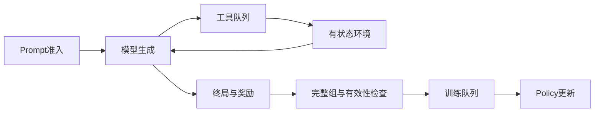

## 1. GPU很忙，训练也可能没有有效进展

推理GPU持续生成token，只说明生成阶段没有空闲。

如果工具队列积压、奖励尚未完成或轨迹过旧被拒收，训练端仍可能缺少可用数据。

反过来，训练GPU等待并不一定意味着需要增加rollout GPU。

瓶颈可能位于CPU环境、镜像加载、外部服务或verifier。

本篇沿用第8.2节的异步策略差异分析，重点补齐环境平台与训练目标之间的耦合。

它是一般平台方法，不把某个公开沙箱系统的内部实现当作通用标准。

## 2. 一条轨迹跨越多个资源池



一个轨迹可以反复经过生成与环境，而不是只走一次直线流水线。

环境状态可能在GPU请求结束后仍需保留。

因此取消、恢复和资源释放应按轨迹生命周期组织。

## 3. 区分三类吞吐

| 指标 | 分子 | 用途 |
|---|---|---|
| raw generation token/s | 所有生成token | 推理引擎利用 |
| accepted action token/s | 进入训练目标的有效动作 | 数据供给与训练工作量 |
| quality per GPU-hour | 预定评测质量相对资源 | 统计与系统综合效果 |

accepted action token/s比原始生成更接近训练负载。

但它仍不是质量改善率。

若平台只保留容易、短且低成本任务，可用吞吐上升而任务能力下降。

## 4. 队列必须具有不同的身份

至少区分：

```text
prompt admission queue
inference ready queue
tool request queue
environment waiting set
reward queue
group assembly buffer
trainer ready queue
```

每个队列都有容量、年龄与资源预算。

只设置一个全局“最大并发轨迹数”不足以控制瓶颈。

同样100条轨迹，可能分别占100个空环境或100个大型运行中进程。

## 5. 服务需求比请求条数更重要

设每条轨迹平均需要k次工具调用，每次占用环境服务时间$T_e$。

环境并发服务槽位为$c_e$。

忽略开销、负载不均与依赖时，轨迹处理能力上限约为：

$$
\mu_e=\frac{c_e}{kT_e}.
$$

这个公式使用的是总服务需求，不包含排队等待。

长尾和共享资源争用会降低实际容量。

如果不同工具资源不同，应分CPU、内存、网络和外部配额分别计账。

## 6. 完整数例一：瓶颈在reward

假设：

```text
rollout能力：5条轨迹/s
环境槽位：64
每轨迹工具调用：4次
每次服务时间：2s
reward worker：4个
每条reward服务时间：1s
trainer能力：6条已接受轨迹/s
接受比例：75%
每条接受轨迹有效动作：8000 token
```

环境轨迹能力为$64/(4\times2)=8$条/s。

reward能力为4条/s。

奖励前后未过滤的端到端供给受$\min(5,8,4)=4$限制。

过滤后供给为$4\times0.75=3$条/s。

trainer能处理6条，但只能得到3条。

有效动作吞吐为：

$$
3\times8000=24000\;token/s.
$$

### 6.1 只扩生成能力

rollout提高到8条/s，reward仍只有4条/s。

接受供给仍为3条/s，有效动作吞吐仍为24000。

多出的生成工作可能只让队列更长、样本更旧。

### 6.2 同时修复reward瓶颈

若reward能力提高到8条/s，其他假设不变：

$$
\min(8,8,8)\times0.75=6.
$$

正好匹配trainer的6条/s，得到48000有效action token/s。

这是容量模型的教学结果，不是增加worker必然得到的实测加速。

## 7. 可执行oracle一：供给链容量

```python
def accepted_rate(generation, env_slots, calls, service_seconds,
                  reward_workers, reward_seconds, acceptance, trainer):
    env = env_slots/(calls*service_seconds)
    reward = reward_workers/reward_seconds
    accepted_supply = min(generation, env, reward)*acceptance
    return min(accepted_supply, trainer)

base = accepted_rate(5, 64, 4, 2, 4, 1, 0.75, 6)
gen_only = accepted_rate(8, 64, 4, 2, 4, 1, 0.75, 6)
balanced = accepted_rate(8, 64, 4, 2, 8, 1, 0.75, 6)
assert (base, gen_only, balanced) == (3, 3, 6)
print("accepted trajectories/s", base, gen_only, balanced)
print("accepted action tokens/s", [r*8000 for r in [base, gen_only, balanced]])
```

该模型假设稳定平均服务需求，不模拟请求重入、长尾、组不完整或网络争用。

实际调度必须用阶段数据校准。

## 8. 等待也占用资源

一条轨迹等待工具结果时，可能仍保留：

- 环境文件系统与进程状态。
- 会话与工具连接。
- KV cache或可恢复生成前缀。
- 已生成token、logprob和奖励元数据。
- 超时计时器与取消句柄。

空闲GPU请求结束不代表这些资源自动释放。

将状态ful环境与可抢占计算分开管理，是平台设计的重要方向。

## 9. 完整数例二：Little定律与状态内存

设进入某等待阶段的稳定速率为2条轨迹/s，平均等待时间20秒。

Little定律：

$$
L=\lambda W=2\times20=40.
$$

平均有40条轨迹在该阶段驻留。

若每个环境保留256MiB状态，仅这部分平均占用：

$$
40\times256MiB=10GiB.
$$

若实际队列等待增加到60秒，平均驻留变120条，对应30GiB。

这还不含KV、共享镜像、临时文件与峰值。

### 9.1 缩短timeout不是免费优化

把20秒超时改为10秒可能减少驻留，但也会淘汰合法长任务。

如果困难任务更慢，平台会改变训练分布。

因此超时需要区分资源保护与任务定义，并报告被删任务的类型。

## 10. 可执行oracle二：驻留与选择偏差

```python
arrival_rate = 2
state_mib = 256
for wait_seconds in [20, 60]:
    residents = arrival_rate*wait_seconds
    gib = residents*state_mib/1024
    print(wait_seconds, residents, gib)
assert arrival_rate*20*state_mib/1024 == 10

# 教学任务池：慢任务更困难，统一时限会改变保留分布。
tasks = [
    {"kind": "easy", "seconds": 2},
    {"kind": "easy", "seconds": 3},
    {"kind": "hard", "seconds": 12},
    {"kind": "hard", "seconds": 18},
]
accepted = [t for t in tasks if t["seconds"] <= 10]
assert len(accepted) == 2
assert all(t["kind"] == "easy" for t in accepted)
print("accepted task kinds", [t["kind"] for t in accepted])
```

这只是构造的选择偏差反例，不是对真实任务难度与时延关系的测量。

## 11. 取消是一套跨角色协议

取消轨迹时，至少需要找到其所有在途工作：

```text
inference request
queued tool request
running environment action
reward request
group membership
trainer admission record
```

对每项记录取消请求、确认、资源回收和迟到结果处理。

仅把trajectory状态设为cancelled，后台任务可能仍继续占CPU和环境。

### 11.1 迟到结果不能复活轨迹

tool response返回时应核对trajectory ID、turn ID、attempt和当前状态版本。

已取消或已由新attempt替代的结果，不应重新写入当前轨迹。

可以归档用于审计，但不能自动推进后续生成。

这种状态校验也防止重试结果串入错误轮次。

## 12. 幂等与副作用

一个工具超时不代表动作未执行。

它可能已经修改文件或提交环境状态，只是响应丢失。

重试需要幂等键或明确的查询/补偿协议。

隔离训练环境也可能包含有意义的状态变化，不能把重试当作透明网络细节。

### 12.1 最小请求身份

```text
trajectory_id
turn_id
logical_action_id
attempt_id
idempotency_key
environment_snapshot_id
```

logical action与attempt分开，便于判断两次请求是否同一个动作的重试。

环境状态与实际观测都需要保留，不应以计划中的结果替代真实返回。

## 13. 超时必须细分

| 超时类别 | 含义 | 典型处理 |
|---|---|---|
| 排队超时 | 尚未开始服务 | 重排、限流或单独标记 |
| 执行超时 | 工具运行超过资源窗口 | 取消、终止与状态确认 |
| 任务时限 | 任务规则定义的预算耗尽 | 按任务奖励定义处理 |
| 通信超时 | 结果是否执行不确定 | 查询状态或幂等重试 |
| 整体轨迹时限 | 整条交互预算耗尽 | 明确截断与信用分配 |

不能把所有timeout直接计为错误答案且reward=0。

否则平台拥塞会被模型学成“某类工具或困难任务不值得尝试”。

无Critic目标也不能因为外部截断就凭空添加value bootstrap。

## 14. Reward版本是目标的一部分

奖励由解析器、测试集、judge模型、权重与规则共同决定。

相同轨迹在不同版本下可能获得不同分数。

记录至少包括：

```text
reward_schema_version
verifier_version
judge_model_version
rubric_hash
test_artifact_hash
environment_version
score与分项原因
```

权重版本管理得再严格，也不能自动修复奖励目标漂移。

## 15. 混合奖励版本的反例

同一prompt采样两条内容相同的回答。

旧verifier判1，新verifier因规则变化判0。

如果把两者放同一GRPO组，奖励为[1,0]。

按总体std归一化得到优势[1,-1]。

模型会对相同内容施加相反方向，差异完全来自评分版本。

如果都用同一verifier，可能是[1,1]或[0,0]，没有这种伪组内差异。

### 15.1 可选版本策略

在一个组或训练窗口内冻结reward版本。

或对全部可重评轨迹统一重评分，再入队。

若按版本分区训练，应明确任务目标与权重。

不能把奖励版本混用当作普通噪声而不记录。

## 16. 奖励幂等与重复入队

reward结果可以按以下组合键去重：

```text
trajectory_id
trajectory_content_hash
reward_version
evaluation_attempt
```

选择哪个attempt为有效结果，需要明确规则。

同一结果消息重复投递不应导致同一轨迹训练两次。

但有意的多epoch训练又需要显式训练消费ID，不能被普通消息去重误删。

逻辑轨迹身份、评分身份与训练消费身份应分开。

## 17. 完整组与异步长尾

GRPO/GSPO的组统计依赖同prompt的一组回答。

部分成员尚未完成时，不能悄悄用较小组替代原G而不记录。

可选择等待、补采、整组拒绝或定义合法部分组目标。

不同选择改变成本和分布。

### 17.1 对齐成本统计

被拒绝或补采的生成token仍消耗GPU时间。

报表应同时记录attempted、completed、rewarded、group-valid和trained数量。

只统计最终有效组，会隐藏大量环境与推理开销。

## 18. 背压应作用于准入

当reward或trainer落后时，继续无限接收新prompt会增加样本年龄。

优先控制新任务admission，并保留正在执行的有价值状态。

多资源预算可以包括：

```text
在途轨迹数
有效/预计动作token
完整上下文token
环境内存与CPU配额
工具调用预算
reward队列年龄
policy版本差
```

单一“并发=1000”参数无法表达这些约束。

## 19. 抢占与恢复的角色边界

trainer、rollout、环境与reward不一定需要同时重启。

trainer恢复期间可以保留兼容的轨迹与环境状态，但必须审计policy年龄与接收条件。

环境恢复要验证snapshot、动作幂等和观察日志。

reward服务恢复要避免重复评分结果进入训练。

权重同步重新连接还需标明新旧policy版本发布边界。

[RobustRL论文](https://www.usenix.org/conference/osdi26/presentation/chen-zhenqian)提供角色隔离恢复案例；其结果不能直接视作本平台SLA。

## 20. DSec案例可以说明什么

[DSec原始报告](https://arxiv.org/abs/2609.22978)公开讨论统一沙箱接口、分层环境、状态生命周期与RL协同。

它帮助说明环境不是一个简单的`subprocess.run`，而是独立资源与状态系统。

本篇不复刻其部署规模或性能数字，也不声称拥有其全部内部实现。

应借鉴的是协议问题：状态在哪里、何时回收、如何恢复、哪些层可独立版本化。

## 21. 观测必须连接资源与学习

| 层次 | 指标 |
|---|---|
| 资源 | GPU忙碌、CPU、环境内存、镜像读、KV |
| 队列 | 进入/服务/完成时间、年龄、取消滞后 |
| 轨迹 | 动作数、观测数、工具轮次、结束原因 |
| 算法 | policy差、ratio、优势、有效组比例 |
| 奖励 | 版本、失败类型、分项与重评分差异 |
| 质量 | 独立任务成功率与time-to-quality |

环境P99增长后若同时出现旧样本比例和clip上升，就有可检查的因果链。

仅看GPU utilization无法解释这些变化。

## 22. 故障定位

| 症状 | 第一批检查 |
|---|---|
| 推理很忙、trainer空闲 | reward、完整组和接受率 |
| 取消后CPU不下降 | 运行中工具与环境回收确认 |
| 同内容奖励不同 | verifier/judge/环境版本 |
| timeout提高后成绩更好 | 是否偏向短容易任务 |
| 重启后重复训练样本 | 轨迹、评分与消费身份去重 |
| 队列不长但样本很旧 | 工具驻留与组等待时间 |
| 扩GPU却吞吐无收益 | 环境、reward与存储容量 |

## 23. 自测与详细答案

### 题1：增加rollout GPU为什么可能没有收益？

后续环境或reward可能已经限制有效数据供给。

更多生成只增加积压和策略年龄。

应先测整个供给链的接受速率。

### 题2：工具超时是否证明动作没有执行？

不能，可能只是结果未返回。

需要幂等、状态查询或补偿机制，避免重复副作用。

### 题3：取消trajectory状态后是否已经释放资源？

不一定，推理、工具、环境和reward任务都可能仍在运行。

需要分角色取消确认与迟到结果处理。

### 题4：同组reward版本混用为什么危险？

组内优势可能反映评分规则差异，而不是回答质量差异。

同一内容也能被赋予正负优势。

应冻结或统一重评版本。

### 题5：更严格timeout带来更高有效吞吐，是否可以直接保留？

需要检查任务选择偏差与独立质量。

若主要淘汰困难长任务，吞吐改善可能损伤目标能力。

### 题6：accepted action token/s是否就是学习效率？

不是，它只衡量进入训练目标的工作量。

最终还需看同GPU预算下的质量与time-to-quality。

## 24. 来源映射与一手资料

扩写指定综述12.2、12.4—12.7；承接已有6.1与8.2，新增重点是多队列容量、取消回收、超时分类和奖励版本导致的目标漂移。

- [DSec v1](https://arxiv.org/abs/2609.22978)：本轮核对2026-09-19原始报告入口。
- [AReaL](https://arxiv.org/abs/2505.24298)：异步RL系统案例。
- [RobustRL](https://www.usenix.org/conference/osdi26/presentation/chen-zhenqian)：角色隔离恢复案例。
- [Gymnasium时间限制](https://gymnasium.farama.org/tutorials/gymnasium_basics/handling_time_limits/)：任务终止与外部截断的区别。
- [HybridFlow](https://arxiv.org/abs/2409.19256)：RL阶段与资源组织背景。

两个CPU oracle只验证容量、驻留与选择偏差的教学模型；没有执行真实环境服务、工具副作用或异步RL训练。
