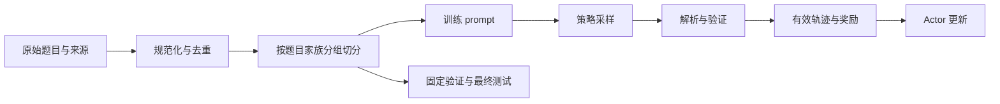

在 RLVR 中，模型生成答案后，验证器把它转换成一个训练信号。验证器常比模型小得多，但它定义了优化器眼中的“成功”。一个十行的评分漏洞，足以改变整个训练方向。

本文用简单数值任务建立可检查的奖励契约，再推广到代码、数学推理和多轮工具场景。代码仅演示受限数字解析，不执行模型生成代码。

## 1. 先区分四种反馈来源

| 类型 | 输入与输出 | 优势 | 限制 |
|---|---|---|---|
| 规则 verifier | 回答、标准 → 判定 | 成本低、规则透明 | 规则可能不完备、被钻空子 |
| ORM | 完整回答 → 质量分 | 能学习整体偏好 | 存在分布外误判和偏差 |
| PRM | 解题步骤/前缀 → 局部分数 | 信号更密集 | 步骤标注和聚合困难 |
| 环境反馈 | 动作执行 → 状态/奖励 | 接近实际任务结果 | 延迟、随机性、失败恢复复杂 |

ORM 是 outcome reward model，PRM 是 process reward model。过程分数可以用于训练或候选排序；“用了 PRM”并不自动说明 Actor 的每个 token 都得到了无偏奖励。[过程监督论文](https://arxiv.org/abs/2305.20050) 讨论了这种监督粒度差异。

例如代码通过测试是可验证结果，但有限测试无法证明程序对所有输入都正确；数学最终答案正确也不保证中间证明有效。应把“被当前验证器判定成功”与“任务全面正确”分开记录。

## 2. 给奖励函数定义契约

先明确四个问题：检查哪个字段、接受什么格式、如何比较、失败怎样处理。

对一个最小算术任务，可约定回答必须为单行：

```text
<answer>5</answer>
```

不能只检查响应中是否包含字符 `5`。否则 `答案可能是 1,2,3,4,5,6,7` 也会获奖。

一个结构化输出示例：

```json
{
  "sample_id": "q17-rollout-3",
  "correct": true,
  "format_ok": true,
  "status": "ok",
  "reward": 1.1,
  "verifier_version": "decimal-v1",
  "latency_ms": 2.3
}
```

`correct` 与 `status` 分开，让系统能区分“判定错误”与“尚未有效判定”。这些是本教程的字段设计，实际框架应通过 adapter 转换。

### 2.1 失败类型不能混为一个零

| 状态 | 含义 | 常见处理 |
|---|---|---|
| `incorrect` | 在有效测试下得到错误结果 | 作为任务失败 |
| `format_error` | 不符合明确输出契约 | 按训练目标罚分或单列 |
| `execution_timeout` | 程序运行超过题目时限 | 环境健康时可判任务失败 |
| `queue_timeout` | 还未运行就排队超时 | 系统失败，按预算重试或剔除 |
| `infrastructure_error` | 节点、容器或服务错误 | 不应伪装成错误答案 |
| `truncated` | 达到 token/轮数限制 | 依据任务定义处理并单列 |

过滤系统失败会改变有效样本分布，应统计比例与来源；不能靠大量丢弃慢样本取得看似更高的 reward。

## 3. 一个受限且可手查的数字 verifier

以下函数只接受有限十进制数字，并限制文本长度。它不使用 `eval`、不解释任意表达式、不运行回答中的代码。

```python
import re
from decimal import Decimal, InvalidOperation

NUMBER = r"[+-]?(?:\d+(?:\.\d*)?|\.\d+)"
PATTERN = re.compile(rf"<answer>({NUMBER})</answer>")

def verify_decimal(response: str, target: str) -> dict:
    if len(response) > 256:
        return {"status": "format_error", "correct": False,
                "format_ok": False, "reward": 0.0}
    match = PATTERN.fullmatch(response.strip())
    if match is None:
        return {"status": "format_error", "correct": False,
                "format_ok": False, "reward": 0.0}
    try:
        predicted = Decimal(match.group(1))
        expected = Decimal(target)
    except InvalidOperation as error:
        raise ValueError("非法的数值数据契约") from error
    if not expected.is_finite():
        raise ValueError("标准答案必须为有限数字")
    correct = predicted == expected
    return {"status": "ok" if correct else "incorrect",
            "correct": correct, "format_ok": True,
            "reward": float(correct) + 0.1}

assert verify_decimal("<answer>5.0</answer>", "5")["reward"] == 1.1
assert verify_decimal("<answer>6</answer>", "5")["reward"] == 0.1
assert verify_decimal("5 或 6", "5")["reward"] == 0.0
assert verify_decimal("<answer>5</answer><answer>6</answer>", "5")["reward"] == 0.0
```

这里错误但格式正确会得 0.1 分，这是有意选择的教学目标；是否适合真实训练应验证。标准答案非法时抛出数据错误，而不是把责任记到模型头上。

该实现不支持分数、科学计数法、单位或等价代数式。真实数学任务必须定义规范化和等价性规则，不能拿此玩具 parser 直接替代符号验证器。

### 3.1 浮点近似应怎样比较

对于明确允许数值误差的任务，可定义：

$$
|\hat y-y|\le\epsilon_{\rm abs}+\epsilon_{\rm rel}|y|.
$$

例如 $y=100$，$\epsilon_{\rm abs}=0.01$，$\epsilon_{\rm rel}=10^{-4}$，允许误差为 $0.02$。$100.015$ 通过，$100.03$ 失败。

容差必须来自任务需求，不能因为模型答不准就任意扩大。对于整数证明、离散分类或 exact-match 任务，不应悄悄启用近似比较。

## 4. 奖励组合先检查尺度与排序

设正确性 $c\in\{0,1\}$、格式 $f\in[0,1]$、代价 $u\in[0,1]$。一种示意目标为：

$$
R=c+0.1f-0.05u.
$$

正确回答最少得 $1-0.05=0.95$；错误回答最多得 $0.1$。因此在这个范围内，格式与成本无法反转正确性优先级。

若把代价改成没有上界的生成长度 $T$，奖励 $c-0.05T$ 会让 100 token 的正确回答比 1 token 的错误回答更低。每个分量的单位、上界、下界都必须先写出来。

### 4.1 稀疏奖励和密集奖励的取舍

只有最终对错的奖励容易验证，但长轨迹中很难区分哪一步有帮助。密集过程奖励能提供更多信号，却可能鼓励重复“看起来正确”的步骤。

若每个步骤都奖励 $+0.1$，模型可能增加步骤数，而不是更快解决题目。平均、求和、最小值、乘积等聚合各自对应不同语义，不能当作等价实现。

### 4.2 奖励缩放与 KL 系数联动

目标若为 $\mathbb E[R]-\beta\mathrm{KL}$，把 $R$ 乘 10 却不改 $\beta$，会使相对 KL 约束减弱。若后面使用组内标准化，一些统一缩放可能被抵消，但剪裁、epsilon、独立 KL loss 和零方差分组会改变这种结论。

应追踪**原始分量 → 组合 reward → 归一化 → advantage → loss**，不要只在一个面板显示名为 `reward` 的最终数值。

## 5. reward hacking 的实际检查方式

Reward hacking 指策略利用评分机制的不完备获取高分，而未实现目标。它不要求模型拥有特殊动机；普通优化过程就会偏向容易得分的输出。

| 漏洞 | 可能学到的行为 | 检查方式 |
|---|---|---|
| 包含标准答案即通过 | 输出所有候选答案 | 多答案、否定句和引用文本测试 |
| 格式标签出现即加分 | 重复输出标签 | 重复标签与空标签测试 |
| 只跑公开测试 | 对已知样例硬编码 | 独立保留测试与变形测试 |
| PRM 对礼貌措辞加分 | 用套话填满步骤 | 固定内容改变表面措辞 |
| 超时样本直接丢弃 | 策略偏向触发未计分路径 | 监控超时率与有效样本占比 |
| LLM judge 直接混入答案文本 | 候选答案尝试影响评分指令 | 隔离候选数据并做对抗评估 |

训练时应抽样检查最高分、最低分和最不稳定分数的回答。仅随机看平均样本，容易错过策略正在集中利用的小范围漏洞。

## 6. 数据流水线与去污染



先分组切分，再做候选扩展，能减少同一题多个回答跨 split 泄漏。文本去重只是第一层；题面改写、变量替换、翻译版本也可能属于同一问题家族。

### 6.1 标准答案放在哪里

如果训练目标是模型独立解题，标准答案可供 verifier 使用，但不能出现在 Actor 的 prompt 或工具观测里。否则模型可能只学到复制答案。

教师使用额外解答作为 privileged context 可以是合法蒸馏设置，但必须明确角色边界：教师可见的信息不等于学生部署时可见的信息。第 6 章继续讨论。

### 6.2 版本与审计字段

每条轨迹建议关联：`prompt_id`、数据集版本、split、policy_version、采样参数、tokenizer/template 哈希、verifier_version、reward 分量、结束原因、错误分类。

这些字段让一次异常可以被重放：相同 token 输入经过相同 verifier，是否还得到相同结果？若验证器访问可变外部服务，还需记录服务版本、相关响应或受控环境快照。

## 7. 生成代码的执行边界

代码验证需要实际运行候选时，应使用隔离环境，限制进程数、CPU 时间、内存、文件系统、网络和输出量。训练节点上的普通 Python 子进程加 timeout，不能单独构成完整隔离。

应将标准测试与评分逻辑放在候选无法修改的位置，并分离基础设施异常与程序失败。不要把云凭据、宿主目录和训练 checkpoint 挂载给候选程序。

这并非额外的评估装饰：如果候选能读取标准答案或改写评分文件，奖励就失去任务意义。[代码模型评估论文](https://arxiv.org/abs/2107.03374) 也把隔离执行作为评估环节。

## 🎯 自测与参考答案

**1. 当前正确率为 0，增加格式奖励是否一定能改善正确率？**

不能保证。它可能帮助形成可解析输出，也可能让模型停留在容易获取的格式分。需要分别观测格式成功率和条件正确率。

**2. 验证器返回 timeout，为什么不能直接当成错误答案？**

必须区分程序违反任务时限与基础设施排队/故障。前者可能是有效负反馈，后者通常不应惩罚当前回答。

**3. 只在训练集中去重，能防止评测污染吗？**

不能。必须跨训练、验证和测试集合检查近重复与题目家族重叠。

**4. 为什么总 reward 应保留各分量？**

相同总分可能来自不同原因。分量能揭示模型是在提升正确性、改进格式，还是利用代价项和过滤规则。

## 📚 参考资料

- [DeepSeek-R1](https://arxiv.org/abs/2501.12948)：可验证奖励用于推理任务的研究背景。
- [Let's Verify Step by Step](https://arxiv.org/abs/2305.20050)：过程监督、结果监督与验证器。
- [Evaluating Large Language Models Trained on Code](https://arxiv.org/abs/2107.03374)：代码正确性测试与执行环境。
