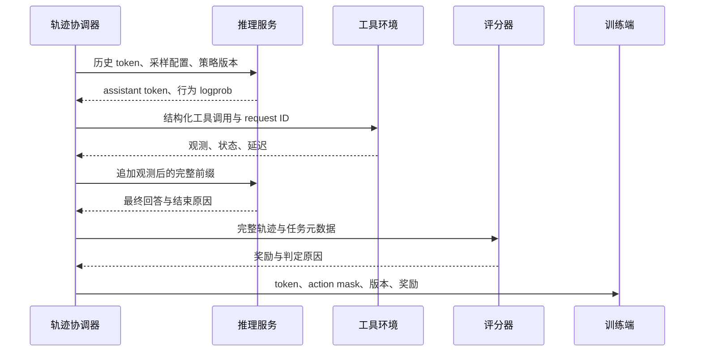

让模型调用一次工具并不难；把上千条并发工具轨迹转换成数学上正确的训练 batch，才是 Agent RL 的系统挑战。每个 token 的作者、每次环境返回的语义，以及轨迹为什么结束，都必须保留下来。

本文使用“查询库存并给出答案”的抽象任务讲清数据结构。示例不调用实际外部服务，也不执行真实交易。

## 1. 从一条可读对话开始

```text
user:     查询 A 商品的库存。
assistant: 调用 inventory_lookup(item="A")
tool:      {"stock": 7}
assistant: A 商品目前有 7 件库存。
```

对语言模型而言，整个历史都会影响下一 token 的概率。但 policy gradient 只能针对 Actor 实际采样的动作；用户问题和工具返回不属于它的动作。

可以把环境交互写为：

$$
a_t\sim\pi_\theta(\cdot\mid s_t),\qquad
s_{t+1}\sim P(\cdot\mid s_t,a_t),\qquad
r_t=R(s_t,a_t,s_{t+1}).
$$

这里 $s_t$ 可以是完整对话历史或其有效表示，$a_t$ 可以是一个 token，也可以是一整段工具调用。时间尺度必须与奖励和折扣定义一致。

多轮文本任务常具有部分可观测性：模型看见的是工具返回的观测，而不是外部系统全部状态。保留历史能帮助决策，但不能据此声称环境天然满足简单的全观测 Markov 假设。

## 2. 三种 mask 不可互相代替

| mask | 回答的问题 | 工具返回 token 的典型值 |
|---|---|---:|
| attention mask | 当前模型是否能读到该位置 | 1 |
| action/loss mask | 该位置是否是策略要优化的动作 | 0 |
| padding mask | 该位置是否为补齐占位 | 非 padding |

一个简化 token 序列：

```text
位置:       0  1  2  3  4  5  6  7  8  9 10 11
内容来源:   P  P  A  A  A  O  O  O  A  A  E  _
attention:  1  1  1  1  1  1  1  1  1  1  1  0
action:     0  0  1  1  1  0  0  0  1  1  1  0
```

$P$ 是 prompt，$A$ 是 Actor 生成，$O$ 是工具观测，$E$ 是 Actor 生成的结束 token，`_` 是 padding。这个例子有 6 个有效动作 token，而不是 9 个“prompt 后 token”。

若框架将 prompt 后的所有 token 统称为 `response_ids`，也不能据名称把整个 response 设为可训练。[verl Agent Loop 文档](https://verl.readthedocs.io/en/latest/advance/agent_loop.html) 的接口明确区分了包含工具结果的 response 与标记模型生成位置的 response mask。

### 2.1 shift 与模板边界

对于 causal LM，位置 $j-1$ 的 logits 用来预测位置 $j$ 的实际 token，因此 action mask 也必须与 target 一起移位。

模板自动插入的角色头是否属于动作，取决于它是否真的由 Actor 采样。由环境拼接的 `<tool>`、角色分隔符不应因为外观像生成文本就进入 policy loss。

```python
# 教学片段，假设每条输入至少有一个动作 token。
next_ids = input_ids[:, 1:]
next_mask = action_mask[:, 1:].float()
logp = logits[:, :-1].float().log_softmax(-1)
action_logp = logp.gather(-1, next_ids.unsqueeze(-1)).squeeze(-1)
loss = -(action_logp * advantages.detach() * next_mask).sum()
loss = loss / next_mask.sum().clamp_min(1)
```

这里 `advantages` 的 shape 与移位后的 `action_logp` 相同，都是 `[B, L-1]`。它展示最简单的策略梯度归约，不包含 PPO clipping 或多卡全局 token 加权。

## 3. token 时间与环境时间

假设第一次工具调用有 20 token，工具返回 1,000 token，最终回答有 10 token。若按 token 定义折扣，每一步与按“工具决策轮次”定义折扣含义不同。

特别是 tool observation 的长度由环境决定。不能因为某个工具返回更长，就无意中让前一动作的回报多折扣 1,000 次。

可采用两种清晰设计：

- 按 Actor token 定义动作序列，并明确工具事件之间的回报传播规则。
- 按环境决策轮次定义回报，再将一轮 advantage 映射到该轮生成 token。

两者不是普遍等价；使用第二种方法时，一轮内所有 token 共享 advantage 是一种信用分配选择。

## 4. 手算多轮回报

设有三次环境决策，奖励分别为：

```text
第一轮：合法工具调用，代价 -0.1
第二轮：再次查询，代价 -0.1
第三轮：最终答对，奖励 +1.0
```

按环境决策步，取 $\gamma=0.9$，从后往前计算：

$$
G_2=1,
\qquad G_1=-0.1+0.9\times1=0.8,
\qquad G_0=-0.1+0.9\times0.8=0.62.
$$

第一轮虽然即时奖励为负，但它可能是最终成功的必要步骤，因此累计回报仍为正。若仅把各轮即时奖励直接当优势，可能错误抑制有成本但必要的工具使用。

若使用 baseline $V(s_t)$，优势还需减去当前状态下的预期回报，而不是把“正回报”一律视为比当前策略更好。

### 4.1 最终奖励广播的含义

在 $\gamma=1$、仅终局奖励时，所有有效动作可共享同一个 Monte Carlo 回报。它实现简单，但长轨迹中方差较大，且难以识别具体错误步骤。

增加 Critic、过程奖励或分轮优势可以改变信用分配；这些方法需要新的估计器和验证，不能只靠把同一个终局分数复制到更多位置就获得更精细的监督。

## 5. termination 与 truncation

[Gymnasium 对时间限制的说明](https://gymnasium.farama.org/tutorials/gymnasium_basics/handling_time_limits/) 区分了任务定义的真正终止和外部条件导致的截断。这会直接影响价值 bootstrap。

| 结束原因 | 含义 | 典型价值处理 |
|---|---|---|
| 成功/明确失败 | 进入任务终止状态 | 不 bootstrap |
| 外部采样窗口结束 | 任务本可继续 | 若有有效下一状态，考虑 bootstrap |
| 题目规定最多 3 次调用 | 有限 horizon 本身属于任务 | 到界可作为终止，状态需反映预算 |
| 工具服务异常 | 交互未按任务执行 | 单列错误，不能盲目套 bootstrap |

不能仅凭字段名 `timeout` 判定：题目运行时限与集群排队超时有不同语义。

### 5.1 一个 bootstrap 数例

当前 $V(s_t)=0.4$，即时奖励 $r_t=-0.1$，下一状态价值为 $0.8$，$\gamma=0.9$：

- 若是外部截断，TD 目标为 $-0.1+0.9\times0.8=0.62$，TD error 为 $0.22$。
- 若是真正任务终止，TD 目标为 $-0.1$，TD error 为 $-0.5$。

错误地把两者合并为一个 `done`，会把同一转移的学习方向翻转。

采用 GRPO 等无 Critic 方法时，也不能凭空添加一个 $V(s)$。此时需要明确定义截断样本的奖励、保留/过滤规则，并报告由此产生的采样偏差。

## 6. 异步调度改变了哪些边界



推理请求与工具请求可异步重叠。某条轨迹等待工具时，另一条可以继续生成；这提升资源利用率，但不能把跨轨迹响应串错。

最低限度的关联键包括 `trajectory_id`、`turn_id`、`request_id`。每次恢复都要核对它们，而不是按“返回先后顺序”拼接文本。

### 6.1 超时、重试与幂等

只读查询可在明确预算内重试；会修改环境的动作必须考虑幂等键，避免重试导致重复副作用。训练环境通常应使用隔离、可重置、可快照的副本。

即使动作是只读的，外部状态也可能变化。重试返回不同库存时，应记录实际观测，不能假定它与第一次失败请求等价。

取消一条轨迹时，需要取消或回收它的生成请求、工具任务与临时资源。否则已经淘汰的轨迹仍占用队列与预算，造成难以解释的尾延迟。

### 6.2 策略版本不能丢

若第一轮使用策略 $v_7$，第二轮使用 $v_8$，整条轨迹不是由单一固定版本产生。可以选择在轨迹内固定版本，也可以显式支持混合行为策略，但必须保存每段动作的真实行为概率与版本。

“所有 token 共用一个 old logprob 张量”并不会自动修复版本混用；它是否充分取决于重要性校正、状态分布和算法假设。

## 7. 可重放的轨迹数据契约

一条最小训练记录可以包含：

```text
prompt_ids, full_ids, attention_mask, action_mask
behavior_log_probs（仅有意义于动作位置）
turn_boundaries, role_spans, policy_versions
rewards, terminated, truncated, end_reason
trajectory_id, environment_version, tool_request_ids
```

Tool 输出可能很大。截断观测、摘要历史或滑动窗口都会改变后续策略实际看见的状态，必须将**实际输入给模型的 token**保存下来。训练时重建的长上下文若不同于采样时上下文，重算出来的 logprob 就不是同一条件事件。

Packing 多条轨迹时，还需阻止跨轨迹 attention，保留位置编码与边界。仅拼接 action mask 不足以保证不同样本彼此隔离。

## 8. 最小调试顺序

1. 手工构造一条轨迹，对齐每个 token 的作者与 mask。
2. 固定模型权重，比较采样端与训练端同一前缀的 logprob。
3. 制造一个工具超时，确认错误分类和结束原因。
4. 同时运行两条不同长度轨迹，检查 request ID 不串线。
5. 固定或记录策略版本后，再打开批量采样与并行训练。

## 🎯 自测与参考答案

**1. 一个工具返回 1,000 token，是否会产生 1,000 个 policy gradient 动作？**

不会。它们是观测，action mask 通常为 0，但可影响后续 Actor 动作。

**2. 为什么工具返回文本仍需 attention mask 为 1？**

模型需要依据观测决策。把它从 attention 中屏蔽，会让后续行动失去环境信息。

**3. 外部截断时总应 bootstrap 吗？**

只有算法具有相应价值估计，并且有效下一状态和任务语义支持时才这样处理。环境故障或无 Critic 方法不能机械套用。

**4. 把工具调用重试两次为什么可能改变任务？**

动作可能有副作用，或外部状态已经变化。需要幂等与实际观测记录，而不是将重试视为透明的网络细节。

## 📚 参考资料

- [verl Agent Loop](https://verl.readthedocs.io/en/latest/advance/agent_loop.html)：多轮轨迹输出与 response mask。
- [Gymnasium：Handling Time Limits](https://gymnasium.farama.org/tutorials/gymnasium_basics/handling_time_limits/)：终止、截断与 bootstrap。
- [GAE](https://arxiv.org/abs/1506.02438)：价值估计与多步优势估计的基础。
