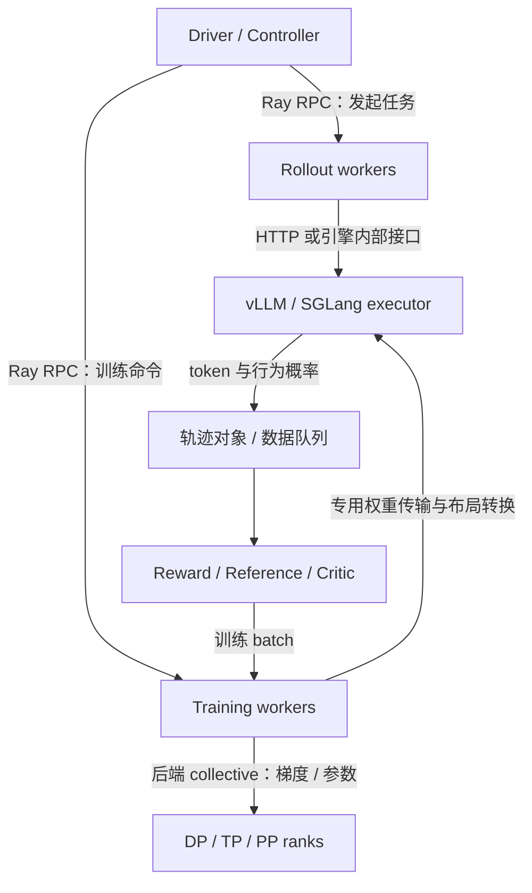

一个 RL 任务不是把监督学习的 loss 换一下。监督学习通常从固定数据集读取答案，RL 则先用正在变化的模型生成答案，再决定这些答案怎样影响下一次更新。训练与生成之间的循环，就是 RL Infra 的核心。

本节固定一个小 batch，用“谁生产、谁消费、什么时候可用”串起整轮过程。

## 1. 逻辑角色不等于模型副本数

| 逻辑角色 | 输入 | 输出 | 是否反向 |
|---|---|---|---|
| Actor / policy trainer | prompt + 已生成 response | 当前策略 log probability、梯度 | 是 |
| Rollout engine | prompt、采样参数、策略版本 | response、行为概率、结束原因 | 否 |
| Reference | 同一 prompt + response | 冻结参考策略 log probability | 否 |
| Reward | prompt、response、标签或环境结果 | 标量或逐步奖励 | 通常否 |
| Critic | 轨迹中的状态 | value、价值损失 | PPO 价值学习中是 |

Actor 与 rollout 通常是同一个逻辑策略的两种执行表示：前者优化权重，后者高效采样。它们可能是两个进程、两套 GPU，也可能在同一组 GPU 上轮流使用显存。

**不能直接说“RL 必须有四个大模型”**：规则奖励没有神经网络；GRPO 通常没有 critic；目标不使用 reference KL 时可能不需要 reference；LoRA 场景还可能通过关闭 adapter 计算参考分布。启用哪些角色取决于最终配置和实现。

模型参数是否冻结，也不等于这一角色没有成本。Reference 仍然需要完整序列前向；一个神经奖励模型还可能有自己的 tokenizer、padding 和设备分配。

## 2. 为整个 batch 规定一套符号

设：

- `B = 2`：本轮不同 prompt 的数量。
- `G = 3`：每个 prompt 的回答数量。
- `N = B × G = 6`：生成的轨迹数。
- `P = 5`：padding 后 prompt 宽度。
- `R = 4`：padding 后 response 宽度。
- `L = P + R = 9`：拼接后的宽度。

以下使用 padding 后张量表示，实际系统也可能使用 packing 或变长格式。

| 字段 | 形状 | 约定 |
|---|---|---|
| prompts | `[B, P]` | 尚未按组复制 |
| input_ids | `[N, L]` | 相同 prompt 按组复制后拼接回答 |
| attention_mask | `[N, L]` | 真实上下文位置为 1 |
| response_mask | `[N, R]` | 本目标参与优化的回答 token 为 1 |
| behavior_logp | `[N, R]` | 实际采样器对所选 token 的概率记录 |
| old_logp | `[N, R]` | 选定旧策略在训练端的概率，可选重算 |
| ref_logp | `[N, R]` | reference 项启用时才需要 |
| rewards | `[N]` 或 `[N, R]` | 序列奖励或逐 token 奖励 |
| advantages | `[N, R]` | 与参与 loss 的 token 一一对应 |
| prompt_group_id | `[N]` | 例如 `[0,0,0,1,1,1]` |

还要携带 `sample_id`、tokenizer/template 版本、`policy_version`、结束原因和采样参数。它们不能靠张量形状推断出来，却决定这个 batch 是否可解释。

## 3. 第一步：先明确谁产生了回答

假设 rollout engine 当前持有版本 `v=12`，按温度 1.0、无 top-k/top-p 截断生成。

```text
prompt A → A1, A2, A3
prompt B → B1, B2, B3

响应长度（含被计入目标的 EOS）：[4, 3, 2, 4, 1, 3]
response_mask:
  A1: 1 1 1 1
  A2: 1 1 1 0
  A3: 1 1 0 0
  B1: 1 1 1 1
  B2: 1 0 0 0
  B3: 1 1 1 0
```

有效 response token 总数是 `4+3+2+4+1+3=17`。若错误地除以 `N×R=24`，loss 会被额外乘以 `17/24`；当各 batch 的 padding 比例不同，等效学习率也跟着变化。

注意 EOS 的约定必须明确：如果 EOS 是模型采样动作且目标包含它，就计入 mask；padding 即使使用相同 token ID，也不能因此计入。工具返回文本可能是有效 attention 上下文，却通常不属于 actor 的动作损失。

### 3.1 生成为什么不能简单等价于训练前向

训练端可以在已知完整回答上一次前向计算所有位置的 logits。生成端第 `t+1` 个 token 的输入依赖刚采出的第 `t` 个 token，需要自回归调度和 KV cache。

同样一批 token，两端在 batch 形状、精度、attention kernel、并行切分和采样变换上都可能不同。即使权重版本相同，两端 log probability 也应比较，而不能先假设逐位相等。

## 4. 第二步：奖励必须对应同一条轨迹

假设规则奖励如下：

| 轨迹 | A1 | A2 | A3 | B1 | B2 | B3 |
|---|---:|---:|---:|---:|---:|---:|
| 奖励 | 1 | 0 | 1 | 0 | 0 | 1 |

按每题组内均值居中，但暂不除标准差：

$$
\bar r_A=\frac23,\qquad \bar r_B=\frac13.
$$

六条序列的优势为：

$$
A=\left[\frac13,-\frac23,\frac13,-\frac13,-\frac13,\frac23\right].
$$

这是一个**仅作数据流演示的组均值 baseline**。若使用标准 GRPO 归一化，还需按规定的总体/样本标准差及 epsilon 计算；若使用 PPO+GAE，还需要每个状态的 value、reward 和终止标记。

序列优势广播到这条序列的有效 response token，然后应用 mask。例如 A2 的优势行是 `[-2/3,-2/3,-2/3,0]`。

Reward worker 可以乱序完成，但必须按 `sample_id` 合并。把“第一个返回的奖励”赋给“第一个请求的回答”，在并行环境下会无声地训练错误目标。

### 4.1 组语义不能被数据切分破坏

GRPO 的组统计应在同一 prompt 的完整有效组上计算。若 A1、A2 被分给 rank 0，而 A3 被分给 rank 1，分别做局部均值，得到的就不是原来定义的优势。

可行做法包括先算组统计再切分，或者保留 group ID 并跨 rank 正确聚合。过滤掉超长轨迹后，也必须重新定义有效组大小和样本处理规则，不能默默把缺失回答补成奖励 0。

## 5. 第三步：四套概率各有用途

| 概率 | 产生时刻 | 是否带梯度 | 主要作用 |
|---|---|---|---|
| `log q_behavior` | 采样时 | 否 | 描述数据来自哪个分布 |
| `log p_old` | 更新 batch 前 | 否 | PPO proximal ratio 的锚点 |
| `log p_theta` | 当前训练前向 | 是 | 真正参与策略梯度 |
| `log p_ref` | 冻结参考模型前向 | 否 | KL 正则或参考对比 |

例如某 token 的概率为 `q=0.20, p_old=0.22, p_theta=0.24, p_ref=0.18`：

$$
\frac{p_\theta}{p_{old}}=1.0909,\qquad
\frac{p_{old}}{q}=1.1,\qquad
\frac{p_\theta}{q}=1.2.
$$

前两个比值对应两种漂移：训练更新、采样与训练端不一致。`p_ref` 不应该出现在 PPO importance ratio 的分母里。只保存一个名为 `log_probs` 的字段，很容易把这些量混起来。

是否启用重算和校正必须由算法及实现共同决定；第 8.2 节进一步讨论异步情形。上述三个比值是算术关系，不自动构成一个无偏的完整轨迹估计器。

## 6. 第四步：进入训练后端

下面是接口示意，**不是任一框架的可执行 API**：

```python
batch = collect_completed_groups(policy_version=12)
batch = validate_ids_masks_and_versions(batch)
batch = attach_reward_reference_and_old_logp(batch)
batch = compute_group_or_value_advantages(batch)

for minibatch in split_training_batch(batch):
    current_logp = actor.forward_selected_logp(minibatch)
    loss = policy_objective(current_logp, minibatch)
    loss.backward()
    synchronize_gradients_if_last_microbatch()
    optimizer_step_if_accumulation_complete()

publish_policy(version=13)
```

### 6.1 Batch 数量要沿真实 DP 维度算

设 8 GPU 用 `TP=2, PP=1`，则 `DP=8/(2×1)=4`。如果每个 DP rank 的 micro batch 为 2 条序列，累计 3 个 micro batch，那么一次优化器更新消费：

$$
B_{\mathrm{optimizer}}=2\times3\times4=24\ \text{条序列}.
$$

不是 `2×3×8=48`。TP rank 共同处理同一序列，不增加独立数据数。

若本轮 `B=4, G=6`，正好产生 24 条序列；如果对这个固定 batch 训练 2 个 epoch，消费了 48 次序列访问，但仍然只有 24 条独立采样轨迹。

### 6.2 不同长度的全局 token 平均

若 rank 0 有 10 个有效 token，rank 1 有 30 个，直接平均两个“本地 token 平均 loss”，会给两 rank 同样权重。正确的全局 token 平均应按有效 token 数汇总分子和分母。

这不是仅影响日志的细节，也会改变梯度目标。应结合 DDP 默认梯度平均方式处理缩放；不能把 loss 的 `mean()` 当作永远正确的聚合。

## 7. 三种通信边界画在同一张图上



Ray 的远程调用负责让某个 worker 执行方法，返回值可以是对象引用。大张量是否经过 object store、共享内存、专用队列或其他传输，由实现决定。Ray actor 也不是 RL 的 actor 策略模型；这两个词来自不同语境。[Ray Actors](https://docs.ray.io/en/latest/ray-core/actors.html)、[Ray Objects](https://docs.ray.io/en/latest/ray-core/objects.html) 给出了进程与对象模型。

NCCL 的 AllReduce、AllGather 等操作负责 GPU rank 间通信。HTTP 的生成请求即使返回了“成功”，也不代表训练后端已经更新权重，更不代表所有推理副本都已加载新版本。

## 8. 一轮结束的真正条件

同步训练最容易理解的一条时间线是：

```text
生成 v12 → 收齐并验证 batch → 打分与优势 → 更新 actor
        → 转换并传输 v13 权重 → 各副本确认 v13 → 放行下一轮
```

这里至少有三个不同的“完成”：

1. 训练 GPU 的优化器更新完成。
2. 推理 GPU 的权重加载和必要缓存失效完成。
3. checkpoint 已落盘且可以恢复。

它们不能用同一个 `step=13` 混为一谈。一个 batch 训练完成，也不意味着它的队列消费进度已与模型状态一起持久化。

## 9. 自测与参考答案

**题 1：为什么 `attention_mask` 不能直接用于多轮 Agent 的 policy loss？**

参考答案：工具观察和用户消息可能是下一轮生成的有效上下文，因此 attention mask 为 1，但它们不是 actor 采样的动作。需要独立的 action/response loss mask。

**题 2：6 条回答的长度为 `[4,3,2,4,1,3]`，token 平均 loss 的分母是什么？**

参考答案：在所有这些位置均有效的约定下是 17。若另有截断或工具 mask，还需进一步扣除对应位置。

**题 3：同权重版本的训练端和推理端概率不同，能否直接说权重同步失败？**

参考答案：不能。还应比对 token ID、position、mask、温度与支持集、dtype、kernel 和并行计算差异。先逐项固定条件，再判断权重。

**题 4：GRPO 不用 critic，是否仍可能有 reference 前向？**

参考答案：可能。Critic 用于价值估计，reference 用于参考策略约束，二者职责独立；应查看是否启用参考 KL 项。

## 📚 参考资料

- [HybridFlow 论文](https://arxiv.org/abs/2409.19256)：混合控制和训练/生成执行布局。
- [verl 配置说明](https://verl.readthedocs.io/en/latest/examples/config.html)：角色配置、batch 与混合引擎概念。
- [verl Rollout Correction](https://verl.readthedocs.io/en/latest/algo/rollout_corr.html)：行为策略、旧策略和当前策略的区分。
- [Ray Core Actors](https://docs.ray.io/en/latest/ray-core/actors.html)：远程有状态 worker 的执行模型。

本节数值用于手算系统语义，没有宣称测得任何框架吞吐或完成多 GPU 验证。
