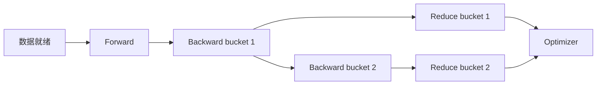

## 先问完成了什么工作，再问用了多久

训练和推理共享GPU、矩阵乘和通信，却有不同的有效工作定义。
训练关心有效target tokens、收敛与可恢复进度。
在线推理关心满足质量和SLO的请求或生成结果。
一个执行了更多padding/recompute的系统，硬件可能更忙，但有效产出未必更多。

本节建立三层模型：数学工作、资源下界、依赖关键路径。
所有数字都是可复算教学输入，不对应特定设备实测。
推理TTFT/TPOT的细节见推理模块8.1，这里重点讨论跨工作负载的统一方法。

## 1. Useful、model 与 executed 三种 FLOPs

| 口径 | 计什么 | 主要用途 |
|---|---|---|
| useful | 对目标语义有效的工作 | 效率与产品价值 |
| model formula | 按声明模型公式估算 | MFU、规模估计 |
| executed | 实际执行指令/算子工作 | 硬件利用与归因 |

Padding、重算、低效重复读取、draft被拒绝等可能增加实际工作。
它们有些是有价值的工程交换，有些是可消除浪费。
报告必须说明分子是否包含它们。
不能用executed FLOPs较高证明模型有效效率更高。

### 1.1 训练的线性层粗算

对权重矩阵 $W$，一轮forward对 $N$ 个token进行矩阵乘：

$$
F_{forward}\approx2N|W|.
$$

若含普通dX和dW，训练约为：

$$
F_{train}\approx6N|W|.
$$

这只是线性层主项。
它不包含attention二次项、norm、router、额外recompute和特殊loss。
MoE用active参数估线性计算，但总参数仍决定权重容量。

### 1.2 推理的单步与整请求

Decode每步对当前新token做线性变换，并读取已有上下文。
整请求成本是prefill加所有decode步，而不是单步成本乘一个固定常数。
随着context增长，attention流量与时间可能上升。
Spec则还需区分候选、验证和已提交token。

## 2. GEMM 的第一个 Roofline 数例

设 $C[M,N]=A[M,K]B[K,N]$，忽略bias：

$$
F=2MNK.
$$

若A/B/C各只从所建模内存层读写一次，元素字节为 $b$：

$$
B_{ideal}=b(MK+KN+MN).
$$

取 $M=4096,N=4096,K=4096,b=2$。
FLOPs约137.44 GFLOP，理想流量约96 MiB。
算术强度约1365.33 FLOP/byte。

这个流量是理想假设，不是实际HBM计数器。
如果tile重复加载、C需read-modify-write或存在layout转换，应另外计入。
如果L2已命中某些输入，HBM字节又可能更少。

## 3. Roofline 是上界，不是预测曲线

对某一级内存：

$$
I=\frac{F}{B},\qquad
P\le\min(P_{compute},BW\cdot I).
$$

等价时间下界：

$$
t\ge\max(F/P_{compute},B/BW).
$$

峰值必须对应实际dtype、dense/sparse指令模式与频率条件。
HBM/L2/shared三个层次可以各建一条roof。
一个kernel低于所有roof时，要进一步看依赖、调度、指令或负载不均。

### 3.1 不同层次不能混用

```text
useful bytes: 算法真正需要的元素
requested bytes: load/store指令请求的字节
L2 traffic: L2实际服务的事务
HBM traffic: 显存实际传输的字节
```

Coalescing改变事务放大，reuse改变重复读取，cache改变HBM流量。
这三类优化可以有相同的最终时间收益，却有不同机制。
应通过计数器区分，不能只看tensor.numel。

## 4. 同一模型的两种矩阵形状

训练的大batch GEMM可能有很大的M。
小batch decode的M可能只有1或几个token。
即使N/K相同，利用率与权重复用也不同。

取 $N=K=4096,b=2$：

| M | FLOPs | 理想输入/输出流量主导 |
|---:|---:|---|
| 1 | 约33.55 MFLOP | 权重约32 MiB |
| 4096 | 约137.44 GFLOP | A/B/C共同约96 MiB |

M=1时算术强度约1 FLOP/byte，M=4096约1365 FLOP/byte。
这解释了batch和阶段对瓶颈的巨大影响。
但真实decode还包含KV、采样、通信和launch，不能只用这一个GEMM预测服务速度。

## 5. 从资源模型到依赖图

假设一个训练step包括数据准备、forward/backward、梯度通信和optimizer。
如果全部串行，可以相加。
如果通信随bucket ready启动，部分通信隐藏在backward后续计算中。
实际wall time由依赖最长路径决定。



R1和B2可重叠的前提是数据依赖已满足，而且资源争用可接受。
使用两个stream只允许并发，不保证性能改善。
如果通信占用SM/HBM使B2变慢，必须把变慢计入关键路径。

## 6. 完整重叠数例

Backward独立计算需80 ms，通信需30 ms，最后有10 ms不可隐藏尾部。
若前20 ms通信可与原本80 ms计算重叠且互不拖慢，则总计90 ms。
串行版本为110 ms，速度比约1.222。

若重叠使计算从80增到95 ms，且仍有10 ms尾部，则总计105 ms。
此时收益只有约1.048。
如果计算变到105 ms，则总计115 ms，反而更慢。

```text
serial:       80 + 30 = 110 ms
ideal overlap:80 + 10 =  90 ms
contended:    95 + 10 = 105 ms
bad overlap: 105 + 10 = 115 ms
```

应同时报告通信可见时间与计算slowdown。
只说“重叠了20 ms”会隐藏共享资源的代价。

## 7. Megatron 固定例子的行为边界

参考Megatron报告冻结于 `48a887fecd01674346f724dcf44f417f455989f0`。
其combined 1F1B通过相邻microbatch的forward/backward组合，尝试隐藏MoE A2A。
本节已用`git show`读取该固定对象的`combined_1f1b.py`相关函数说明与循环入口。
它不是对任意dense模型自动加速的通用开关。

Stable0.19与该早期snapshot必须分开。
同一package版本字符串不代表相同feature contract。
具体schedule、模型plan与FSDP组合限制需按所用版本核对。

## 8. MFU 的分母已经包含哪些损失

$$
MFU=\frac{F_{model/step}}{N_{GPU}P_{peak}T_{step}}.
$$

如果 $T_{step}$ 是真实wall time，数据等待、通信、bubble已经体现在分母。
不能再乘一次“通信效率”把这些损失重复扣除。
如果分母只使用device-active时间，应另命名并解释，不与wall-time MFU混比。

变长packing的有效token可以用loss mask求和。
Padded tokens/s与target tokens/s需要分开。
一个减少padding的改动可能让executed FLOPs下降，但有效token吞吐提高。

## 9. 可运行的多形状与关键路径计算

```python
def gemm(m, n, k, item_bytes=2):
    flops = 2*m*n*k
    traffic = item_bytes*(m*k+k*n+m*n)
    return flops, traffic, flops/traffic

small = gemm(1,4096,4096)
large = gemm(4096,4096,4096)
assert large[1] == 96*2**20
assert abs(large[2]-1365.3333333333333) < 1e-9
print("decode-like AI", small[2])
print("large GEMM AI", large[2])

# 节点耗时与依赖；不模拟资源争用。
cost = {"F":20,"B1":40,"B2":40,"R1":20,"R2":10,"O":5}
deps = {"F":[],"B1":["F"],"B2":["B1"],
        "R1":["B1"],"R2":["B2"],"O":["R1","R2"]}
finish = {}
for node in cost:
    finish[node] = max((finish[p] for p in deps[node]), default=0)+cost[node]
assert finish["O"] == 115
assert sum(cost.values()) == 135
print("critical_path_ms", finish["O"], "sum_of_work_ms", sum(cost.values()))

serial = 80+30
for compute_ms in [80,95,105]:
    elapsed = compute_ms+10
    print("compute",compute_ms,"total",elapsed,"speedup",serial/elapsed)
```

图模型只计算依赖最长路径。
若B2与R1共享资源而变慢，需要先更新cost再计算。
它不是完整GPU调度模拟。

## 10. 优化决策表

| 证据 | 候选变化 | 必须同时验证 |
|---|---|---|
| useful/actual bytes差大 | layout/coalescing/fusion | 寄存器与数值 |
| 大GEMM远离compute roof | tile/dtype/backend | 对齐、实际指令 |
| 小kernel间host gap大 | graph/融合/批量提交 | 地址与padding |
| 训练通信尾部大 | bucket/prefetch/拓扑 | 计算slowdown与峰值 |
| 推理queue主导 | admission/扩容/路由 | goodput、公平 |
| data wait尖峰 | 有界预取/NUMA/IO | 内存、恢复游标 |

先选择能显著缩短关键路径的变化。
再用微架构指标解释机制。
不要在用户路径不经过的kernel上无限autotune。

## 11. 两类容量约束会改变最优点

更深prefetch可以隐藏通信，但需要更多inflight buffer。
更多graph buckets可以减少launch，却占用graph-private pools。
更大batch可以提高GEMM复用，却增加activation或KV。
因此性能优化通常是受容量约束的最小时间问题。

$$
\min T_{critical}(config)
\quad s.t.\quad M_{peak}(config)\le M_{available}.
$$

训练还需要质量与恢复约束。
推理还需要SLO、租户公平与协议约束。
理论最快但无法满足这些约束的点不是可行方案。

## 12. 六道追问与答案

### Q1：为什么不能用tensor大小直接当HBM bytes？

它忽略cache、重复读取、事务放大和写回。
需要说明是算法下界还是计数器实际流量。
Roofline分母应与所建模内存层一致。

### Q2：MFU升高是否一定训练更有效？

要先检查FLOPs与token口径。
更多padding或recompute可能增加执行工作而不增加有效目标token。
最终需结合有效吞吐、质量和wall time。

### Q3：通信在另一个stream上，为什么还可能慢？

它可能与计算争用SM、HBM、L2、copy engine或NIC路径。
还可能缺乏足够独立计算窗口。
需测visible communication和compute slowdown。

### Q4：训练与decode能共用同一个GEMM性能结论吗？

不能无条件共用。
M维、batch、权重复用和通信频率可能完全不同。
必须按真实shape分布测量。

### Q5：如何解释step time比所有kernel时长之和更短？

Kernel可能并发，或者跨stream有重叠。
求和描述工作量，wall time由依赖关键路径决定。
反过来，host/data空隙又可能使wall time更长。

### Q6：为什么最满rank和最慢rank都要看？

最满rank决定容量可行性，最慢rank决定同步关键路径。
二者可能不是同一个rank。
平均显存和平均时间都可能掩盖实际限制。

## 13. 实验记录模板

```yaml
work_definition:
  target_tokens: count_valid_loss_or_accepted_outputs
  model_flops: stated_formula
  executed_flops: separate_profiler_measurement
memory_boundary: HBM
time_boundary: complete_step_or_request_critical_path
overlap:
  visible_communication_ms: measured
  compute_slowdown_ms: measured
capacity:
  peak_per_rank: measured
  inflight_buffers: included
```

这份模板是记录契约，不是自动测量工具。
字段值应来自原始trace和明确公式。
缺少的项目标为未测，不用估算值冒充实测。

## 14. 来源与版本

### 交付前再检查一次并行统计

假设四个rank的计算时间为40、41、39、60ms，之后执行共同barrier。
平均时间45ms不代表step计算只需45ms。
在这个依赖模型中，barrier至少等到60ms。
若只优化前三个rank各5ms，最慢rank仍为60ms，关键路径可能完全不变。
若优化最后rank至45ms，整体计算段才可能下降到45ms。

这提示两个实践动作：

1. 先按同角色、同shape比较rank，避免把合法工作量差异误报为硬件慢。
2. 再关联NIC、CPU、时钟、专家路由或样本长度，查最早分歧。

训练同步与推理TP/EP都适用这个分析。
独立DP副本则可能只影响部分请求，不能把全部副本简单取max当集群吞吐。
统计聚合必须与真实依赖一致。

参考推理宝典PERF-007—011、KERN-023—030。
训练综述第8.1、8.5—8.7节。
Megatron报告模块A的schedule、模块C的overlap与公式底稿第3、10节。

- [固定Megatron combined 1F1B](https://github.com/NVIDIA/Megatron-LM/blob/48a887fecd01674346f724dcf44f417f455989f0/megatron/core/pipeline_parallel/combined_1f1b.py)：本节额外只读核对35—98行。
- [Nsight Compute Profiling Guide](https://docs.nvidia.com/nsight-compute/ProfilingGuide/index.html)：分层流量与计数器解释。
- [Triton fused softmax](https://triton-lang.org/main/getting-started/tutorials/02-fused-softmax.html)：IO与融合的限定场景示例。

动态文档仅作为方法入口；具体硬件峰值、工具版本与配置需在实验中冻结。
本节CPU计算未运行GPU、训练或在线服务。
