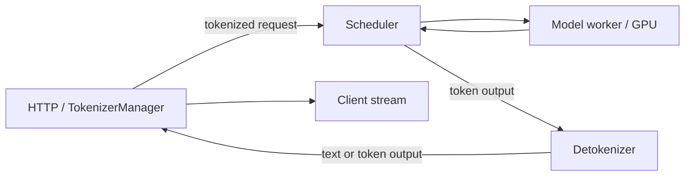

## 从一个具体请求开始

假设客户端发送一条文本 prompt，要求最多生成 4 个 token，并使用流式输出。
为了观察数据结构，下面把 tokenizer 的结果固定为 `[10,20,30]`。
这些整数是教学 token IDs，不对应某个真实 tokenizer 的词表。
我们要追踪的不是一个 HTTP handler 名字，而是请求身份、数据和资源的转移。

本文只读核对了以下本地 HEAD，涉及文件没有工作区修改：

| 项目 | 固定 commit |
|---|---|
| SGLang | `46d9427b913b20ce0d72b95a9209717448b37368` |
| vLLM | `9c8e90eb2637a863ca14e47fd436b10ed7ba6536` |

它们是参考资料对应的源码快照，不是“最新版”承诺。
本文不是全仓覆盖分析；范围是被列出的请求入口与输出主链。
特殊多模态、分布式和 streaming-input 分支只在影响接口契约时说明。

## 1. 三种数据表示

```text
API input
  text/messages + generation options
       ↓ render/tokenize/validate
engine request
  token IDs + sampling params + request identity
       ↓ schedule/execute
engine output
  token IDs + finish state + usage/metadata
       ↓ detokenize/format
HTTP stream
  incremental text/events + terminal response
```

文本不是 scheduler 的主要执行单位。
GPU 也不会直接读取 HTTP JSON。
每个边界都会进行校验、归一化与表示转换。
任何转换失败都需要清理此前登记的请求状态。

### 1.1 为什么要单独管理 tokenizer

tokenization、模板渲染和多模态预处理主要消耗 CPU。
它们的异常、并发和响应式行为与 GPU batch 调度不同。
把这些工作从 GPU 调度关键路径拆开，可以减少相互阻塞。
代价是 IPC、状态关联和取消传播更复杂。

不能笼统认为“进程越多越快”。
若 IPC、序列化或 CPU 核绑定成为瓶颈，更多进程也会增加复制和调度。
需要按 trace 判断实际瓶颈。

## 2. SGLang 的入口路径

固定版原生生成入口位于 `srt/entrypoints/http_server.py` 的 `generate_request`。
流式分支遍历 `TokenizerManager.generate_request()` 的异步输出，并封装 SSE 数据。
非流式分支等待一次完整结果。
OpenAI 兼容路由还有协议转换层，不能把原生 `/generate` 函数直接等同于全部 HTTP 入口。

```text
http_server.generate_request
  → tokenizer_manager.generate_request
      → normalize_batch_and_arguments
      → initialize request state
      → validate/resolve LoRA
      → _tokenize_one_request
      → _send_one_request
      → _wait_one_response
```

`generate_request` 首先启动必要的结果处理 loop。
然后规范 batch 与参数，建立每个 rid 对应的前端状态。
在暂停条件与模型更新读锁下完成验证、tokenize 和发送。
这些边界说明模型更新与请求执行不能随意交叉。

### 2.1 输入不总是文本

`_tokenize_one_request` 至少区分：

| 输入 | 处理关注点 |
|---|---|
| `text` | 调 tokenizer，可能涉及多模态 processor |
| `input_ids` | 直接使用 token IDs，仍需语义/长度校验 |
| `input_embeds` | 需要对应执行与缓存支持 |

固定代码会拒绝 `input_embeds` 与未禁用 radix cache 的不兼容组合。
这体现缓存身份不能仅从任意 embedding 自动推断。
跳过 tokenizer 初始化后，不能再默认接受普通文本 prompt。
绕过 tokenizer 不等于绕过模型输入限制。

### 2.2 请求状态为何先于发送建立

输出可能很快到达，前端必须提前知道 rid 对应哪个等待者。
因此注册状态发生在发送之前。
但如果长度验证或发送失败，该状态尚不会收到 scheduler 的正常完成通知。
固定版外层异常路径会丢弃仍 pending 的请求状态，避免永远泄漏。

这是一个典型的“先注册、后执行、失败回滚”事务。
检查入口时不能只看成功返回，还要找注册之后每条异常出口。

## 3. IPC 数据与资源不是一回事

SGLang `_send_one_request` 包含多模态特征的 dispatch 准备、共享表示包装和发送。
它使用 `dispatched` 标志，在发送未成功时撤销尚未交接的资源。
这说明“Python 对象已经构造出来”与“下游已经接管”是不同状态。

```text
prepare resources
  → serialize/wrap metadata
  → dispatch
  → success: downstream owns its contract
  → failure: cancel pre-dispatch resources
```

Token IDs 可以通过 IPC 描述。
大张量可能使用共享内存或设备特征 transport，具体依赖配置。
不能因使用同一个请求类，就认为所有 payload 都通过同一种拷贝路径。

### 3.1 默认进程图与可配置边界

`Engine._launch_subprocesses` 的固定实现说明默认主进程中初始化 TokenizerManager，并启动 scheduler 和 detokenizer 子进程。
多节点、TP、DP 或其他部署方式会扩大 worker 组织。
因此最小图是理解入口，不是穷尽全部进程拓扑。



图中的箭头表达协议流，不表示每条箭头都是 TCP。
实际 endpoint、socket、共享内存与 worker 配置要从启动参数追踪。

## 4. SGLang 的输出回传

`TokenizerManager.handle_loop` 持续从 detokenizer 通道接收结果。
它按 rid 找到前端状态，写入待发送输出并通知等待的 coroutine。
`_wait_one_response` 取出这些结果，形成客户端可消费的响应。

固定版本中有 incremental stream 的合并逻辑。
若多个增量 chunk 在前端队列中积压，必须拼接所有 delta，而不能只保留最后一项。
否则会丢 token IDs 或文本片段。

### 4.1 为什么合并 chunk 会影响 ITL

GPU 可能每 20 ms 生成一个 token。
如果前端 100 ms 才处理一次积压，客户端会一次收到多个 token。
模型 cadence 与网络可见 cadence 已不同。
这时只测 GPU step 时间无法解释用户看到的卡顿。

下面的文本合并只是协议示意：

```text
pending deltas: ["你", "好", "！"]
correct merge: "你好！"
incorrect last-only: "！"
```

累积式响应与增量式响应不能使用同一个拼接规则。
累计响应的最新文本已包含前面的内容，重复拼接会重复输出。

## 5. vLLM V1 的入口与前后端分离

固定版 `AsyncLLM.generate` 调用 `add_request`，创建每请求输出 collector。
请求经 input processor 转成 `EngineCoreRequest` 后送到独立 core。
后台 output handler 从 core 接收输出，通过 output processor 送到对应 collector。

```text
API renderer/input
  → AsyncLLM.add_request
  → InputProcessor
  → EngineCoreRequest
  → EngineCore client/process
  → scheduler/executor
  → EngineCoreOutput
  → OutputProcessor / RequestState
  → RequestOutputCollector
  → AsyncLLM.generate yields
```

scheduler 内的 `Request` 与前端的 `RequestState` 不是同一个对象。
前者跟踪执行进度和资源，后者关心 detokenization、停止条件和输出。
这有利于保持 core 的 token 执行边界，但要求严格关联请求与完成状态。

### 5.1 固定版本已出现的 API 迁移

本地 `AsyncLLM.add_request` 和 `InputProcessor` 对部分 raw-prompt/`EngineCoreRequest` 直接传入路径发出 deprecated 提示。
建议使用 Renderer 生成的输入表示，具体取决于调用接口。
这是所读 snapshot 的事实，不应把旧教程里的调用方式写成永久公共 API。
应用代码应优先使用稳定公开入口，内部类型主要用于阅读理解。

### 5.2 避免阻塞事件循环

已渲染的输入可以直接进入 `process_inputs`。
仍需 tokenization/多模态处理的 raw prompt 走异步输入处理路径。
原因是 CPU 重处理不能长期占住所有流式请求共享的 event loop。
异步函数名本身不保证内部无阻塞，仍需 trace 验证。

## 6. 输出处理也要给其他请求让出 CPU

vLLM `_run_output_handler` 从 core 获取一批结果。
固定实现按配置 chunk 分割输出处理，并在分块间让出 event loop。
这样避免一次大批 detokenization/后处理长期阻塞其他连接。
发现 stop string 导致前端结束时，还会向 core 发送对应 abort。

这说明 stop 判断可以跨前后端分布。
前端决定不再输出后，core 仍需停止后续计算并回收资源。
“客户端流结束”与“core 请求结束”必须通过协议收敛。

## 7. 入口至首 token 的完整数例

对固定的 `[10,20,30]` 请求，假设各阶段串行关键路径为：

| 阶段 | 时长 |
|---|---:|
| HTTP 校验/模板 | 2 ms |
| Tokenizer | 4 ms |
| IPC 与 core 接收 | 1 ms |
| Scheduler 排队 | 20 ms |
| Prefill/采样 | 12 ms |
| 输出后处理/网络 | 3 ms |

TTFT=42 ms。
把 prefill 加速一倍只减少 6 ms，TTFT 变为 36 ms。
如果 event loop 被其他任务阻塞 50 ms，TTFT 会变成 92 ms。
这个例子解释了为什么入口 CPU 也可能比 GPU kernel 更值得优先优化。

这些时间是显式教学假设。
真实 IPC 与后处理可以重叠，需以关键路径代替全部 span 求和。

## 8. 可运行的请求登记与 delta 模型

以下代码独立于两个框架，只验证边界不变量。

```python
class Frontend:
    def __init__(self):
        self.pending = {}

    def submit(self, rid, ids, fail=False):
        assert rid not in self.pending
        self.pending[rid] = []
        try:
            if not ids:
                raise ValueError("empty teaching input")
            if fail:
                raise RuntimeError("dispatch failed")
        except BaseException:
            self.pending.pop(rid, None)
            raise

    def output(self, rid, delta, final=False):
        if rid not in self.pending:
            return None
        self.pending[rid].append(delta)
        text = "".join(self.pending[rid])
        if final:
            self.pending.pop(rid)
        return text

f = Frontend()
try:
    f.submit("bad", [10], fail=True)
except RuntimeError:
    pass
assert "bad" not in f.pending
f.submit("ok", [10, 20, 30])
assert f.output("ok", "你") == "你"
assert f.output("ok", "好") == "你好"
assert f.output("ok", "！", final=True) == "你好！"
assert not f.pending
assert f.output("ok", "late") is None
assert sum([2,4,1,20,12,3]) == 42
print("registration rollback and delta output passed")
```

真实代码还要处理 batch 子请求、异常传播、usage 与取消时序。
“迟到结果被忽略”不代表相关 GPU buffer 已经安全回收。
资源生命周期仍要在 core/worker 中单独验证。

## 9. 对照两个框架时保持同一问题

| 问题 | SGLang 固定主链 | vLLM V1 固定主链 |
|---|---|---|
| 输入规范化 | GenerateReqInput/TokenizerManager | Renderer/InputProcessor |
| GPU 执行请求 | scheduler `Req` | core `Request` |
| 前端等待状态 | rid→ReqState | RequestState/collector |
| 调度输出回传 | scheduler→detokenizer→manager | core output→OutputProcessor |
| 流式消费 | `_wait_one_response` | `generate` 读取 collector |

表格描述职责对齐，不证明类结构同构。
不要把一个框架的状态字段套用给另一框架。
下一篇会比较它们对“还需计算多少 token”的不同表达。

## 10. 六道追问与答案

### Q1：为什么请求状态要先注册再发送？

结果可能很快返回，必须先有 rid→等待者映射。
但注册后发送失败需要回滚，否则没有正常完成路径替它清理。
这是入口异常测试的重要边界。

### Q2：输入已经是 token IDs，还需要验证什么？

需要检查长度、模型上下文、采样参数、adapter、任务与多模态语义。
token IDs 只省去部分文本处理，不保证执行配置合法。

### Q3：为什么最后一个 chunk 不能替代全部 pending chunk？

若 chunk 是增量，每段只包含新增内容。
只取最后一段会丢此前内容。
累计式响应则相反，重复拼接会重复文本。

### Q4：为什么 GPU 很快但用户首 token 仍慢？

排队、tokenizer、IPC、event loop 和网络可能在关键路径。
需关联 client trace 与 core/worker 时间线。
仅测 CUDA event 无法覆盖这些阶段。

### Q5：core 输出与 HTTP 输出之间还能发生什么？

Detokenization、stop-string 检查、usage 汇总、chunk 合并与序列化。
它们既影响语义，也影响客户端可见 ITL。

### Q6：为什么不直接调用内部 Request 类型构造服务？

内部类型随 snapshot 演进，并承担隐含不变量。
公共入口负责更多验证与兼容。
阅读源码可以使用内部类型理解边界，应用集成应核对公开 API。

## 11. 源码证据与阅读台账

以下范围为本节重点读取片段，不声称整文件覆盖。

| 固定文件 | 已核对符号/范围 | 支撑结论 |
|---|---|---|
| SGLang `entrypoints/http_server.py` | 895—937 | 原生生成流式封装 |
| SGLang `entrypoints/engine.py` | 1022—1100 | 默认进程启动职责 |
| SGLang `managers/tokenizer_manager.py` | 768—890、959—1035 | 规范化、输入分支与异常清理 |
| 同上 | 1555—1630、1688—1753、2154—2198 | dispatch、delta、输出回传 |
| vLLM `v1/engine/async_llm.py` | 283—386、551—612、666—735 | 请求与输出异步主链 |
| vLLM `v1/engine/input_processor.py` | 281—347 | 验证与输入迁移边界 |

固定源码链接：

- [SGLang TokenizerManager](https://github.com/sgl-project/sglang/blob/46d9427b913b20ce0d72b95a9209717448b37368/python/sglang/srt/managers/tokenizer_manager.py)。
- [SGLang HTTP server](https://github.com/sgl-project/sglang/blob/46d9427b913b20ce0d72b95a9209717448b37368/python/sglang/srt/entrypoints/http_server.py)。
- [SGLang Engine](https://github.com/sgl-project/sglang/blob/46d9427b913b20ce0d72b95a9209717448b37368/python/sglang/srt/entrypoints/engine.py)。
- [vLLM AsyncLLM](https://github.com/vllm-project/vllm/blob/9c8e90eb2637a863ca14e47fd436b10ed7ba6536/vllm/v1/engine/async_llm.py)。
- [vLLM InputProcessor](https://github.com/vllm-project/vllm/blob/9c8e90eb2637a863ca14e47fd436b10ed7ba6536/vllm/v1/engine/input_processor.py)。

参考宝典对应 `FND-001`、`PROD-001—004`、`SCH-001/002` 与 `PROJECT-006` 的阅读方法。
本文 CPU 模型验证输入/输出不变量，未启动真实 HTTP 或 GPU 引擎。
