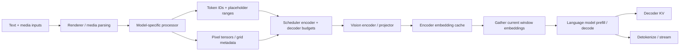

## 1. 一张图片不等于一个廉价 token

HTTP输入里一段图片引用可能很短，但后续会产生解码像素、patch、视觉特征和大量decoder位置。
这些阶段分别消耗CPU、主机内存、encoder GPU、embedding cache与decoder KV。
只按文本长度或请求数量准入，会漏掉大部分成本。
本节选一条真实固定路径逐层展开。

源码基线为vLLM `9c8e90eb2637a863ca14e47fd436b10ed7ba6536`。
模型路径选`Qwen2_5_VLForConditionalGeneration`及其注册processor，不泛化为所有VLM。
已核对目标文件无本地修改；未下载模型、执行视觉encoder或运行GPU。
CPU oracle仅验证数量、位置与引用生命周期。

## 2. 本节的完整数据流



箭头描述数据/控制依赖，不保证每一步都在独立进程。
同一个cache命中只会省掉特定阶段。
例如CPU processor cache命中，不自动意味着GPU encoder或decoder KV已命中。

## 3. Renderer 与 processor 的边界

固定`renderers/base.py::_process_multimodal`解析媒体items与UUID，组织processor输入，再调用`apply`。
Processor接收prompt token IDs、媒体items和处理参数。
它可以调用模型对应HF processor生成pixel tensors、grid等元数据。
这些工作可能在CPU执行，并在异步入口被移出主event loop。

媒体读取、解码、resize/crop和tokenization是不同成本。
URL短不代表图像小，图像数量相同也不代表patch数相同。
服务入口要限制实际媒体体积、分辨率、帧数与处理预算。
身份/权限校验仍由服务层负责，不能把processor当作完整入口安全层。

### 3.1 BaseMultiModalProcessor 的输出契约

固定`apply`执行四类工作：

1. Prompt token的模型相关处理。
2. 计算或复用HF processor结果。
3. 按视觉特征数量扩展/替换占位token。
4. 返回各媒体item在最终token序列中的位置范围。

输出包含`prompt_token_ids`、`mm_kwargs`、`mm_hashes`和`mm_placeholders`。
这些字段必须相互对应。
仅修改token序列而不更新placeholder ranges，会让后续embedding放错位置。

## 4. Qwen2.5-VL 的视觉 token 数

固定`Qwen2_5_VLMultiModalProcessor._get_prompt_updates`读取`image/video_grid_thw`。
普通未剪枝路径的特征token数为：

$$
N_{visual}=T_{grid}H_{grid}W_{grid}/merge\_size^2.
$$

这是processor之后的grid，不应直接用HTTP图片像素宽高替代。
Resize、patch与merge的模型规则决定这些值。
视频剪枝分支另有保留token计算，因此不能把普通式用于所有配置。

### 4.1 完整数例

两张图片经processor得到grid分别为`[1,28,28]`与`[1,32,32]`，merge size=2。
它们产生196与256个视觉位置，共452。
如果有64个普通文本token，最终decoder输入共516个位置，忽略额外模型边界token。

```text
text:       64 positions
image A:   196 positions, range [64,260)
image B:   256 positions, range [260,516)
```

边界token要在真实processor结果里计入，不能在容量表中默认消失。
一个`<image>`占位符在处理后变成很多位置，是第一种常见预算误差。

## 5. EngineCoreRequest 如何保存媒体信息

固定`InputProcessor`把按模态分组的输入、hash与placeholder合并，并按序列位置排序。
每个`MultiModalFeatureSpec`包含媒体数据、modality、identifier和位置范围。
这些信息进入EngineCoreRequest，供scheduler和worker共同解释。

```text
feature item
  modality
  processed tensor data
  cache identifier
  placeholder offset / length / embedding mapping
```

图片和视频不能在batching时任意重排后忘记还原。
固定worker按模态分组执行时仍追踪item顺序，最后把输出与identifier对应。
若encoder output顺序与placeholder顺序不一致，shape可能合法而语义完全错误。

## 6. 四层缓存的身份与 owner

| 层 | 保存内容 | 主要省掉 |
|---|---|---|
| Processor cache | 预处理tensor与prompt update信息 | 解码/resize/CPU处理 |
| Encoder cache | GPU视觉/音频特征 | Encoder计算 |
| Decoder KV/prefix | 文本与视觉位置经过语言层后的KV | Decoder prefill重算 |
| 外部传输/cache | backend定义的数据 | 远端恢复或阶段交接 |

它们的key和失效时机不同。
更换视觉tower权重后，旧encoder embedding即使媒体内容相同也不再可靠。
更换decoder权重后，旧KV不能复用。
CPU resize配置变化也会改变processor结果。

### 6.1 固定 hash 路径的边界

`ProcessorInputs.get_mm_hashes`在普通路径纳入model_id、媒体与processor kwargs。
当使用者提供UUID且没有额外processor kwargs时，某路径直接使用该UUID。
因此调用方必须保证UUID确实对应稳定内容与适用namespace。
不能把用户提供的任意字符串当成已验证的内容哈希。

当启用tower/connector LoRA时，固定`InputProcessor._get_mm_identifier`额外结合adapter名称。
该分支有配置条件，不代表所有LoRA或外部cache都自动获得完整隔离。
跨租户namespace与访问控制需要检查实际端到端契约。

## 7. Encoder 准入与 decoder chunk 联动

`Scheduler._try_schedule_encoder_inputs`先判断某item的输出位置是否与当前decoder计算窗口重叠。
如果未缓存，还需检查encoder compute budget和cache容量。
某些路径可从ECConnector加载外部encoder结果。
这些都不同于decoder KVConnector的职责。

```text
decoder window overlaps item?
  → already cached?
  → external result available?
  → enough encoder compute + cache slots?
  → schedule encoder / load
  → allow dependent decoder positions
```

如果encoder无法准入，固定逻辑会把本轮decoder范围截到该媒体item之前，或本轮不安排该请求。
不能让decoder先读尚未计算的视觉特征。
如果禁止chunked multimodal input，还需避免把一个媒体item只排一部分。

### 7.1 数例：短文本能先走，图片不能假装已就绪

沿用image A的`[64,260)`范围，encoder输出196 token。
若本轮encoder预算只有192，不能完整容纳A。
请求尚未执行时，scheduler可以只安排前64个文本位置，而非继续穿过图片区域。
下一轮预算足够、encoder cache有空间并生成结果后，才允许消费对应视觉位置。

Decoder chunk只消费部分视觉embedding，不意味着视觉encoder也可以任意按相同边界切开。
许多视觉encoder使用双向attention，需要整item计算。
具体支持应由模型和backend声明。

## 8. 从 pixel tensors 到 embedding cache

固定`GPUModelRunner._execute_mm_encoder`收集已调度媒体items，按模态/兼容形状组织批次。
随后调用模型`embed_multimodal`，或在支持时走encoder graph路径。
Qwen2.5-VL图像路径调用visual模块，并按各grid对应输出数量split。

```text
pixel_values + grid_thw
  → vision patch embedding / vision blocks / merge
  → per-image features [N_visual, H_decoder]
  → sanity check item count
  → encoder_cache[identifier]
```

如果输入已经是合法image embeddings，则可能绕过像素encoder。
这需要相同模型空间、dtype与shape契约，不能把任意向量当视觉特征。
`prompt_embeds`等passthrough模态也有独立分支，不等同图片已编码缓存命中。

### 8.1 固定源码暴露的实际限制

Worker对某些视频剪枝/动态分辨率组合采用逐item执行，避免错误预算导致的峰值。
Qwen2.5-VL在剪枝后会附加/重算位置相关信息，因此相应encoder graph模态被禁用以防输出格式不一致。
这些是固定版本的条件分支，不应概括为“所有视频可高效合批”或“开启graph总能工作”。
应分别报告剪枝前encoder工作与剪枝后decoder视觉token。

## 9. 当前窗口怎样取回视觉 embedding

`_gather_mm_embeddings`把请求当前token窗口与placeholder范围求交。
只取该窗口需要的encoder结果切片，并构造`is_mm_embed`映射。
后续embedding合并把视觉特征放到对应位置，普通文本位置仍使用词表embedding。
统一decoder输入随后产生各层KV。

```text
full encoder output [196,H]
current decoder window intersects first 128 image positions
  → gather [0:128,H]
  → merge into correct flattened batch rows
  → language-model forward
```

Placeholder数量与特征行数必须一致。
固定merge工具在数量不匹配时给出错误，而不是截断凑齐。
M-RoPE等位置机制还需保持时间/高/宽坐标，不能把展平索引直接当全部位置语义。

### 9.1 Decoder-only VLM 与 encoder-decoder 不同

Qwen2.5-VL这类路径把视觉特征嵌入语言输入位置。
Whisper等encoder-decoder可通过cross-attention使用encoder结果，不应把encoder输出数直接加进decoder自回归长度。
固定scheduler对此有专门分支和不同cache manager行为。
因此本节公式与位置数例不能无条件推广给所有多模态模型。

## 10. 数例：encoder features 与 decoder KV 两笔账

仍用452个视觉位置，假设特征宽H=3584、BF16。
Encoder结果为：

$$
452\times3584\times2=3239936bytes\approx3.09MiB.
$$

再假设decoder有28层、4个KV heads、head维128、BF16。
每位置KV为56KiB，452个视觉位置在decoder中产生约24.72MiB KV。
这还没计64个文本位置以及随后生成的token。

| 项目 | 教学假设下容量 |
|---|---:|
| Encoder features | 约3.09MiB |
| 视觉位置decoder KV | 约24.72MiB |
| 516个输入位置全部decoder KV | 约28.22MiB |

这些参数用于显式算例，不代表任意Qwen2.5-VL型号的运行测量。
Encoder中间activation、图像输入、workspace与graph pools仍需单独计入峰值。
只用最终feature大小估encoder内存，可能严重低估。

## 11. 引用释放、可驱逐与物理删除

固定`EncoderCacheManager`维护identifier→请求引用集合，以及无引用的freeable候选。
`free_encoder_input`先删除请求引用；最后一个引用退出后，数据进入可驱逐集合。
它不立即要求worker删除tensor。
需要容量时，controller驱逐并通过`free_encoder_mm_hashes`通知worker。

```text
RESERVED
  → ENCODING
  → READY + referenced
  → READY + no request refs / evictable
  → scheduler eviction notification
  → worker removes cache tensor at its execution boundary
```

同一调度轮被驱逐又重新分配的key，不应误发删除通知。
固定`get_freed_mm_hashes`会过滤仍在cached集合中的key。
这是控制面与worker物理状态一致性的细节。

### 11.1 Spec read-ahead 改变最后消费者

Decoder已消费完视觉范围，不一定意味着drafter不再读取它。
固定`_free_encoder_inputs`把lookahead和output placeholders纳入回收判断。
例如范围结束260、lookahead=2、没有未决placeholder时，computed=260仍不满足262边界。
不能在启用spec后继续沿用仅比较`computed >= end`的旧逻辑。

### 11.2 取消不是直接清空全局cache

取消只释放该请求的引用，其他请求可能共享同一encoder结果。
正在执行的GPU消费者还需遵循运行时的stream/执行边界。
不能把scheduler的Python集合更新当成任意异步设备访问已结束的证明。
模型权重更新还需使相应旧结果失效，固定manager提供reset入口。

## 12. CPU oracle：位置、容量与共享引用

```python
from math import prod

grids = [(1,28,28),(1,32,32)]
merge = 2
visual = [prod(g)//(merge*merge) for g in grids]
assert visual == [196,256]
text_tokens = 64
assert text_tokens+sum(visual) == 516
feature_bytes = sum(visual)*3584*2
kv_per_token = 2*28*4*128*2
assert feature_bytes == 3239936
assert kv_per_token == 56*1024
assert sum(visual)*kv_per_token/2**20 == 24.71875

offset,length,budget = 64,196,192
scheduled_decoder = offset if budget < length else 128
assert scheduled_decoder == 64

class Entry:
    def __init__(self):
        self.ready = False
        self.refs = set()
        self.gpu_users = 0  # 教学模型显式记录额外异步消费者。
    def can_evict(self):
        return self.ready and not self.refs and self.gpu_users == 0

cache = {"image-A": Entry()}
entry = cache["image-A"]
entry.refs.update({"request-1","request-2"})
entry.ready = True
entry.refs.remove("request-1")
assert not entry.can_evict()
entry.refs.remove("request-2")
entry.gpu_users = 1
assert not entry.can_evict()
entry.gpu_users = 0
assert entry.can_evict()
del cache["image-A"]
assert not cache
end,lookahead = 260,2
assert not (end+lookahead <= 260)
assert end+lookahead <= 262
print("visual_tokens",visual,"features_MiB",feature_bytes/2**20)
print("shared references and lookahead retirement passed")
```

Toy `gpu_users`不是声称固定EncoderCacheManager有同名字段。
它用于解释逻辑引用与异步最后访问是不同安全条件。
真实执行次序仍应在目标worker/backend中验证。

## 13. 故障与观测矩阵

| 事件 | 观察与验收 |
|---|---|
| 媒体解码/processor失败 | 请求失败、CPU临时资源与额度归还 |
| Placeholder与特征数量不符 | 明确报错，禁止静默截断 |
| CPU cache命中但encoder miss | 正常执行encoder，指标不混淆 |
| Decoder KV hit但所需encoder结果缺失 | 按实际window/预算处理，不读空缓存 |
| 取消共享图像请求 | 只释放自身引用，保留其他消费者 |
| Spec回读视觉边界 | lookahead与placeholder进度正确 |
| Weight/adapter更新 | 相应特征与KV身份失效 |
| 视频剪枝后OOM | 检查原始encoder工作而非只看保留token |

建议分开记录media bytes、processor时间、grid/patch数、encoder tokens、feature bytes与decoder tokens。
再关联encoder cache hit、prefill KV hit、queue age和TTFT。
否则一个“cache hit”指标无法说明究竟省了哪个阶段。

## 14. 六道追问与答案

### Q1：图片只占一个占位符，为什么还会OOM？

Processor会扩展成大量视觉位置，encoder中间activation也可能很大。
最终decoder还为这些位置保留KV。
入口文本长度无法代表真实资源。

### Q2：CPU processor cache命中是否省掉视觉encoder？

不自动省掉。
它缓存预处理结果，GPU encoder结果由另一层管理。
需要分别检查两层identity与命中。

### Q3：为什么同一媒体不能只用URL作缓存key？

内容可能变化，processor参数、模型与adapter也影响结果。
用户UUID同样需要稳定身份契约。
跨租户安全域还需独立控制。

### Q4：Decoder chunk能否任意切视觉encoder输入？

不一定。
Decoder可分段消费已完成特征，但视觉encoder可能需要双向整item计算。
预算和模型支持必须分别确认。

### Q5：请求结束为何cache tensor仍在？

无引用结果可以保留为未来复用候选。
控制器在需要容量时驱逐，再通知worker删除。
这是可驱逐缓存，不应直接解释为泄漏。

### Q6：多模态encoder结果与cross-attention KV一样吗？

不同。
前者是源特征，后者是decoder层投影出的注意力状态。
不同模型的消费与回收时机不同，不能共用一条无条件公式。

## 15. 固定源码与阅读范围

- [`renderers/base.py`](https://github.com/vllm-project/vllm/blob/9c8e90eb2637a863ca14e47fd436b10ed7ba6536/vllm/renderers/base.py)：728—765，媒体items/UUID到processor。
- [`processing/processor.py`](https://github.com/vllm-project/vllm/blob/9c8e90eb2637a863ca14e47fd436b10ed7ba6536/vllm/multimodal/processing/processor.py)：1392—1458、1707—1749，CPU缓存与placeholder契约。
- [`processing/inputs.py`](https://github.com/vllm-project/vllm/blob/9c8e90eb2637a863ca14e47fd436b10ed7ba6536/vllm/multimodal/processing/inputs.py)：16—80，hash/UUID与kwargs边界。
- [`qwen2_5_vl.py`](https://github.com/vllm-project/vllm/blob/9c8e90eb2637a863ca14e47fd436b10ed7ba6536/vllm/model_executor/models/qwen2_5_vl.py)：1146—1217、1423—1468、1654—1708，特征数量与视觉执行。
- [`scheduler.py`](https://github.com/vllm-project/vllm/blob/9c8e90eb2637a863ca14e47fd436b10ed7ba6536/vllm/v1/core/sched/scheduler.py)：1560—1706、2249—2284，encoder预算与最后消费边界。
- [`encoder_cache_manager.py`](https://github.com/vllm-project/vllm/blob/9c8e90eb2637a863ca14e47fd436b10ed7ba6536/vllm/v1/core/encoder_cache_manager.py)：75—152、192—277，引用、候选与驱逐通知。
- [`gpu_model_runner.py`](https://github.com/vllm-project/vllm/blob/9c8e90eb2637a863ca14e47fd436b10ed7ba6536/vllm/v1/worker/gpu_model_runner.py)：1235—1242、3070—3395，执行、cache与gather。

母稿对应FND-020、SCH-016、KV-010/015、PROD-002、DESIGN-009。训练综述的CPU/IO段落与Megatron报告multimodal RoPE边界补充系统背景，不替代上述Serving证据。
未运行真实视觉模型、质量评测、encoder graph或GPU取消竞态；不同模型的媒体/位置/cache协议需重新核对。
